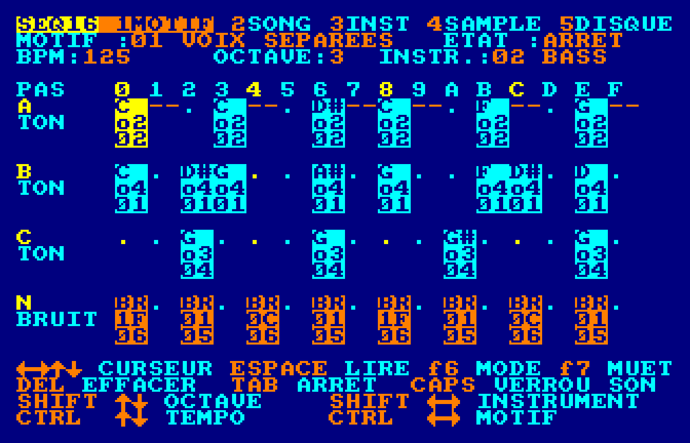
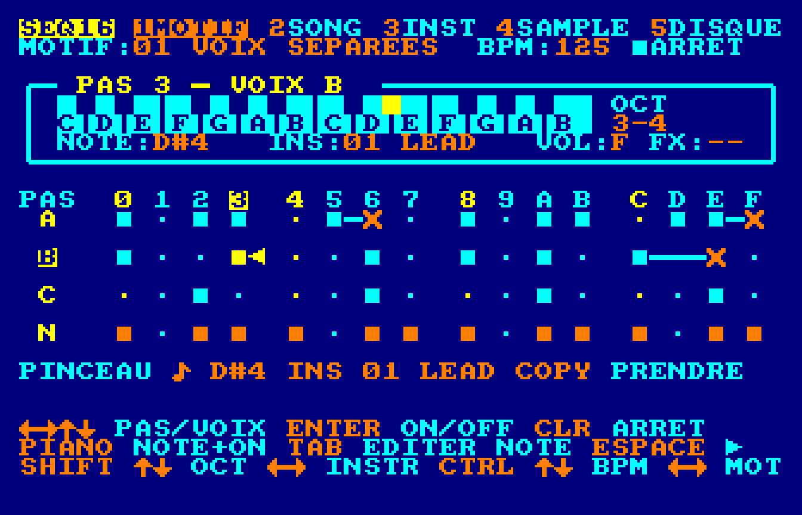
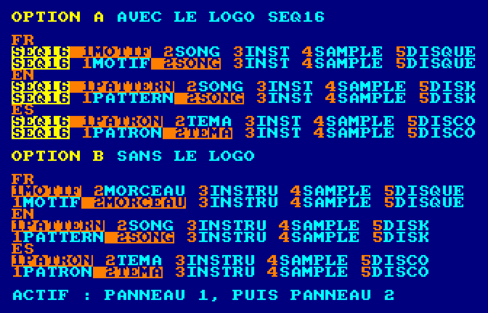
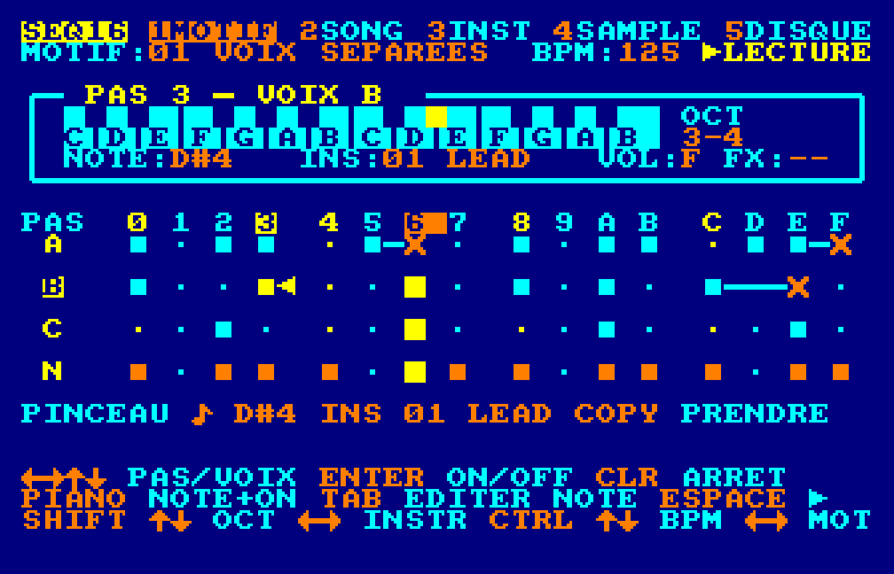
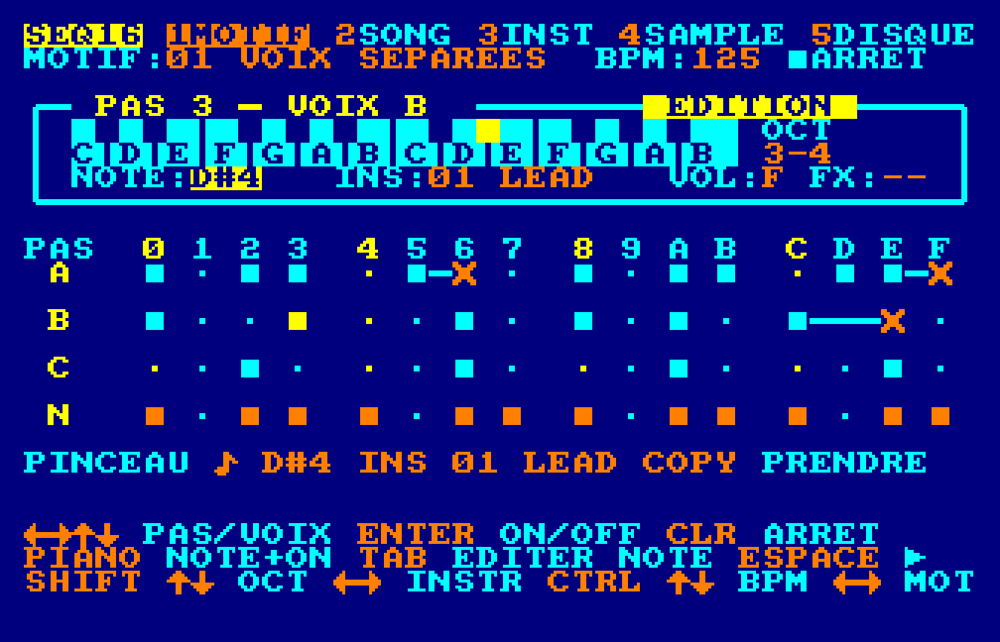
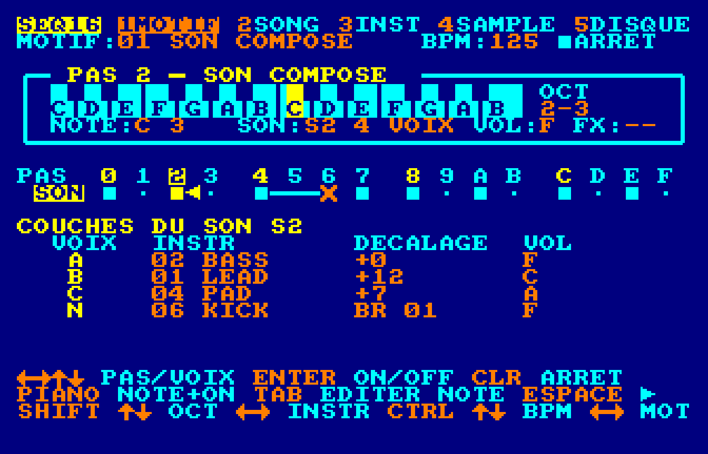
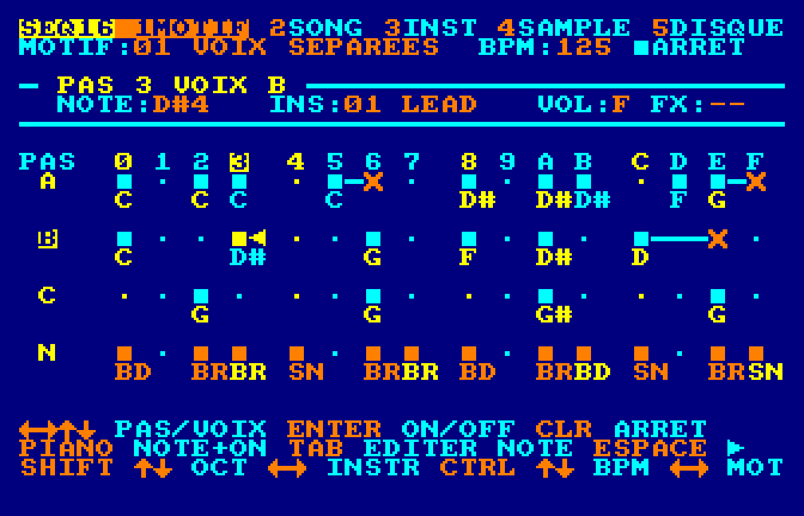
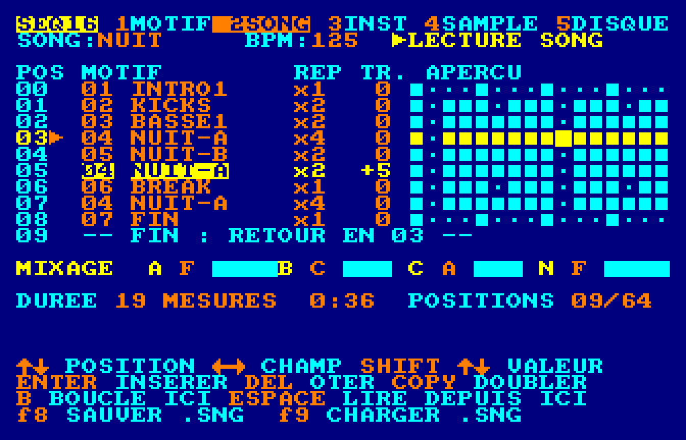
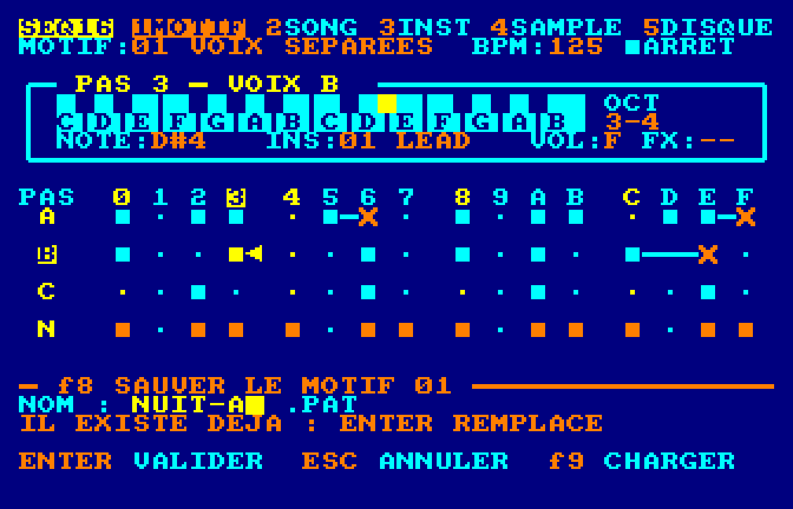
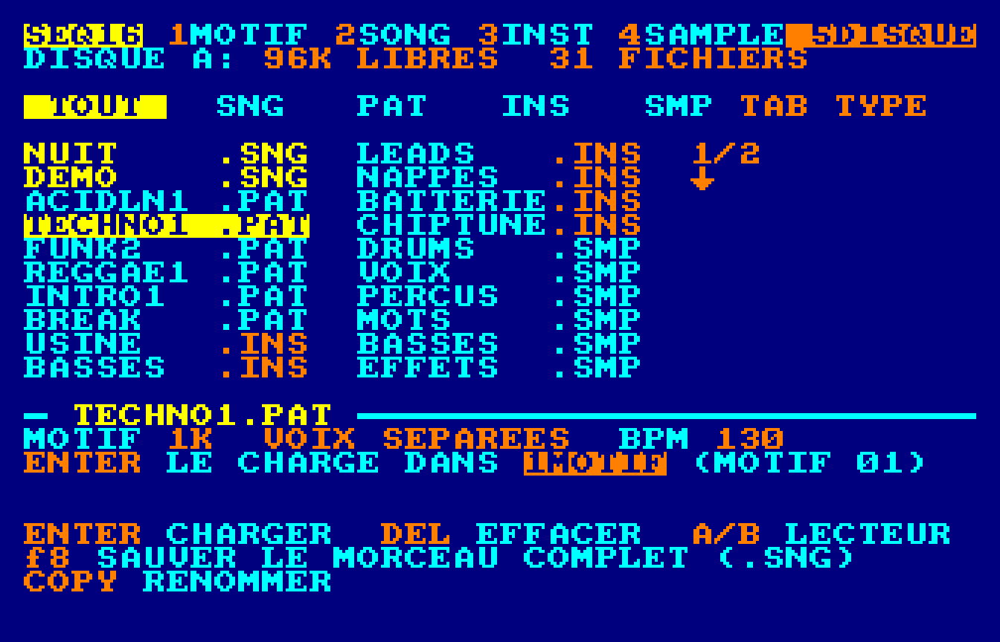

# Plan de développement : SEQ-16 v1.0

État : **validé le 22 novembre 2026** (section 9). Lots 1 (PR #16),
2 (PR #17), 3 (PR #18), 4 (PR #20) et 5a (PR #21) faits ; morceaux de
test (PR #19).
Les écrans ci-dessous sont des maquettes, dessinées par `tools/mockups.py` avec
la police de la ROM du CPC et les quatre couleurs du mode 1 :
`python tools/mockups.py` les refait dans `plan/img/`.

## 1. Pourquoi SEQ-16 ressemble à un SEQ-8

La lecture fait bien 16 pas : un pas par double croche (le compteur avance du
BPM à chaque image et joue un pas tous les 750, soit BPM ÷ 15 pas par seconde).
Le défaut vient de l'écran et des motifs :

- **Une case fait 2 colonnes sur 3 lignes** (note, octave, instrument). Deux
  notes voisines se collent (`D#G`, `o4o4`, `0101`) : pour rester lisible, on
  pose une note un pas sur deux.
- **80 % des notes des 125 motifs d'usine sont sur les pas pairs** (1452
  contre 378) : ils sonnent en croches.
- **La grille prend 12 lignes de texte** pour 4 voix ; son dessin dure environ
  5 images, d'où l'à-coup au changement de motif.

| v0.9 actuelle | Proposition |
|---|---|
|  |  |

## 2. Cinq panneaux

    SEQ16 1MOTIF 2SONG 3INST 4SAMPLE 5DISQUE      (40 colonnes tout juste)

| Touche | Panneau | Contenu |
|---|---|---|
| f1 | MOTIF | la grille de 16 pas (section 3) |
| f2 | SONG | l'enchaînement des motifs et le mixage (section 4) |
| f3 | INST | les 32 instruments et les 8 sons composés (écran f2 actuel) |
| f4 | SAMPLE | le sampler (écran f4 actuel) |
| f5 | DISQUE | le catalogue et la gestion des fichiers (section 6) |

Les autres touches de fonction du pavé numérique :

| Touche | Action | Aujourd'hui |
|---|---|---|
| f6 | mode voix séparées / son composé (panneau MOTIF) | f5 |
| f7 | muet / son | pareil |
| f8 | **sauver** ce que montre le panneau | (S, I, M, E dans l'écran Disque) |
| f9 | **charger** dans le panneau | (L, O, P, D dans l'écran Disque) |

f8 et f9 sont sur le pavé numérique : ils ne gênent pas les 24 touches du piano.
**Noms des onglets** : option A retenue. Avec le logo `SEQ16`, il reste 25 caractères
pour les 5 noms ; sans le logo, 31. `MORCEAU` ne tient que sans le logo.

| | Option A, avec le logo (recommandée) | Option B, sans le logo |
|---|---|---|
| FR | `SEQ16 1MOTIF 2SONG 3INST 4SAMPLE 5DISQUE` | `1MOTIF 2MORCEAU 3INSTRU 4SAMPLE 5DISQUE` |
| EN | `SEQ16 1PATTERN 2SONG 3INST 4SAMPLE 5DISK` | `1PATTERN 2SONG 3INSTRU 4SAMPLE 5DISK` |
| ES | `SEQ16 1PATRON 2TEMA 3INST 4SAMPLE 5DISCO` | `1PATRON 2TEMA 3INSTRU 4SAMPLE 5DISCO` |

L'option A garde le nom du programme à l'écran ; SONG se comprend chez tous
les musiciens (l'espagnol a déjà TEMA). `tools/lang.py` vérifie que chaque
traduction tient dans la place du français.

## 3. Panneau MOTIF : une case par pas

- **Grille** : une ligne par voix (A, B, C, N), 16 cases groupées par temps.
  `■` note (orange pour le bruit), `·` vide (jaune sur les temps 0, 4, 8, C),
  `■───X` durée d'une note jusqu'à son arrêt, `X` arrêt de note.
- **Curseur** : `■◄` en jaune ; le numéro du pas et la lettre de la voix
  passent en inverse.
- **Panneau de la note**, en haut : le pas et la voix choisis, un clavier de
  2 octaves (l'octave de saisie) où la note s'allume, puis NOTE, INS, VOL, FX.
- **Pinceau** : la note que pose `ENTER` (la dernière jouée au piano ou prise
  avec `COPY`).

| Lecture | Modifier une note (`TAB`) |
|---|---|
|  |  |

En lecture, le numéro du pas joué passe en orange et ses notes s'allument en
blocs jaunes. Redessiner une case ne coûte que 2 caractères.

| Touche | Nouvelle grille | Aujourd'hui |
|---|---|---|
| flèches | pas et voix | pareil |
| `ENTER` | allume ou éteint le pas ; allumer pose le pinceau | — |
| `COPY` | prend la note de la case comme pinceau | — |
| piano | pose la note, l'allume, et le curseur avance d'un pas ; la note devient le pinceau | pose la note |
| `TAB` | grille ↔ panneau de la note (`←→` champ, `↑↓` valeur) | arrêt de note |
| `CLR` | arrêt de note | pareil |
| `DEL` | vide la case | pareil |
| `SHIFT` + flèches | octave, instrument | pareil |
| `CTRL` + flèches | tempo, motif | pareil |
| `ESPACE` | lit le motif en boucle, ou arrête | pareil |

| Son composé | Variante B (non retenue) |
|---|---|
|  |  |

En son composé, une seule ligne « SON » ; la place libre montre les 4 couches
du son choisi (instrument, décalage, volume), déjà stockées dans un son. La
variante B (une ligne d'info, le nom des notes sous les cases) reste possible
comme seconde vue, mais les noms se collent encore.

## 4. Panneau SONG

Aujourd'hui, il n'y a pas d'enchaînement : on joue un motif en boucle et on en
change avec `CTRL ←→`. Le panneau SONG range les motifs dans l'ordre.

- **Une position** = un motif (01 à 32), un nombre de répétitions (x1 à x16)
  et une transposition (-12 à +12 demi-tons, sur les voix A, B, C ; le bruit
  ne bouge pas). Le nom du motif est celui de son fichier `.PAT`.
- **64 positions**, une **boucle** (`B` : « boucle ici ») : à la fin, la
  lecture repart de la position marquée `↑`.
- **Aperçu** : 16 caractères par position, un `■` pour chaque pas qui a au
  moins une note. La forme du morceau se lit d'un coup d'œil.
- **Durée** en mesures et en minutes (une mesure = 16 pas = 15 × 16 ÷ BPM
  secondes, soit 1,92 s à 125 BPM).
- **Mixage** : les volumes A, B, C, N quittent l'écran Disque pour ce panneau ;
  ils appartiennent au morceau.

| Touche | Action |
|---|---|
| `↑↓` | position |
| `←→` | champ (motif, répétitions, transposition) |
| `SHIFT ↑↓` | change la valeur |
| `ENTER` / `DEL` / `COPY` | insérer / ôter / doubler une position |
| `B` | la boucle repart d'ici |
| `ESPACE` | lit le morceau depuis la position du curseur |
| f8 / f9 | sauver / charger le `.SNG` |

**Deux façons de lire** : `ESPACE` dans MOTIF lit le motif en boucle, comme
aujourd'hui ; `ESPACE` dans SONG lit le morceau. Pendant la lecture du
morceau, le panneau MOTIF suit le motif joué. Le lecteur prépare le motif
suivant pendant la dernière mesure, pour un enchaînement sans trou.

Données : 64 positions × 3 octets = 192 octets, plus la boucle, le nom du
morceau (8 caractères) et les 32 noms de motifs (256 octets).

## 5. Une sauvegarde par panneau

Le même dialogue dans tous les panneaux : f8 ouvre « SAUVER », on tape le nom,
`ENTER` valide, `ESC` annule ; si le fichier existe, un second `ENTER`
remplace. f9 ouvre la liste des fichiers du bon type (le sélecteur actuel,
64 fichiers, pages de 24).

| Panneau | f8 sauve | f9 charge | Contenu |
|---|---|---|---|
| MOTIF | `NOM.PAT` | `.PAT` dans le motif affiché | 1 motif, 260 octets (format actuel) |
| SONG | `NOM.SNG` | un morceau | **tout ce qu'il faut pour le rejouer** : enchaînement, boucle, mixage, BPM, 32 motifs et leurs noms, instruments et sons composés, banque de samples |
| INST | `NOM.INS` | une banque `.INS` (`SHIFT f9` : un seul son pris dans une banque) | 32 instruments, 8 sons composés, 848 octets (format actuel) |
| SAMPLE | `NOM.SMP` | une banque `.SMP` | la banque de samples (format actuel) |
| DISQUE | f8 : le morceau complet (`.SNG`) | `ENTER` charge le fichier choisi dans son panneau | — |

- Un `.SNG` suffit pour rejouer le morceau : il garde les instruments et la
  banque de samples, donc il sonne pareil même si les `.INS` et `.SMP` ont
  changé ou disparu depuis. Il fait de 9 à 25 Ko selon la taille de la banque
  (une disquette DATA en contient au moins 7).
- Les `.INS` et `.SMP` restent utiles pour échanger des sons entre morceaux.
- Les `.PAT`, `.INS` et `.SMP` gardent leur format : les disquettes de
  motifs, d'instruments et de samples actuelles servent telles quelles.
- Les `.SNG` v1 et v2 se chargent encore (sans enchaînement : une position
  par motif utilisé).

## 6. Panneau DISQUE

- Le catalogue, filtré par type (`TAB` : TOUT, SNG, PAT, INS, SMP), en pages.
- La fiche du fichier choisi : type, taille et ce qu'il contient (mode et BPM
  d'un motif, nombre de positions d'un morceau…).
- `ENTER` charge le fichier dans son panneau (un `.PAT` va dans MOTIF, au
  motif affiché), `DEL` l'efface (après confirmation), `COPY` le renomme,
  `A`/`B` change de lecteur.
- f8 sauve le morceau complet (`.SNG`), comme f8 dans le panneau SONG.

## 7. Mémoire : utiliser les 128 Ko du 6128

SEQ-16 n'utilise que les 64 premiers Ko. Carte actuelle (v0.9) :

| Zone | Adresses | Taille |
|---|---|---|
| banque de samples | `#0040`-`#3EFF` | 16 064 octets |
| programme | `#3F00`-`#73E6` | 13,5 Ko |
| morceau (instruments, sons, 32 motifs) | `#73E7`-`#97C6` | 9 184 octets |
| tampon AMSDOS | `#97C7`-`#9FC6` | 2 Ko |
| **libre** | | **57 octets** |
| zone haute (lecture des samples, tables) | `#A000`-`#A64B` | 1,6 Ko |

(Le fichier SEQ16.BIN va jusqu'à `#7832` : sa fin est la source de la zone
haute, recopiée au démarrage puis recouverte par le morceau.)

Le panneau SONG, la nouvelle grille et le panneau DISQUE n'y tiennent pas.
Proposition : ranger les données dans la seconde banque de 64 Ko, que le
6128 montre par blocs de 16 Ko en `#4000`-`#7FFF` (port `#7FC4` à `#7FC7`).

- **Bloc 4** : les 32 motifs, leurs noms et l'enchaînement (≈ 8,8 Ko ; la
  place permettrait plus tard 48 motifs).
- **Bloc 5** : instruments, sons composés, presse-papiers, annulation.
- **Blocs 6 et 7** : libres (une seconde banque de samples, plus tard).
- La mémoire principale gagne environ 8,5 Ko (9 184 octets moins les deux
  tampons de motif) pour le code des nouveaux panneaux.

Règles, parce que le programme occupe lui-même `#4000`-`#7FFF` :

- le motif joué et le motif suivant sont copiés en mémoire principale
  (2 × 260 octets, hors de `#4000`-`#7FFF`) : le lecteur ne touche jamais la
  banque ;
- la routine qui change de bloc et copie est en zone haute, et tourne
  interruptions coupées (260 octets ≈ 1,5 ms) ;
- les fichiers passent par le tampon AMSDOS, puis sont copiés dans la banque.

Il faut d'abord apprendre ce découpage au CPC simulé (`tools/cpcsim.py`),
sinon aucun test ne passe. Le CPC 464 et le 664 sans extension mémoire ne
sont pas visés (ils ne le sont déjà pas : SEQ-16 vise le 6128).

## 8. Ordre des travaux

Chaque lot se termine par ses tests dans le CPC simulé et une PR.

1. **Mémoire 128 Ko** : découpage dans `cpcsim.py`, données en banque, copie
   des motifs, tests de non-régression (lecture, chargement, digidrums).
   **Fait (PR #16)** : les 32 motifs dans le bloc 4, 7 790 octets libres au
   lieu de 57, message au démarrage sur un CPC sans mémoire supplémentaire,
   127 tests verts. `song_data` étant lui-même en `#4000`-`#7FFF`, ses
   copies vers le bloc passent par `io_buffer` (`bank_put`, `bank_get`).
2. **Cinq panneaux** : barre d'onglets, f6 à f9, dialogue commun de
   sauvegarde et de chargement.
   **Fait (PR #17)** : barre `SEQ16 1MOTIF 2SONG 3INST 4SAMPLE 5DISQUE` (un
   seul texte par langue), f6 mode, f8 / f9 dans les 5 panneaux (nom
   proposé, RETURN / ESC, confirmation si le fichier existe, liste des
   fichiers du bon type), panneau SONG provisoire (nom du morceau, f8, f9).
   L'écran DISQUE garde ses anciennes touches jusqu'au lot 5 ; le mode
   d'emploi, le site et les README seront mis à jour au lot 8.
3. **MOTIF** : nouvelle grille, panneau de la note, pinceau, `TAB`.
   **Fait (PR #18)** : `src/grid.asm`, une case par pas, traits de durée,
   curseur en croix, pas joué allumé, panneau de la note (clavier de 2
   octaves, NOTE, INS, VOL, FX), pinceau, `ENTER`, `COPY`, `TAB` (édition de
   NOTE, INS, VOL), couches du son composé.  Changer de motif écrit 281
   caractères au lieu de 499 ; un déplacement du curseur en écrit 71 (le
   panneau suit le curseur).  Le champ FX s'affiche mais ne se modifie pas
   encore (l'octet d'effet n'est pas utilisé par le lecteur).
4. **SONG** : enchaînement, lecture du morceau, boucle, mixage déplacé.
   **Fait (PR #20)** : `src/songpanel.asm`, 64 positions (motif,
   répétitions, transposition), boucle, aperçu, durée, mixage, lecture du
   morceau depuis le curseur (MOTIF suit le motif joué), `.SNG` version 3
   (bloc v3 de 450 octets : enchaînement et noms des motifs), anciens `.SNG`
   chargés avec une position par motif utilisé.  Les motifs prennent le nom
   de leur fichier `.PAT` ; f8 dans MOTIF propose ce nom (ou `MOTIF-nn`).
   Corrigé en passant : le 2e motif de démonstration d'usine était presque
   vide depuis toujours (ses cases tombaient toutes sur la même).
   Reste pour le lot 5 : la banque de samples avec le morceau (décision 8).
5. **Sauvegardes par panneau et DISQUE** : `.SNG` v3, chargement des
   anciens `.SNG`, catalogue filtré, effacer, renommer, sauver tout.
   **5a fait (PR #21)** : `.SNG` version 4, un seul fichier avec la banque
   de samples (choix du 22 novembre : option 2).  AMSDOS n'écrit d'un coup
   qu'un bloc contigu ; `src/sngio.asm` écrit donc octet par octet
   (`CAS OUT CHAR`) un en-tête AMSDOS fait par le programme (type binaire,
   longueur exacte, somme de contrôle), l'image du morceau par paquets de
   256 octets copiés du bloc 4, puis la banque ; la relecture fait l'inverse
   et vérifie les longueurs.  **À vérifier sur une vraie machine** : que
   AMSDOS relit bien un octet `&1A` au milieu de la banque (la doc ne le dit
   pas noir sur blanc ; sinon, le chargement s'arrête avec un message, sans
   rien abîmer).  5b : le panneau DISQUE.
6. **Motifs d'usine** en vraies doubles croches (charleston sur 16 pas,
   contretemps, syncopes), disquettes de motifs refaites, 2 ou 3 morceaux de
   démonstration.
7. **Langues** : textes anglais et espagnols.
8. **Documentation** : mode d'emploi, site, captures, vidéos, README, puis
   la release v1.0 en anglais, français et espagnol.

## 9. Décisions (22 novembre 2026)

| # | Question | Décision |
|---|---|---|
| 1 | Panneau MOTIF : clavier en haut ou variante B | clavier en haut |
| 2 | `ENTER` allume un pas | oui |
| 3 | Le curseur avance d'un pas après une note jouée au piano | oui |
| 4 | Le nom SEQ-16 reste | oui |
| 5 | Noms des onglets | option A, avec le logo (section 2) |
| 6 | f6 mode, f7 muet, f8 sauver, f9 charger, partout | oui |
| 7 | SONG : 64 positions, motif, répétitions, transposition, une boucle | oui |
| 8 | Contenu du `.SNG` | tout ce qu'il faut pour rejouer le morceau, samples compris |
| 9 | Le mixage passe dans SONG | oui |
| 10 | Seconde banque de 64 Ko du 6128 | oui |
