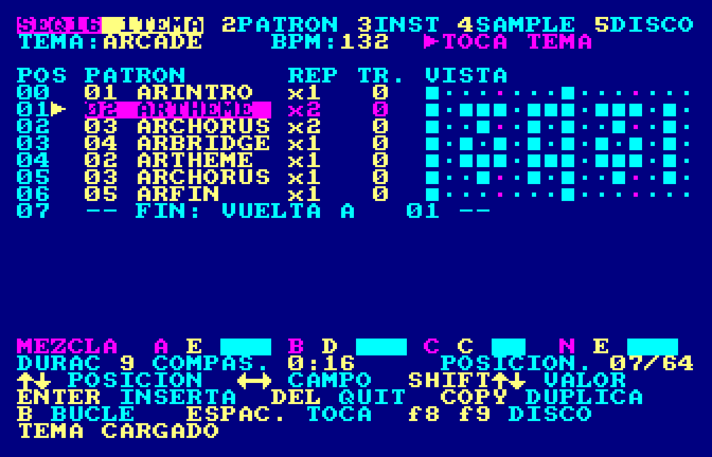
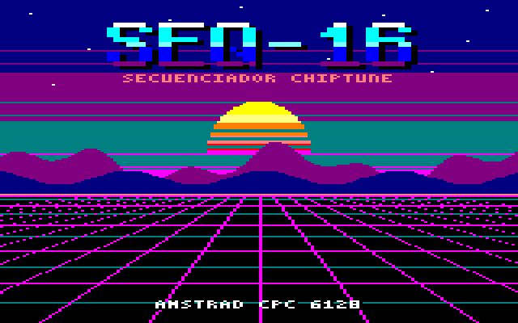
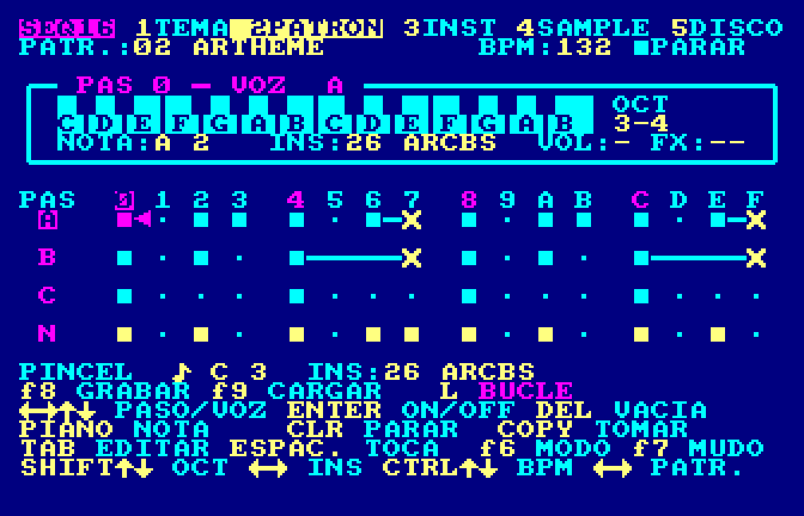
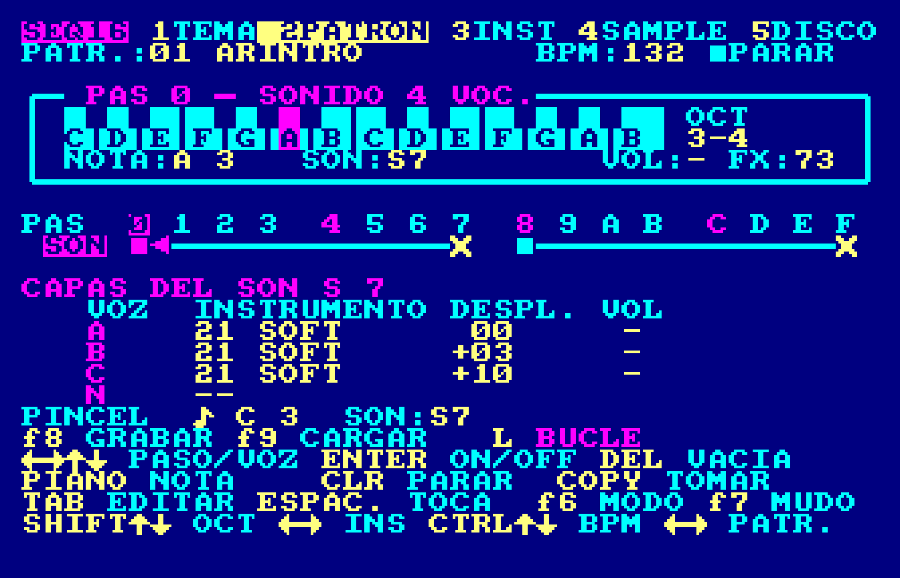
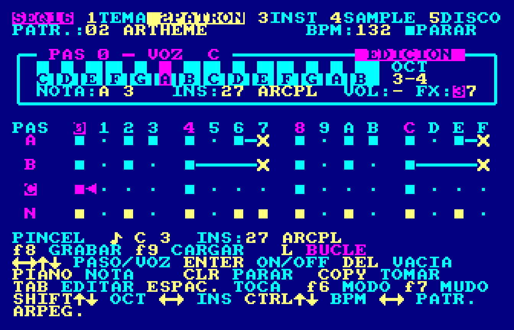
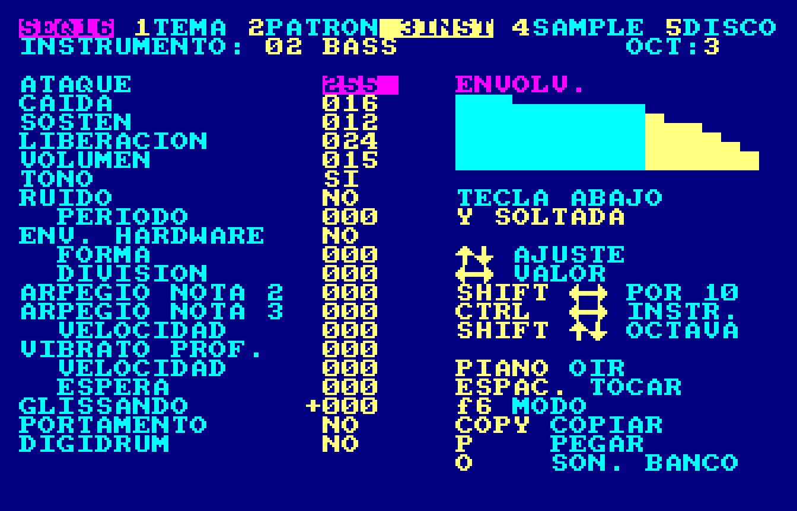
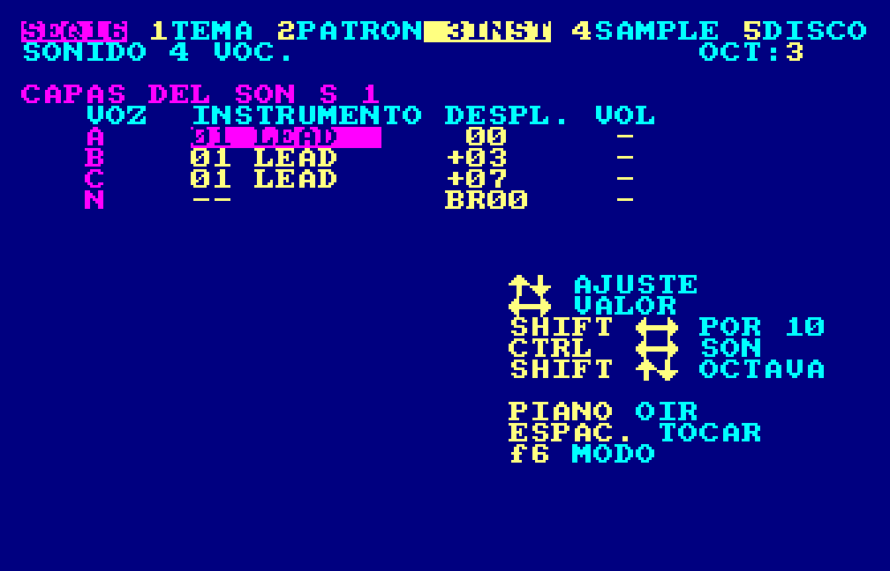
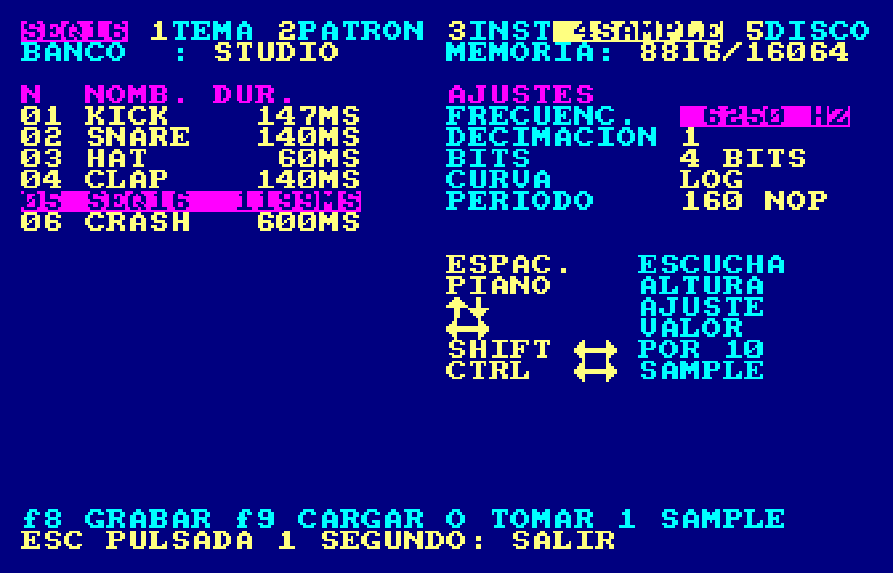
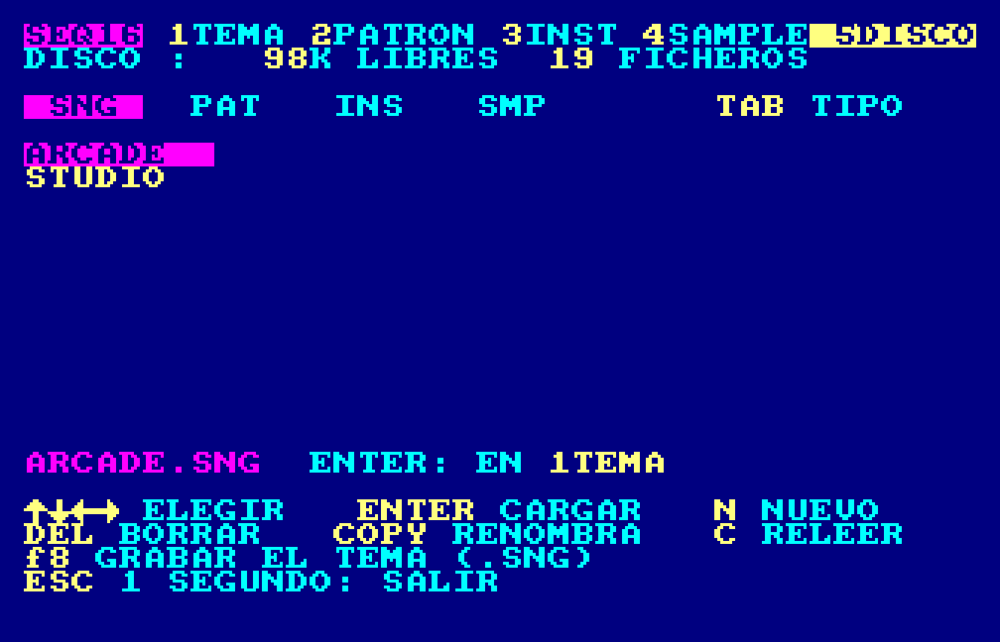
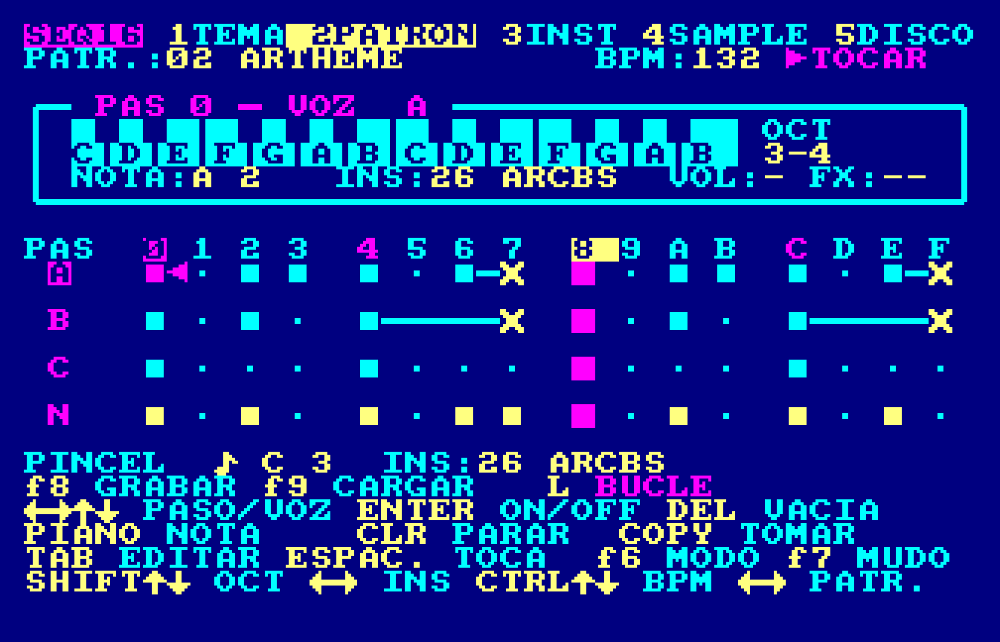

<div align="center">

```
███████╗███████╗ ██████╗        ██╗ ██████╗
██╔════╝██╔════╝██╔═══██╗      ███║██╔════╝
███████╗█████╗  ██║   ██║█████╗╚██║███████╗
╚════██║██╔══╝  ██║▄▄ ██║╚════╝ ██║██╔═══██╗
███████║███████╗╚██████╔╝       ██║╚██████╔╝
╚══════╝╚══════╝ ╚══▀▀═╝        ╚═╝ ╚═════╝
   S E C U E N C I A D O R   C H I P T U N E  ·  A M S T R A D   C P C   6 1 2 8

Ready
RUN"SEQ16
█
```

**Un secuenciador chiptune de 4 voces (3 tonos + ruido) para Amstrad CPC 6128, escrito en ensamblador Z80.**
32 patrones de 16 pasos, encadenados en un tema (64 posiciones, repeticiones, transposición, bucle), 32 instrumentos, 8 sonidos de 4 voces, 7 efectos por paso, y un **sampler** que toca sonidos grabados de verdad (batería, voces…) en el chip de sonido del CPC, con un grano que se ajusta en directo. La idea: el sonido degradado es lo que se busca.
El disco trae **13 bancos de instrumentos (416 sonidos), 8 bancos de samples (el 9.º, `CHIFFRES`, está en `seq16-samples.dsk`), 125 patrones de fábrica** y un **disco de demostración** con dos temas completos.


[](https://github.com/ChristopheCruz/CPC-SEQ-16/releases/latest)
[](https://www.buymeacoffee.com/ChristopheCruz)

[🇫🇷 Français](README.fr.md) · [🇬🇧 English](README.md) · 🇪🇸 Español

🌐 **Web, manual y vídeo: [seq16.slr-ai.com](https://seq16.slr-ai.com/es/)**



</div>

---

## Índice

- [Probarlo ya](#-probarlo-ya)
- [El disco de demostración](#-el-disco-de-demostración)
- [En un CPC de verdad con un Gotek](#-en-un-cpc-de-verdad-con-un-gotek)
- [Los cinco paneles](#️-los-cinco-paneles)
- [Las teclas](#️-las-teclas)
  - [f1 — TEMA](#f1--tema-el-tema)
  - [f2 — PATRON](#f2--patron-el-secuenciador)
  - [f3 — INST](#f3--inst-instrumentos-y-sonidos-de-4-voces)
  - [f4 — SAMPLE](#f4--sample-el-sampler)
  - [f5 — DISCO](#f5--disco-el-catálogo)
- [Los efectos por paso (FX)](#-los-efectos-por-paso-fx)
- [Los ficheros](#-los-ficheros)
- [Los bancos de sonidos](#-los-bancos-de-sonidos)
- [Los patrones de fábrica](#-los-patrones-de-fábrica)
- [El sampler: samples y digidrums](#-el-sampler-samples-y-digidrums)
- [La memoria y el tiempo real](#-la-memoria-y-el-tiempo-real)
- [Pruebas](#-pruebas)
- [Ensamblar](#️-ensamblar)
- [Organización del código](#-organización-del-código)
- [Hoja de ruta](#️-hoja-de-ruta)
- [Agradecimientos](#-agradecimientos)
- [Licencia](#-licencia)

## 💾 Probarlo ya

1. Descarga **[`seq16-es.dsk`](https://github.com/ChristopheCruz/CPC-SEQ-16/releases/latest)** de la última release (también hay una copia en [`build/`](build/)).
   - **Version française :** `seq16-fr.dsk` (`build/seq16-fr.dsk`). **English version:** `seq16-en.dsk`. Mismo programa, mismos ficheros, mismas teclas: solo cambian los textos de la pantalla.
   - **Demostración:** `build/seq16-demo-es.dsk` (y `seq16-demo-fr.dsk` en francés, `-en`): el programa y dos temas completos, ver [El disco de demostración](#-el-disco-de-demostración).
   - **Solo bancos:** `seq16-inst.dsk` (13 bancos de instrumentos `.INS`) y `seq16-samples.dsk` (9 bancos de samples `.SMP`), discos de datos sin el programa.
   - **Patrones de fábrica:** `seq16-motifs-mono.dsk` (62 patrones con sonido de 4 voces) y `seq16-motifs-poly.dsk` (63 patrones con voces sueltas). Ver [Los patrones de fábrica](#-los-patrones-de-fábrica).
2. Mete el disco en un emulador (WinAPE, Caprice32, ACE-DL, RetroVirtualMachine…) configurado como **CPC 6128**.
3. Escribe:

```basic
RUN"SEQ16
```

La pantalla de carga aparece mientras se carga el programa (`RUN"SEQ16.BIN` lo lanza directamente, sin pantalla).

<p align="center"></p>

El programa arranca en el panel **PATRON**, con **SYNTH**, el tema synthwave de fábrica (la menor, 108 BPM, Am - F - C - G: bajo en octavas, arpegios, lead con vibrato, acordes con sonido de 4 voces). **ESPACIO** toca el patrón en pantalla; en **f1 TEMA**, **ESPACIO** toca todo el tema. También está en el disco (`SYNTH.SNG`), y **N N** (tema nuevo) lo vuelve a poner.
Para salir, mantén **ESC** pulsada un segundo: una pulsación sola no basta, para no perder el trabajo por error.

SEQ-16 necesita un **CPC 6128** (guarda los patrones en la memoria adicional): en un 464, o un 664 sin ampliación, lo avisa al arrancar.

## 🎮 El disco de demostración

`seq16-demo-es.dsk` contiene el programa, dos temas, sus 10 patrones, sus instrumentos y sus samples. En el panel **f1 TEMA**, **f9** elige un tema y **ESPACIO** lo toca.

| Tema | Estilo | Lo que muestra |
|---|---|---|
| **ARCADE** | chiptune, la menor, 132 BPM, **sin samples** | la intro y el estribillo con **sonido de 4 voces** (una sola voz que toca un acorde), el tema y el puente con voces sueltas, y los **7 efectos por paso**: vibrato, arpegio, bajo que baja, redoble de caja, acordes repetidos, bajo cortado, melodía que sube, charles con demora, caída de láser |
| **STUDIO** | re menor, 100 BPM, **con samples** | una batería de samples (digidrums), un crash, y la voz «SEQ seize», un **sample largo** que abre el tema y vuelve en el break. Su banco `STUDIO.SMP` se carga con el tema |

Mientras suena la voz de STUDIO, los demás sonidos se paran: es normal, un sample ocupa todo el procesador (ver [Los digidrums](#los-digidrums-samples-en-el-tema)).
El disco lo fabrica [`tools/gen_demo.py`](tools/gen_demo.py); [`demo/LISTE.md`](demo/LISTE.md) describe cada patrón (en francés).

## 🔌 En un CPC de verdad con un Gotek

Para tocar en la máquina real, hay que copiar `seq16-es.dsk` en la memoria USB de una disquetera Gotek (firmware FlashFloppy o HxC).
La herramienta compañera **[CPC DISK](https://github.com/ChristopheCruz/CPC-DISK)** se encarga: un editor de imágenes `.dsk` con aspecto de pantalla de CPC, en Python puro, sin dependencias. Sirve para:

- abrir `seq16-es.dsk` y recorrer su catálogo AMSDOS;
- recuperar los temas `.SNG` grabados en el disco, o añadir otros;
- preparar la memoria USB del Gotek.

## 🖥️ Los cinco paneles

Cinco paneles, que se eligen con las teclas de función del teclado numérico. Las pestañas de arriba muestran el panel actual.
En cada panel, **f8** graba y **f9** carga el fichero que le corresponde.

<table>
<tr>
<td width="50%" align="center">
<br>
<b>f1 · TEMA</b><br>
<sub>El encadenamiento de los patrones: 64 posiciones, repeticiones, transposición, bucle, y la mezcla de las voces.</sub>
</td>
<td width="50%" align="center">
<br>
<b>f2 · PATRON, voces sueltas</b><br>
<sub>Las voces A, B, C y el ruido N en 16 pasos; arriba, la nota del cursor, su instrumento, su volumen y su efecto.</sub>
</td>
</tr>
<tr>
<td width="50%" align="center">
<br>
<b>f2 · PATRON, sonido de 4 voces</b><br>
<sub>Una sola línea de notas que toca un sonido de 4 voces a la vez; sus capas se ven debajo.</sub>
</td>
<td width="50%" align="center">
<br>
<b>f2 · Un efecto (FX)</b><br>
<sub>TAB: el panel del paso se edita; aquí el efecto ARPEG. (37) de una casilla.</sub>
</td>
</tr>
<tr>
<td width="50%" align="center">
<br>
<b>f3 · INST, instrumentos</b><br>
<sub>Envolvente dibujada en directo, ruido, envolvente hardware, arpegio, vibrato, glissando, portamento, digidrum.</sub>
</td>
<td width="50%" align="center">
<br>
<b>f3 · INST, sonidos de 4 voces</b><br>
<sub>f6: los 8 sonidos de 4 voces, voz por voz: instrumento, desplazamiento, volumen.</sub>
</td>
</tr>
<tr>
<td width="50%" align="center">
<br>
<b>f4 · SAMPLE</b><br>
<sub>El banco de samples a la izquierda, el grano del sample elegido a la derecha (aquí el banco del tema STUDIO).</sub>
</td>
<td width="50%" align="center">
<br>
<b>f5 · DISCO</b><br>
<sub>El catálogo por tipo de fichero; ENTER carga el fichero en su panel.</sub>
</td>
</tr>
</table>

<p align="center"><br><sub>f2 · Sonando: el paso que suena se sigue en pantalla, y la música no se para mientras se redibuja la pantalla.</sub></p>

## ⌨️ Las teclas

### f1 — TEMA (el tema)

Un tema encadena hasta **64 posiciones**. Cada posición toca un patrón un número de veces (1 a 16), transpuesto de −12 a +12 semitonos (las voces A, B y C; el ruido no se mueve). Una columna VISTA muestra los pasos del patrón.

| Teclas | Acción |
|---|---|
| ↑/↓ | elegir una posición (bajo la línea FIN: la mezcla) |
| ←/→ | elegir un campo: patrón, repeticiones, transposición (en la mezcla: la voz) |
| SHIFT + ↑/↓ | cambiar el valor del campo (en la mezcla: el volumen de la voz) |
| ENTER | insertar una posición |
| DEL | quitar la posición |
| COPY | duplicar la posición |
| B | el bucle empieza aquí; **B en la posición del bucle lo quita**: la línea FIN dice entonces `PARAR` y la reproducción se para al final del tema |
| ESPACIO | tocar el tema desde la posición del cursor / parar |
| f8 / f9 | grabar / cargar un tema `.SNG` |

- **La marca ►** sigue la posición que suena; **↑** marca el inicio del bucle.
- **El nombre de un patrón** es el de su fichero `.PAT` (grabado o cargado): aparece en TEMA y en PATRON.
- **La línea MEZCLA** ajusta el volumen general de cada voz (A, B, C, N), que se graba con el tema. El chip de sonido manda el canal A a la izquierda, el C a la derecha y el B a los dos lados: según cómo se escuche, un canal puede sonar más fuerte que los otros; aquí se equilibra.
- **La línea DURAC** da la duración del tema (compases, minutos) y el número de posiciones.
- **En el panel PATRON**, el tema no avanza: el patrón que se ve se repite, y uno mismo cambia de patrón. Al volver a TEMA, el tema sigue.

### f2 — PATRON (el secuenciador)

La rejilla: las voces A, B, C y N (ruido) en 16 pasos, o una sola línea `SON` en modo sonido de 4 voces. Encima, el **panel del paso**: el paso y la voz del cursor, un teclado de 2 octavas, y la nota, el instrumento, el volumen y el efecto de la casilla.

| Teclas | Acción |
|---|---|
| Flechas | mover el cursor (paso / voz); se oye la nota a la que se llega |
| Teclas del piano | poner una nota con el instrumento del pincel, oírla, pasar al paso siguiente |
| ENTER | encender la casilla con el pincel, o apagarla |
| DEL | vaciar la casilla |
| CLR | parada de nota (`X`) |
| COPY | tomar la casilla como pincel (nota e instrumento) |
| TAB | editar el panel del paso: ←/→ elige NOTA, INS, VOL, y luego las dos cifras del FX (el efecto, su fuerza); ↑/↓ cambia el valor; TAB otra vez vuelve a la rejilla |
| CAPS LOCK | bloquear el instrumento del pincel |
| ESPACIO | tocar / parar |
| L | **BUCLE** (el patrón se repite) o **1 VEZ** (se toca una vez y se para) |
| f6 | voces sueltas / sonido de 4 voces |
| f7 | silenciar (o volver a oír) la voz del cursor |
| SHIFT + ↑/↓ | octava de entrada |
| SHIFT + ←/→ | instrumento del pincel (y de la nota bajo el cursor) |
| CTRL + ↑/↓ | tempo en BPM |
| CTRL + ←/→ | patrón anterior / siguiente (32 patrones); mientras suena, la música sigue |
| f8 / f9 | grabar / cargar el patrón que se ve (`.PAT`) |

Una nota mantenida se prolonga con una raya hasta su parada. Una voz silenciada se ve en amarillo pálido.

### f3 — INST (instrumentos y sonidos de 4 voces)

**f6** cambia entre los instrumentos y los sonidos de 4 voces.

**Los instrumentos:**

| Teclas | Acción |
|---|---|
| ↑/↓ | elegir un ajuste |
| ←/→ | cambiar su valor (con SHIFT: de 10 en 10) |
| CTRL + ←/→ | instrumento anterior / siguiente (32 instrumentos) |
| SHIFT + ↑/↓ | octava de prueba |
| Teclas del piano | probar el instrumento |
| ESPACIO | oír el patrón con el sonido cambiado |
| COPY | copiar el instrumento (ajustes y nombre) |
| P | pegar: el instrumento copiado sustituye al que se ve |
| O | tomar un sonido de un banco `.INS` del disco: se elige el banco y luego uno de sus 32 sonidos (flechas, RETURN; ESC cancela) |
| f8 / f9 | grabar / cargar un banco de instrumentos `.INS` |

- El dibujo de la envolvente se actualiza con cada cambio de ataque, caída, sostenido o relajación.
- Los instrumentos 25 a 28 (`USER1` a `USER4`) están libres para tus propios sonidos; los instrumentos 29 a 32 son los digidrums de fábrica (`DGKICK`, `DGSNAR`, `DGHAT`, `DGCLAP`).
- **El ajuste DIGIDRUM** (el último): en `SI`, el instrumento toca un sample en vez de una nota. La línea `PERIODO` pasa a ser `SAMPLE` seguida del nombre del sample: su valor es el número del sample en el banco (0 = el primero). Ver [Los digidrums](#los-digidrums-samples-en-el-tema).

**Los sonidos de 4 voces (f6):** un sonido de 4 voces toca hasta 4 instrumentos a la vez, uno por voz, a partir de una sola nota. La tabla muestra sus 4 voces.

| Teclas | Acción |
|---|---|
| ↑/↓ | elegir un campo: para cada voz, el instrumento, el desplazamiento, el volumen |
| ←/→ | cambiar su valor (con SHIFT: de 10 en 10) |
| CTRL + ←/→ | sonido anterior / siguiente (S1 a S8) |
| Teclas del piano | probar el sonido |

| Campo | Valores |
|---|---|
| INSTRUMENTO | `--` (voz sin usar) o 01 a 32 |
| DESPL. | desplazamiento en semitonos, de −24 a +24; para la voz N, el periodo del ruido (`BR00` a `BR1F`) |
| VOL | `-` (el volumen del instrumento) o 0 a 15 |

La misma tabla se ve bajo la rejilla del panel PATRON en modo sonido de 4 voces.

### f4 — SAMPLE (el sampler)

| Teclas | Acción |
|---|---|
| ESPACIO | escuchar el sample elegido (ESPACIO otra vez: parar) |
| Teclas del piano | escuchar el sample más agudo o más grave (±12 semitonos) |
| CTRL + ←/→ | sample anterior / siguiente |
| ↑/↓ | elegir un ajuste: frecuencia, decimación, bits, curva |
| ←/→ | cambiar su valor (con SHIFT: de 10 en 10, para la frecuencia) |
| O | tomar un sample de otro banco `.SMP`: se añade al final del banco en memoria (16 samples y 16 KB como máximo) |
| f8 / f9 | grabar el banco (con los ajustes y los samples añadidos) / cargar otro banco `.SMP` |

La primera vez que se abre SAMPLE, el banco `DRUMS.SMP` se carga solo. Todo está detallado más abajo, en [el manual del sampler](#manual-de-los-samples-paso-a-paso).

### f5 — DISCO (el catálogo)

El catálogo del disco, por tipo de fichero: `SNG` (temas), `PAT` (patrones), `INS` (instrumentos), `SMP` (samples). Arriba, el espacio libre y el número de ficheros.

| Teclas | Acción |
|---|---|
| Flechas | elegir un fichero |
| TAB | tipo siguiente (SNG, PAT, INS, SMP) |
| ENTER | cargar el fichero en su panel, que se muestra (un `.PAT` va al patrón que se ve) |
| DEL | borrar el fichero (pulsar dos veces; `\|ERA` de AMSDOS) |
| COPY | renombrar el fichero (`\|REN`) |
| N | tema nuevo (pulsar dos veces) |
| C | releer el disco (después de cambiarlo) |
| ESPACIO | escuchar el patrón |
| f8 | grabar el tema `.SNG` |

**Grabar con f8** (en cualquier panel): el nombre propuesto aparece en la línea de mensajes; escribe el nombre (8 letras o cifras como máximo) y RETURN; ESC cancela. Si el fichero ya existe, un segundo RETURN lo sustituye.

## ✨ Los efectos por paso (FX)

Cada casilla de un patrón puede llevar un **efecto**, escrito en hexadecimal como en los trackers: la primera cifra elige el efecto, la segunda ajusta su fuerza x (0 a F). `--`: ningún efecto.

| FX | Efecto | Lo que pasa | Ejemplo |
|---|---|---|---|
| `1x` | SUBE | la nota se desliza hacia el agudo, más rápido con x | `14` subida lenta |
| `2x` | BAJA | la nota se desliza hacia el grave | `2C` caída de láser |
| `3x` | ARPEG. | la nota y la nota + x semitonos, alternando rápido | `37` quinta, `3C` octava |
| `4x` | REPITE | la nota se vuelve a tocar cada x imágenes (1/50 s) | `43` redoble de caja |
| `5x` | CORTA | la nota se suelta después de x imágenes | `52` staccato |
| `6x` | DEMORA | la nota empieza x imágenes después del paso | `62` swing, flam |
| `7x` | VIBRATO | vibrato de profundidad x en esta nota | `73` |

- **Para poner un efecto**: en el panel PATRON, pon el cursor en la casilla, **TAB**, ve al FX con **→** (la primera cifra y luego la segunda) y cámbialo con **↑/↓**. El nombre del efecto aparece en la línea de mensajes.
- **Con sonido de 4 voces**, el efecto del paso vale para todas las voces del sonido.
- REPITE, CORTA y DEMORA también funcionan en la voz de ruido.
- **CORTA en un digidrum** acorta el sample: `52` en un KICK lo para después de 2 imágenes (40 ms en vez de 148). Un sample para toda la música mientras suena; cortarlo hace perder menos pasos.
- El efecto solo vale para la nota del paso: el piano y la escucha de una casilla no lo llevan.

El tema ARCADE del [disco de demostración](#-el-disco-de-demostración) usa los 7 efectos.

## 🎵 Los ficheros

| Fichero | Contenido | Panel |
|---|---|---|
| `.SNG` | **todo el tema**: los 32 patrones (y sus nombres), los 32 instrumentos, los 8 sonidos de 4 voces, la mezcla, el encadenamiento (posiciones, bucle), y **el banco de samples** que usa, si lo hay | TEMA, DISCO |
| `.PAT` | un patrón solo (260 bytes): su modo, su tempo y sus 16 pasos | PATRON |
| `.INS` | 32 instrumentos, sus nombres y los 8 sonidos de 4 voces (848 bytes) | INST |
| `.SMP` | un banco de samples (16 como máximo, 16 KB como máximo), con sus ajustes | SAMPLE |

- **Un `.SNG` lleva consigo su banco de samples** (formato versión 4): se puede copiar a otro disco sin olvidar nada.
- Los temas de los formatos antiguos (versiones 1 a 3) se siguen cargando.
- Si ya existe un fichero con el mismo nombre, AMSDOS guarda el antiguo con la extensión `.BAK`.

## 🎹 Los bancos de sonidos

Los sonidos por defecto están **dentro del programa**: al arrancar y después de **N N** (tema nuevo, panel DISCO), siempre se tienen los mismos 32 instrumentos. Los bancos del disco se añaden a ellos.

### Bancos de instrumentos `.INS` (13 bancos, 416 sonidos)

- **Cargar un banco entero**: panel **INST**, **f9** (o DISCO, ENTER en un `.INS`).
- **Tomar un solo sonido** para el instrumento que se ve: panel **INST**, tecla **O**, y luego elegir el banco y el sonido.
- **Grabar tus propios instrumentos**: panel **INST**, **f8**.

| Banco | Contenido |
|---|---|
| `USINE` | los 32 instrumentos por defecto del programa (para recuperarlos después de otro banco) |
| `BATTERIE` | bombos, cajas, charles, toms, platillos, cencerro, claves |
| `BASSES` | bajos cortos, largos, deslizados, «buzzer», sucios, wobble |
| `LEADS` | sonidos de melodía: vibratos, portamentos, sync, trinos |
| `NAPPES` | colchones lentos, acordes mantenidos, coros, órganos |
| `ARPEGES` | acordes arpegiados a 3 velocidades: mayor, menor, 7.ª, sus, disminuido… |
| `EFFETS` | láseres, sirenas, monedas, saltos, explosiones, motores |
| `BUZZER` | la envolvente hardware del AY: 4 formas × 3 divisiones, y variantes |
| `CLAVIERS` | pianos, cuerdas pulsadas, campanas, órganos, vientos |
| `CHIPTUNE` | un banco completo para una música de videojuego |
| `PERCUS` | congas, bongos, claves, triángulo, tablas, gong |
| `GLISSES` | portamentos, glissandos hacia arriba o hacia abajo |
| `BRUITS` | ruido mantenido a 10 alturas, viento, lluvia, mar, tren |

Los fabrica [`tools/gen_instruments.py`](tools/gen_instruments.py) (`--list` muestra todos los sonidos).

### Bancos de samples `.SMP` (9 bancos)

`DRUMS.SMP` sigue siendo el banco por defecto: se carga solo la primera vez que se abre SAMPLE.

| Banco | Contenido | Tamaño |
|---|---|---|
| `DRUMS` | KICK, SNARE, HAT, CLAP (los digidrums de fábrica) | 2 KB |
| `VOIX` | «bonjour», «Amstrad», «SEQ 16», «1, 2, 3, 4» (en francés) | 13 KB |
| `BATTERI2` | batería tipo caja de ritmos: bombo largo, toms, cencerro, crash… (12 sonidos) | 12 KB |
| `PERCUS` | congas, bongo, claves, triángulo, pandereta, agogó, tabla… (12 sonidos) | 13 KB |
| `EFFETS` | láser, zap, explosión, moneda, salto, sirena, alarma, ovni… (12 sonidos) | 14 KB |
| `BASSES` | 10 notas de bajo (DO), para tocar con el piano | 15 KB |
| `NOTES` | pulsado, piano, campana, órgano, metal, coro, orquesta… (10 notas, DO) | 14 KB |
| `CHIFFRES` | «zéro» a «dix» (números en francés; solo en `seq16-samples.dsk`) | 11 KB |
| `MOTS` | «allez», «oui», «non», «encore», «stop», «bravo», «CPC»… (14 palabras en francés) | 16 KB |

El disco de demostración añade `STUDIO.SMP` (DRUMS, la voz SEQ16 y el CRASH de BATTERI2), el banco del tema STUDIO.
Todos los sonidos están **sintetizados** ([`tools/gen_samples.py`](tools/gen_samples.py)) o **dichos por espeak**: ningún sample sacado de Internet, así que no hay problemas de derechos.

## 🎼 Los patrones de fábrica

Dos discos llenos de patrones listos, para empezar un tema, aprender el secuenciador o tomar prestado un ritmo. Cada patrón es un fichero `.PAT`.

| Disco | Patrones | Contenido |
|---|---|---|
| `seq16-motifs-mono.dsk` | 62 patrones **mono** | modo **sonido de 4 voces**: una sola línea de notas tocada por uno de los 8 sonidos: riffs, arpegios, bajos, acordes, sintonías de juego |
| `seq16-motifs-poly.dsk` | 63 patrones **poly** | modo **voces sueltas**: ritmos completos (batería en N, bajo, acordes o melodía), y piezas de solo batería y de bajo + batería |

Estilos: techno, house, electro, hip-hop, trap, rock, funk, reggae, dub, bossa, salsa, drum & bass, synth-pop, synthwave, disco, chiptune y sintonías de juego, blues, jazz, vals, marcha, ambient… de 80 a 170 BPM. La lista completa está en [`patterns/LISTE.md`](patterns/LISTE.md) (en francés).

**Cargar un patrón**: en el panel **PATRON**, muestra el hueco que quieres llenar (CTRL + ←/→), mete un disco de patrones, pulsa **f9**, elige con las flechas (al salir del borde, cambia la página), RETURN. El patrón sustituye al que se ve, con su modo, su tempo y su nombre. También se puede pasar por el panel **DISCO** (TAB hasta `PAT` y luego ENTER).

**Grabar un patrón**: en el panel **PATRON**, **f8**, escribe un nombre, RETURN: el patrón que se ve se graba solo en `NOMBRE.PAT` y toma ese nombre.

Los patrones están escritos para los **instrumentos y sonidos de fábrica** (también en `USINE.INS`). Cuatro patrones poly (`DIGIHOP1`, `DIGIHSE1`, `DIGIFNK1`, `DIGIBRK1`) usan los digidrums: carga antes un banco de samples.
Los fabrica [`tools/gen_patterns.py`](tools/gen_patterns.py), que además comprueba que cada nota está en la tonalidad del patrón, en la tesitura de su instrumento, y que dos voces nunca chocan.

## 🥁 El sampler: samples y digidrums

SEQ-16 toca **samples**: un panel **SAMPLE** para escuchar y ensuciar un sonido, y **digidrums**, samples disparados en un paso como una nota.
La idea es clara: **la degradación es lo que se busca**. Grano, aliasing, soplido y cortes son efectos deseados y ajustables.

El CPC no tiene convertidor digital-analógico. Toca un sample cambiando muy rápido el **volumen** de un canal del AY: 16 niveles en una curva casi logarítmica. De ahí sale el grano.

### Manual de los samples, paso a paso

**1. Abrir el sampler.** Pulsa **f4**. La primera vez, el banco `DRUMS.SMP` se carga solo y sus 4 sonidos aparecen a la izquierda.

**2. Escuchar.**
- Elige un sample con **CTRL + ←/→**. El sample elegido está en magenta invertido.
- **ESPACIO** lo toca a su altura original. ESPACIO otra vez lo para.
- **Las teclas del piano** lo tocan más agudo o más grave: la fila de arriba, desde la tecla del DO, empieza en la altura original y sube de semitono en semitono; la fila de abajo toca una octava más grave.
- Mientras suena, la pantalla no se mueve: es normal.

**3. Ensuciar el sonido.** A la derecha, elige un ajuste con **↑/↓** y cambia su valor con **←/→** (para la frecuencia, con SHIFT, de 10 en 10). Vuelve a escuchar después de cada cambio.

| Ajuste | Valores | Efecto |
|---|---|---|
| FRECUENC. | 4.000 a 16.129 Hz | la altura y el brillo; más bajo es más grave y más sucio |
| DECIMACION | 1, 2, 3, 4, 6, 8 | una muestra de cada N, mantenida N veces: aparecen silbidos metálicos |
| BITS | 4, 3, 2, 1 | menos niveles; con 1 bit, solo queda un «bip» duro y débil |
| CURVA | LOG, LINEAL, SATURADA, PLEGADA, INVERSA | LOG es el sonido original; LINEAL es más hueco, SATURADA recorta, PLEGADA pliega lo que se pasa, INVERSA da la vuelta a la onda |
| PERIODO | (información) | la duración de una muestra en µs, es decir en NOP |

**4. Cambiar de banco.** **f9**, elige el fichero `.SMP` con las flechas, RETURN (ESC cancela).

**5. Grabar el banco** con sus ajustes y los samples añadidos: **f8**.

**6. Fabricar tus propios sonidos.** En el PC, convierte tus ficheros WAV con [`tools/wav2smp.py`](#convertir-tus-propios-sonidos-toolswav2smppy), o con el editor gráfico de [CPC DISK](#el-editor-gráfico-de-bancos-en-pc-la-pestaña-samples-seq-16-de-cpc-disk).

**Conviene saber**: un banco ocupa 16 KB como máximo (unos 4 segundos a 8 kHz, 5 segundos a 6,25 kHz) y contiene 16 sonidos como máximo.

### Los digidrums: samples en el tema

Un **digidrum** es un instrumento que toca un sample del banco cargado en vez de una nota. Los 4 instrumentos de fábrica 29 a 32 (`DGKICK`, `DGSNAR`, `DGHAT`, `DGCLAP`) tocan los 4 sonidos de `DRUMS.SMP`.

**Para hacer uno propio**, en el panel **INST**:

1. Pon el último ajuste, **DIGIDRUM**, en `SI`.
2. La línea `PERIODO` pasa a ser `SAMPLE` y muestra el nombre del sample. Cambia su valor con ←/→: 0 = el primer sample del banco, 1 = el segundo…
3. El **VOLUMEN** ajusta la fuerza del sample (15 = al máximo). Los demás ajustes no sirven.
4. Pruébalo con el piano.

**En el patrón**, pon este digidrum como una nota:

- **la altura**: la nota **DO de la octava 4** toca el sample tal cual; cada semitono por encima o por debajo lo hace más agudo o más grave, hasta ±12 semitonos;
- **la voz** elige el canal del AY: A, B o C. En la voz N (ruido), el sample suena en el canal C;
- **una voz silenciada** (f7) no toca sus digidrums.

**Un sample ocupa todo el procesador.** Suena entero, con las interrupciones cortadas. Mientras tanto:

- la pantalla y el teclado no responden;
- el secuenciador se para y las otras voces se **congelan** (sus envolventes, arpegios y vibratos dejan de moverse);
- al terminar el sample, el secuenciador **recupera el tempo**: los pasos que cayeron durante el sample se tocan de golpe, y luego la música sigue a tiempo.

Con sonidos cortos (menos de 150 ms, como los de `DRUMS.SMP`), casi no se nota. Un sample largo (la voz del tema STUDIO) corta los demás sonidos mientras suena: es el precio de la calidad del sample.
Otro punto: cuando cambia el sample, su altura o su volumen, el programa tiene que **preparar las tablas** de reproducción del sample, lo que puede tardar hasta unos 300 ms. En un patrón que alterna muchos samples distintos, puede oírse como un pequeño tropiezo.

### El editor gráfico de bancos (en PC): la pestaña SAMPLES SEQ-16 de CPC DISK

Una aplicación de escritorio para fabricar un banco `.SMP` a partir de ficheros WAV, sin línea de comandos. Forma parte de **CPC DISK**, el editor de discos: es su pestaña **SAMPLES SEQ-16**, en francés, inglés o español. Un solo programa de Windows, `cpc-dsk-gui.exe`, sirve para hacer los bancos y meterlos en el disco (y en la memoria del Gotek).

```bat
python tools\smp_gui.py          rem el editor solo, en su ventana
```

- **A la izquierda**, la lista de samples (16 como máximo): añadir WAV (Ctrl+W, varios a la vez), abrir un banco `.SMP` existente (Ctrl+O), quitar, subir, bajar. Un indicador muestra el espacio ocupado de los 16.064 bytes de la memoria del CPC; se pone rojo si el banco es demasiado grande.
- **A la derecha**, los ajustes del sample elegido: nombre (6 caracteres), frecuencia, saturación, recorte de silencios, suavizado, tramado, bits, decimación, curva, troceado. La forma de onda muestra el original arriba y el resultado del CPC abajo.
- **Escuchar** el original o el resultado del CPC.
- **Grabar .SMP** (Ctrl+S) y luego **Añadir al disco**.

El código está en CPC DISK (`cpc_dsk/seq16/`); `tools/smp_gui.py`, `tools/smp_model.py` y `tools/wav2smp.py` remiten a él.

### Convertir tus propios sonidos: `tools/wav2smp.py`

Python 3, solo la biblioteca estándar. Entrada: WAV mono o estéreo, 8 o 16 bits, a cualquier frecuencia.

```bat
rem un sonido por fichero, a 8 kHz (por defecto)
python tools\wav2smp.py kick.wav snare.wav -o samples\MIBANCO.SMP -v

rem un loop de batería cortado en 8 trozos, a 6 kHz
python tools\wav2smp.py loop.wav --slice 8 --rate 6000 -o samples\LOOP.SMP

rem muy sucio: saturado, 2 bits, una muestra de cada 3
python tools\wav2smp.py voz.wav --drive 4 --bits 2 --decim 3 -o samples\SUCIO.SMP

rem añadir el banco al disco build\seq16-fr.dsk
python tools\wav2smp.py sonido.wav -o samples\SONIDO.SMP --dsk

rem ver el contenido de un banco
python tools\wav2smp.py --info samples\DRUMS.SMP
```

| Opción | Efecto |
|---|---|
| `--rate` | frecuencia de 4.000 a 16.000 Hz. Más baja es más sucia y ocupa menos memoria |
| `--drive` | ganancia antes del recorte (1 = nada, 4 = muy saturado). También sube los finales del sonido |
| `--clean` | añade un filtro antes del remuestreo, para menos aliasing |
| `--bits 4/3/2/1` | menos niveles |
| `--dither noise` | tramado: un soplido sustituye a los escalones |
| `--decim` | 1, 2, 3, 4, 6 u 8: una muestra de cada N se mantiene N veces. Se guarda como ajuste, no destruye nada |
| `--slice N` | corta cada WAV en N trozos iguales |
| `--names` | nombres de los samples (6 caracteres), separados por comas |
| `--dsk` | añade el banco a `build/seq16-fr.dsk` (o al disco indicado) |
| `--trim` | quita los silencios al principio y al final de cada sonido |
| `-v` | muestra el tamaño y la duración, y avisa por encima de 16 KB |

Cada conversión escribe también WAV de escucha junto al banco, que simulan el resultado del CPC. Un segundo a 8 kHz ocupa 4 KB.

### El formato `.SMP`

El formato está descrito en detalle al principio de `cpc_dsk/seq16/wav2smp.py`, en CPC DISK:

- una cabecera `SQSM` de 16 bytes (versión 1);
- una ficha de 16 bytes por sample: nombre, posición, longitud, frecuencia, bucle, banderas, ajustes;
- los datos, 2 muestras de 4 bits por byte.

La frecuencia se guarda como la duración de una muestra en NOP (µs), de 62 a 250: es directamente el ajuste del bucle de reproducción del Z80. Cada muestra es un código de nivel del AY, de 0 a 15. La tabla de los 16 niveles del AY viene del emulador libre [Ayumi](https://github.com/true-grue/ayumi) (licencia MIT).

## 🧠 La memoria y el tiempo real

- **Memoria principal**: el programa, el tema actual y el búfer de AMSDOS ocupan de `#3F00` a `#9FFF`. El banco de samples está en la memoria baja (`#0040-#3EFF`, 16.064 bytes), la rutina de reproducción de los samples y sus tablas en la zona alta (`#A000-#A67B`, bajo la memoria de AMSDOS).
- **Memoria adicional del 6128**: el **bloque 4** guarda los 32 patrones (solo el patrón que se ve está en memoria principal, y el siguiente patrón de un tema se prepara ahí por adelantado); el **bloque 5** guarda el tema de fábrica, que **N N** vuelve a leer. Los bloques 6 y 7 quedan libres para lo que venga.
- **La música no se para mientras se dibuja la pantalla.** En un CPC de verdad, el firmware escribe un carácter en unos 3,5 ms: redibujar una pantalla tarda más de un segundo. Así que cada carácter escrito deja paso al sonido, y las imágenes de sonido atrasadas se recuperan: los pasos caen a tiempo, incluso al cambiar de patrón.
- **Los errores de disco** muestran el código de AMSDOS y el número de bytes leídos, para saber dónde y por qué falló una carga.

## 🧪 Pruebas

```bat
pip install z80
python -m unittest discover -s tools -p "test_*.py"
```

Más de 220 pruebas. La mayoría ejecutan el `SEQ16.BIN` real en un CPC simulado ([`tools/cpcsim.py`](tools/cpcsim.py)): cada rutina del firmware se sustituye por una versión simulada que cambia los registros como el firmware real; el PPI, el AY, la memoria adicional, AMSDOS (con sus reglas: un solo fichero abierto, fin de fichero «suave» en el byte `#1A`…) y la pantalla de texto están modelados, y el tiempo se cuenta en NOP. Un CPC «lento» escribe cada carácter en 3,5 ms, como el firmware real.

Comprueban, entre otras cosas: la reproducción a tempo (pasos regulares al cambiar de patrón, incluso a la velocidad real de la pantalla), cada panel y sus teclas, los efectos por paso imagen a imagen, los sonidos de 4 voces, grabar y cargar todos los ficheros (temas con su banco de samples incluido), los digidrums, las traducciones (cada texto cabe en el sitio del francés), los patrones de fábrica, los temas de prueba y el disco de demostración.

Las pruebas leen los discos de `build/` y `build/seq16.sym`: vuelve a lanzar `build.bat` después de cualquier cambio en `src/`.

## 🛠️ Ensamblar

En Windows:

1. Pon `rasm.exe` en `tools\` ([EdouardBERGE/rasm](https://github.com/EdouardBERGE/rasm), página *Releases*).
2. Si cambias los instrumentos y patrones de fábrica en `tools/gen_factory.py`, lanza antes `python tools\gen_factory.py`.
3. Si cambias los sonidos de batería (`tools/gen_drums.py`) o las curvas (`tools/wav2smp.py`), lanza `python tools\gen_drums.py` o `python tools\gen_smp_tables.py`.
4. Si cambias los bancos: `python tools\gen_instruments.py` (bancos `.INS`) y `python tools\gen_samples.py` (bancos `.SMP`; hace falta espeak para las voces).
5. Lanza `build.bat`. Ensambla `src/main.asm`, fabrica `build\seq16-fr.dsk` con todos los bancos, y luego las versiones inglesa y española, los discos de bancos y de patrones, los temas de prueba (`build\seq16-songs.dsk`) y la demostración (`build\seq16-demo-fr.dsk`).
6. Para rehacer las capturas de pantalla (README y web): `python tools\snapshots.py`; para el vídeo: `python tools\make_video.py es` (hacen falta ffmpeg y numpy).

**Las traducciones** están en [`tools/lang.py`](tools/lang.py): el código fuente sigue en francés, y el script hace una copia por idioma en la que cada texto mostrado se sustituye. Una traducción nunca es más larga que el francés (se completa con espacios): los tres programas tienen el mismo tamaño y las mismas direcciones. Si añades un texto al código, añade su traducción; `python tools/lang.py --check` avisa de los textos olvidados o demasiado largos.

**También hace falta el proyecto CPC DISK**, el editor de discos: SEQ-16 usa su biblioteca (`cpc_dsk`) para escribir en los discos. Ponlo al lado de este proyecto:

```
_Codes/
├── CPC-SEQ-16/    este proyecto
└── CPC-DISK/      el editor de discos (o AmstradCPC, su antiguo nombre)
```

`tools/cpcdisk.py` lo encuentra solo. Otras opciones: `pip install -e ../CPC-DISK`, o la variable de entorno `CPC_DISK` con su carpeta.

## 📁 Organización del código

| Fichero | Papel |
|---|---|
| [`src/main.asm`](src/main.asm) | el arranque, el bucle principal, las teclas, el panel INST, el disco, el mapa de memoria |
| [`src/grid.asm`](src/grid.asm) | el panel PATRON: la rejilla, el panel del paso, la edición, las capas de un sonido de 4 voces |
| [`src/songpanel.asm`](src/songpanel.asm) | el panel TEMA: el encadenamiento, la reproducción del tema, la mezcla |
| [`src/panels.asm`](src/panels.asm) | f8 / f9 en cada panel |
| [`src/diskpanel.asm`](src/diskpanel.asm) | el panel DISCO: catálogo, carga, borrar, renombrar |
| [`src/sngio.asm`](src/sngio.asm) | el `.SNG` versión 4 (tema y banco de samples), leído y escrito byte a byte |
| [`src/song.asm`](src/song.asm) | el tema en memoria, los patrones en el bloque 4 |
| [`src/bank.asm`](src/bank.asm) | la memoria adicional del 6128 (bloques 4 y 5) |
| [`src/boot.asm`](src/boot.asm) | lo que solo sirve al arrancar: la construcción del tema de fábrica (SYNTH, descomprimido desde [`src/factory_song.asm`](src/factory_song.asm), hecho por `tools/gen_synth.py`), guardado en el bloque 5 |
| [`src/seq.asm`](src/seq.asm) | el secuenciador: formato del patrón, reproducción a tempo, BUCLE / 1 VEZ |
| [`src/sound.asm`](src/sound.asm) | el motor de sonido (4 voces, envolventes, arpegio, vibrato, glissando, efectos por paso) |
| [`src/factory.asm`](src/factory.asm) | instrumentos, sonidos y patrones de fábrica (fichero generado) |
| [`src/tables.asm`](src/tables.asm) | tablas de notas y de volúmenes (fichero generado) |
| [`src/firmware.asm`](src/firmware.asm) | las direcciones de las rutinas del sistema del CPC que se usan |
| [`src/sample.asm`](src/sample.asm), [`src/smptables.asm`](src/smptables.asm) | la reproducción de los samples: acceso directo al AY, carga de un banco; curvas y alturas (generado) |
| [`src/smpscreen.asm`](src/smpscreen.asm) | el panel SAMPLE, la lista para elegir ficheros |
| [`src/banks.asm`](src/banks.asm), [`src/hizone.asm`](src/hizone.asm) | copiar / pegar instrumentos, bancos `.INS` y `.SMP`, digidrums; rutinas copiadas en la zona alta |
| [`tools/cpcsim.py`](tools/cpcsim.py), `tools/test_*.py` | el CPC simulado y las pruebas |
| [`tools/lang.py`](tools/lang.py) | las versiones inglesa y española |
| [`tools/gen_patterns.py`](tools/gen_patterns.py), [`tools/gen_songs.py`](tools/gen_songs.py), [`tools/gen_demo.py`](tools/gen_demo.py) | los patrones de fábrica, los temas de prueba, el disco de demostración |
| [`tools/gen_factory.py`](tools/gen_factory.py), [`tools/gen_tables.py`](tools/gen_tables.py), [`tools/gen_instruments.py`](tools/gen_instruments.py), [`tools/gen_samples.py`](tools/gen_samples.py), [`tools/gen_drums.py`](tools/gen_drums.py) | los ficheros generados y los bancos |
| [`tools/snapshots.py`](tools/snapshots.py), [`tools/make_video.py`](tools/make_video.py) | las capturas de pantalla y el vídeo, rodados en el CPC simulado |
| [`tools/amsdsk.py`](tools/amsdsk.py), [`tools/cpcdisk.py`](tools/cpcdisk.py) | escribir en un disco `.dsk`, con la biblioteca de CPC DISK |
| [`samples/`](samples/), [`instruments/`](instruments/), [`patterns/`](patterns/), [`songs/`](songs/), [`demo/`](demo/) | bancos, patrones, temas de prueba, demostración |
| [`build/`](build/) | los discos listos para usar |
| [`snapshots/`](snapshots/) | las capturas de pantalla de este README |

## 🗺️ Hoja de ruta

- [x] Patrones de 16 pasos, 32 patrones, 4 voces, sonido de 4 voces
- [x] Cinco paneles, f8 / f9 en todos, panel DISCO (catálogo, borrar, renombrar)
- [x] Encadenar los patrones en un tema: 64 posiciones, repeticiones, transposición, bucle
- [x] Edición en pantalla de los sonidos de 4 voces
- [x] Los 7 efectos por paso (FX)
- [x] `.SNG` que lleva consigo su banco de samples
- [x] Copiar / pegar instrumentos, 13 bancos de instrumentos, 9 bancos de samples, 125 patrones de fábrica
- [x] Samples: convertidor, reproducción en el CPC, panel SAMPLE, digidrums, editor gráfico en PC
- [x] Disco de demostración
- [ ] Renombrar los instrumentos
- [ ] Copiar / pegar bloques de pasos
- [ ] Samples: tablas guardadas en la memoria adicional, modo TROCEADO, retoques del panel SAMPLE

## 🙏 Agradecimientos

SEQ-16 se apoya en el trabajo de otras personas. Gracias a ellas.

**Herramientas y bibliotecas**
- [RASM](https://github.com/EdouardBERGE/rasm), el ensamblador Z80 de Édouard Bergé: ensambla el programa y escribe el disco.
- [z80](https://github.com/kosarev/z80), el emulador Z80 para Python de Ivan Kosarev: hace funcionar el CPC simulado de las pruebas.
- [Ayumi](https://github.com/true-grue/ayumi), el emulador de AY-3-8912 de Peter Sovietov (licencia MIT): su tabla de volúmenes la usa el convertidor de samples.
- [eSpeak NG](https://github.com/espeak-ng/espeak-ng): las voces de los bancos de samples `VOIX`, `CHIFFRES` y `MOTS`.
- [CPC DISK](https://github.com/ChristopheCruz/CPC-DISK): la biblioteca de discos, y el editor de bancos de samples (su pestaña SAMPLES SEQ-16).
- [Python](https://www.python.org/) y [tkinter](https://docs.python.org/3/library/tkinter.html): las herramientas, las pruebas y el editor.
- Fuentes [Press Start 2P](https://fonts.google.com/specimen/Press+Start+2P) de CodeMan38 y [VT323](https://fonts.google.com/specimen/VT323) de Peter Hull ([SIL Open Font License 1.1](https://openfontlicense.org/)).

**Documentación y referencias**
- [CPCWiki](https://www.cpcwiki.eu/): el firmware del CPC, el chip de sonido AY-3-8912, AMSDOS y el formato de las imágenes DSK.
- [Un ejemplo de cargador](https://cpcwiki.eu/index.php/Programming:An_example_loader) y la [Amstrad Whole Memory Guide](https://cpcwiki.eu/index.php/Amstrad_Whole_Memory_Guide_-_The_machine_pack) (CPCWiki), y el [manual del firmware del 6128](https://archive.org/stream/SOFT968TheAmstrad6128FirmwareManual/SOFT968%20-%20The%20Amstrad%206128%20Firmware%20manual_djvu.txt) (SOFT968, archive.org): la rutina `MC START PROGRAM`, que lanza el programa después de la pantalla de carga.
- [HxC2001](https://hxc2001.com/) y [FlashFloppy](https://github.com/keirf/FlashFloppy): los firmwares del Gotek y su documentación.

**Pruebas**
- [WinAPE](http://www.winape.net/): el emulador con el que se probaron los discos.

## 📜 Licencia

[MIT](LICENSE): puedes usar, copiar, modificar y compartir SEQ-16, bancos de sonidos y patrones de fábrica incluidos, siempre que conserves el aviso de copyright. Amstrad y CPC son marcas de sus respectivos propietarios; SEQ-16 es un proyecto independiente.

---

<div align="center">

<sub>Hecho con ♥ para el CPC · ver también <a href="https://github.com/ChristopheCruz/CPC-DISK">CPC DISK</a>, el editor de discos <code>.dsk</code></sub>

</div>
