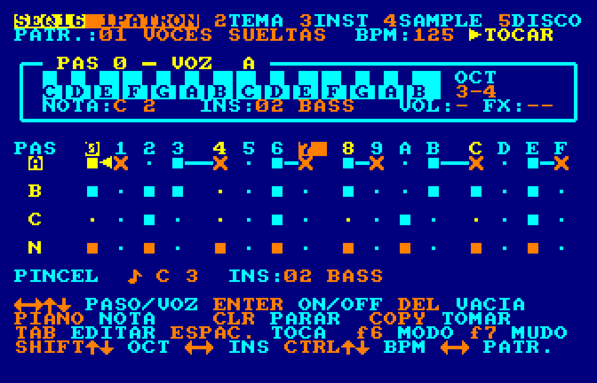
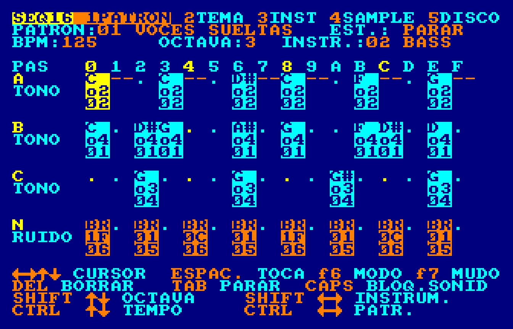
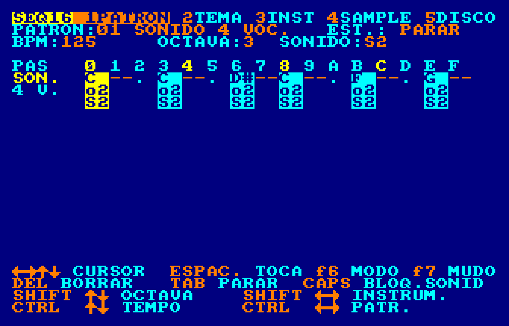
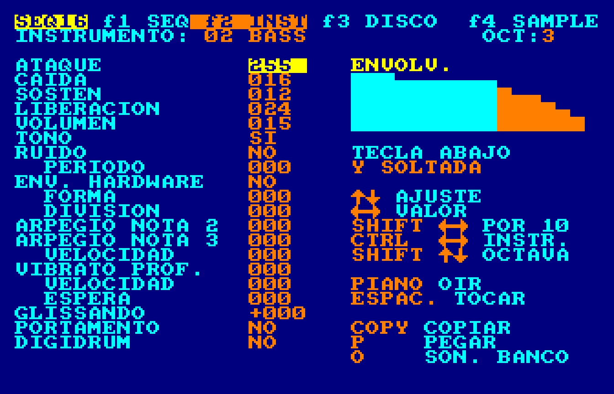
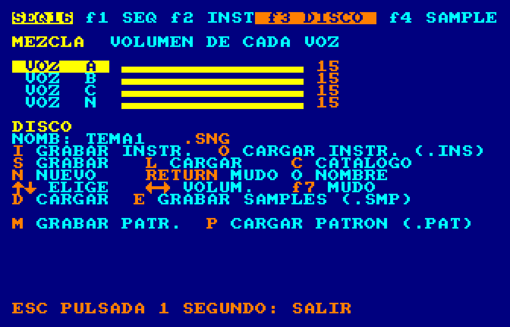
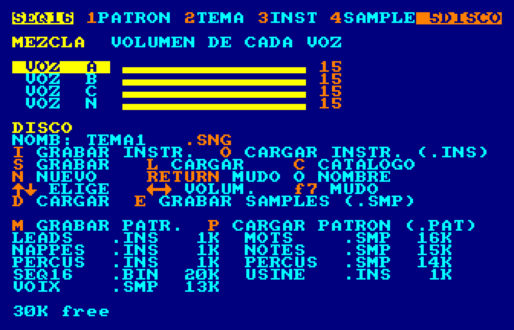
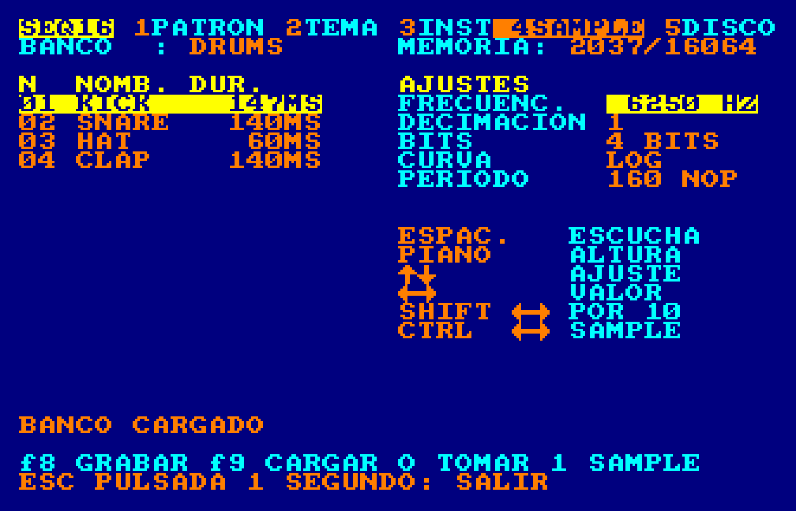

<div align="center">

```
███████╗███████╗ ██████╗        ██╗ ██████╗
██╔════╝██╔════╝██╔═══██╗      ███║██╔════╝
███████╗█████╗  ██║   ██║█████╗╚██║███████╗
╚════██║██╔══╝  ██║▄▄ ██║╚════╝ ██║██╔═══██╗
███████║███████╗╚██████╔╝       ██║╚██████╔╝
╚══════╝╚══════╝ ╚══▀▀═╝        ╚═╝ ╚═════╝
   S E C U E N C I A D O R   C H I P T U N E  ·  A M S T R A D   C P C   6 1 2 8

Ready
RUN"SEQ16
█
```

**Un secuenciador chiptune de 4 voces (3 tonos + ruido) para Amstrad CPC 6128, escrito en ensamblador Z80.**
16 pasos por patrón, 32 patrones, 32 instrumentos, los temas se graban en disquete.
Y un **sampler**: la pantalla **f4** toca sonidos grabados de verdad (batería, voces…) con el chip de sonido del CPC, con un grano que ajustas en directo (frecuencia, decimación, bits, curva). La idea: degradar el sonido es justo lo que se busca.
Los samples también suenan **dentro de los temas** (digidrums), y el disquete trae **13 bancos de instrumentos (416 sonidos) y 9 bancos de samples**.


[](https://github.com/ChristopheCruz/CPC-SEQ-16/releases/latest)
[](https://www.buymeacoffee.com/ChristopheCruz)

[🇫🇷 Français](README.fr.md) · [🇬🇧 English](README.md) · 🇪🇸 Español



</div>

---

## Índice

- [Pruébalo ya](#-pruébalo-ya)
- [En un CPC real con un Gotek](#-en-un-cpc-real-con-un-gotek)
- [Las pantallas](#️-las-pantallas)
- [Las teclas](#️-las-teclas)
- [El formato de los temas](#-el-formato-de-los-temas)
- [Los bancos de sonidos](#-los-bancos-de-sonidos)
- [Los patrones de fábrica](#-los-patrones-de-fábrica)
- [El sampler: samples y digidrums](#-el-sampler-samples-y-digidrums)
  - [Los samples, paso a paso](#los-samples-paso-a-paso)
  - [Los digidrums: samples dentro del tema](#los-digidrums-samples-dentro-del-tema)
  - [El editor gráfico de bancos (en PC)](#el-editor-gráfico-de-bancos-en-pc-la-pestaña-samples-seq-16-de-cpc-disk)
- [Reensamblar](#️-reensamblar)
- [Organización del código](#-organización-del-código)
- [Hoja de ruta](#️-hoja-de-ruta)
- [Agradecimientos](#-agradecimientos)

## 💾 Pruébalo ya

1. Descarga **[`seq16-es.dsk`](https://github.com/ChristopheCruz/CPC-SEQ-16/releases/latest)** de la última release (también hay una copia en [`build/`](build/)).
   - **Version française :** `seq16.dsk`. **English version:** `seq16-en.dsk`. El mismo programa, los mismos bancos, las mismas teclas: solo cambian los textos de la pantalla.
   - **Solo los bancos:** `seq16-inst.dsk` (13 bancos de instrumentos `.INS`) y `seq16-samples.dsk` (9 bancos de samples `.SMP`), disquetes de datos sin el programa: cambia de disquete y carga un banco (f3: **O** o **D**).
   - **Patrones de fábrica:** `seq16-motifs-mono.dsk` (62 patrones mono, en sonido de 4 voces) y `seq16-motifs-poly.dsk` (63 patrones poli, en voces sueltas): en f3, **P** carga uno en el patrón mostrado. Ver [Los patrones de fábrica](#-los-patrones-de-fábrica).
2. Mete el disquete en un emulador (WinAPE, Caprice32, ACE-DL, RetroVirtualMachine…) configurado como **CPC 6128**.
3. Teclea:

```basic
RUN"SEQ16
```

Para salir, mantén **ESC** pulsada un segundo. Una pulsación sola no basta, para no perder tu trabajo por error.

El disquete trae también bancos de sonidos listos para usar (ver [Los bancos de sonidos](#-los-bancos-de-sonidos)):

- **9 bancos de samples** `.SMP`: batería, percusión, efectos, bajos, notas, voces… Pulsa **f4** para escucharlos.
- **13 bancos de instrumentos** `.INS` de 32 sonidos cada uno. En **f3**, la tecla **O** carga uno; en **f2**, la tecla **O** toma un solo sonido.

## 🔌 En un CPC real con un Gotek

Para tocar en la máquina de verdad, hay que copiar `seq16-es.dsk` en el pendrive USB de una disquetera Gotek (firmware FlashFloppy o HxC).
La herramienta compañera **[CPC DISK](https://github.com/ChristopheCruz/CPC-DISK)** se encarga de ello: es un editor de imágenes `.dsk` con aspecto de pantalla de CPC, en Python puro, sin dependencias. Sirve para:

- abrir `seq16-es.dsk` y recorrer su catálogo AMSDOS;
- recuperar los temas `.SNG` grabados en el disquete, o añadir otros;
- preparar el pendrive del Gotek.

## 🖥️ Las pantallas

Cuatro pantallas, que se eligen con las teclas de función del teclado numérico: **f1** secuenciador, **f2** instrumento, **f3** disco, **f4** sampler (ver [El sampler](#-el-sampler-samples-y-digidrums)).

<table>
<tr>
<td width="50%" align="center">
<br>
<b>f1 · Secuenciador, voces sueltas</b><br>
<sub>Las voces A, B, C y el ruido N en 16 pasos: nota, octava, instrumento.</sub>
</td>
<td width="50%" align="center">
<br>
<b>f1 · Secuenciador, sonido de 4 voces</b><br>
<sub>Una sola línea que toca un sonido compuesto en las 4 voces a la vez.</sub>
</td>
</tr>
<tr>
<td width="50%" align="center">
<br>
<b>f2 · Instrumento</b><br>
<sub>Envolvente dibujada en directo, ruido, envolvente hardware, arpegio, vibrato, glissando, portamento.</sub>
</td>
<td width="50%" align="center">
<br>
<b>f3 · Mezcla y disco</b><br>
<sub>Volumen y silencio de cada voz, grabar y cargar temas.</sub>
</td>
</tr>
<tr>
<td width="50%" align="center">
<br>
<b>f1 · Tocando</b><br>
<sub>El paso que suena se sigue en pantalla durante la reproducción.</sub>
</td>
<td width="50%" align="center">
<br>
<b>f3 · Catálogo</b><br>
<sub>El contenido del disquete, sin salir del programa.</sub>
</td>
</tr>
</table>

<sub>Las capturas muestran la versión en español (`seq16-es.dsk`); los disquetes en francés y en inglés muestran las mismas pantallas con sus propios textos.</sub>

**f4 · Sampler (Sample Composer)**: el banco de sonidos a la izquierda, el grano del sonido elegido a la derecha.

<p align="center"></p>

## ⌨️ Las teclas

### f1 — Secuenciador

| Teclas | Efecto |
|---|---|
| Flechas | mover el cursor; se oye la nota a la que llegas |
| Teclas del piano | poner una nota, oírla, pasar al paso siguiente |
| DEL | borrar la casilla |
| TAB (o CLR) | corte de nota (`--`) |
| CAPS LOCK | bloquear el instrumento de entrada |
| ESPACIO | tocar / parar |
| f5 | voces sueltas / sonido de 4 voces |
| f7 | silenciar (o volver a oír) la voz del cursor |
| SHIFT + ↑/↓ | octava de entrada |
| SHIFT + ←/→ | instrumento de entrada (y el de la nota bajo el cursor) |
| CTRL + ↑/↓ | tempo en BPM |
| CTRL + ←/→ | patrón anterior / siguiente (32 patrones) |

Una voz silenciada muestra `MUDO` a la izquierda de la cuadrícula.

### f2 — Instrumento

| Teclas | Efecto |
|---|---|
| ↑/↓ | elegir un ajuste |
| ←/→ | cambiar su valor (con SHIFT: de 10 en 10) |
| CTRL + ←/→ | instrumento anterior / siguiente (32 instrumentos) |
| SHIFT + ↑/↓ | octava de prueba |
| Teclas del piano | probar el instrumento |
| ESPACIO | escuchar el patrón con el sonido modificado |
| COPY | copiar el instrumento (ajustes y nombre) |
| P | pegar: el instrumento copiado sustituye al que está en pantalla |
| O | tomar un sonido de un banco `.INS` del disquete: eliges el banco y luego uno de sus 32 sonidos (flechas, RETURN; ESC cancela) |

El dibujo de la envolvente se actualiza con cada cambio de ataque, caída, sostén o liberación.
Los instrumentos 25 a 28 (`USER1` a `USER4`) están libres para crear tus propios sonidos. Los instrumentos 29 a 32 son los digidrums de fábrica (`DGKICK`, `DGSNAR`, `DGHAT`, `DGCLAP`).

**Copiar un sonido en otro instrumento**: elige el instrumento de origen (CTRL + ←/→), pulsa **COPY**, ve al instrumento de destino y pulsa **P**.

**El ajuste DIGIDRUM** (el último): en `SI`, el instrumento toca un sample en vez de una nota. La línea `PERIODO` pasa entonces a `SAMPLE` seguida del nombre del sample: su valor es el número del sample en el banco (0 = el primero). Ver [Los digidrums](#los-digidrums-samples-dentro-del-tema).

### f3 — Mezcla y disco

| Teclas | Efecto |
|---|---|
| ↑/↓ | elegir una voz (A, B, C, N) o el nombre de fichero |
| ←/→ | volumen de la voz (0 a 15) |
| RETURN o f7 | mudo / audible (en la línea del nombre: escribir el nombre) |
| S | grabar el tema |
| L | cargar el tema |
| C | mostrar el catálogo del disquete |
| I | grabar los instrumentos: los 32 instrumentos y los 8 sonidos compuestos, en `NOMBRE.INS` |
| O | cargar un banco de instrumentos `.INS` (flechas y luego RETURN; ESC cancela). Los patrones no cambian |
| D | elegir un banco de samples `.SMP` del disquete (para la pantalla f4): flechas y luego RETURN; ESC cancela |
| E | grabar el banco de samples (con los ajustes hechos en f4), con su nombre: `DRUMS.SMP`… |
| M | grabar el patrón mostrado (el de f1), solo, en `NOMBRE.PAT`: su modo, su tempo y sus 16 pasos |
| P | cargar un patrón `.PAT` del disquete en lugar del patrón mostrado (flechas y luego RETURN; ESC cancela). Suena con los instrumentos del momento |
| N | tema nuevo (pulsar dos veces) |
| ESPACIO | escuchar el patrón mientras ajustas |

**El nombre de fichero**: baja a la línea `NOMB`, pulsa RETURN, escribe el nombre (8 letras o cifras como máximo) y luego RETURN.
La primera letra que tecleas sustituye al nombre anterior; DEL corrige. La extensión `.SNG` se añade sola.

**El volumen de las voces**: el chip de sonido del CPC manda el canal A a la izquierda, el canal C a la derecha y el canal B a los dos lados.
Según cómo escuches (altavoz interno, un solo auricular, un amplificador conectado a una sola salida), un canal puede parecer más fuerte que los demás: aquí lo equilibras, y el ajuste se graba con el tema.

### f4 — Sampler

| Teclas | Efecto |
|---|---|
| ESPACIO | escuchar el sample elegido (ESPACIO otra vez: parar) |
| Teclas del piano | escuchar el sample más agudo o más grave (±12 semitonos) |
| CTRL + ←/→ | sample anterior / siguiente |
| ↑/↓ | elegir un ajuste: frecuencia, decimación, bits, curva |
| ←/→ | cambiar su valor (con SHIFT: de 10 en 10, para la frecuencia) |
| O | tomar un sample de otro banco `.SMP`: se añade al final del banco en memoria (16 samples y 16 KB como máximo) |

Para cambiar de banco: pantalla **f3**, tecla **D**, elige el fichero `.SMP` con las flechas y luego RETURN.
Para grabar el banco (ajustes y samples añadidos incluidos): pantalla **f3**, tecla **E**.
La primera vez que abres f4, el banco `DRUMS.SMP` se carga solo.
Todo se explica con detalle más abajo, en el [manual del sampler](#los-samples-paso-a-paso).

## 🎵 El formato de los temas

Un fichero `.SNG` (unos 9 KB) contiene **todo el tema**:

- los 32 patrones;
- los 32 instrumentos y sus nombres;
- los 8 sonidos compuestos;
- los volúmenes y las voces silenciadas;
- el nombre del banco de samples usado (formato **versión 2**).

Al cargar un tema versión 2, su banco de samples se vuelve a cargar si no es el que está en memoria (mensaje `TEMA Y BANCO DE SAMPLES CARGADOS`). Si no está en el disquete, el tema se carga igualmente.
Los temas del formato antiguo (versión 1, grabados antes de los digidrums) se siguen cargando.

Si ya existe un fichero con el mismo nombre, AMSDOS guarda el antiguo con la extensión `.BAK`.

## 🎹 Los bancos de sonidos

Los sonidos por defecto se quedan **dentro del programa**: al arrancar y después de **N** (tema nuevo), siempre tienes los mismos 32 instrumentos. Los bancos del disquete se suman a ellos.

### Bancos de instrumentos `.INS` (13 bancos, 416 sonidos)

Un banco `.INS` contiene 32 instrumentos, sus nombres y 8 sonidos compuestos (848 bytes). Puedes:

- **cargar un banco entero**: pantalla **f3**, tecla **O**;
- **tomar un solo sonido** para el instrumento en pantalla: pantalla **f2**, tecla **O**, y luego eliges el banco y el sonido;
- **grabar tus propios instrumentos**: pantalla **f3**, tecla **I** (fichero `NOMBRE.INS`, con el nombre de la línea NOMB).

Los nombres de los bancos son nombres de fichero en francés, iguales en todas las versiones.

| Banco | Contenido |
|---|---|
| `USINE` (fábrica) | los 32 instrumentos por defecto del programa (para recuperarlos después de cargar otro banco) |
| `BATTERIE` (batería) | bombos, cajas, charles, toms, platillos, cencerro, claves |
| `BASSES` (bajos) | bajos cortos, largos, deslizados, «buzzer», sucios, wobble |
| `LEADS` | sonidos de melodía: vibratos, portamentos, sync, trinos |
| `NAPPES` (colchones) | colchones lentos, acordes sostenidos, coros, órganos |
| `ARPEGES` (arpegios) | acordes arpegiados a 3 velocidades: mayor, menor, 7.ª, sus, disminuido… |
| `EFFETS` (efectos) | láseres, sirenas, monedas, saltos, explosiones, motores |
| `BUZZER` | la envolvente hardware del AY: 4 formas × 3 divisiones, y variantes |
| `CLAVIERS` (teclados) | pianos, cuerdas pulsadas, campanas, órganos, vientos |
| `CHIPTUNE` | un banco completo para una música de videojuego |
| `PERCUS` | congas, bongos, claves, triángulo, tablas, gong |
| `GLISSES` (deslizados) | portamentos, glissandos hacia arriba o hacia abajo |
| `BRUITS` (ruidos) | ruido sostenido a 10 alturas, viento, lluvia, mar, tren |

Los fabrica [`tools/gen_instruments.py`](tools/gen_instruments.py) (`--list` muestra todos los sonidos).

### Bancos de samples `.SMP` (9 bancos)

`DRUMS.SMP` sigue siendo el banco por defecto: se carga solo la primera vez que abres f4.

| Banco | Contenido | Tamaño |
|---|---|---|
| `DRUMS` | KICK, SNARE, HAT, CLAP (los digidrums de fábrica) | 2 KB |
| `VOIX` (voces) | «bonjour», «Amstrad», «SEQ 16», «1, 2, 3, 4» (en francés) | 13 KB |
| `BATTERI2` | batería estilo caja de ritmos: bombo largo, toms, cencerro, crash… (12 sonidos) | 12 KB |
| `PERCUS` | congas, bongo, claves, triángulo, pandereta, agogó, tabla… (12 sonidos) | 13 KB |
| `EFFETS` (efectos) | láser, zap, explosión, moneda, salto, sirena, alarma, ovni… (12 sonidos) | 14 KB |
| `BASSES` (bajos) | 10 notas de bajo (DO), para tocar con el piano de f4 | 15 KB |
| `NOTES` (notas) | pulsado, piano, campana, órgano, metal, coro, orquesta… (10 notas, DO) | 14 KB |
| `CHIFFRES` (cifras) | «zéro» a «dix» (cero a diez, en francés) | 11 KB |
| `MOTS` (palabras) | «allez», «oui», «non», «encore», «stop», «bravo», «CPC»… (14 palabras en francés) | 16 KB |

Todos los sonidos están **sintetizados** ([`tools/gen_samples.py`](tools/gen_samples.py)) o **los dice espeak**: ninguna muestra sacada de Internet, así que ningún problema de derechos.
En f4, la tecla **O** toma un sample de uno de estos bancos y lo añade al banco en memoria. **f3 + E** graba el resultado.

## 🎼 Los patrones de fábrica

Dos disquetes llenos de patrones listos para usar, para empezar un tema, aprender el secuenciador o tomar prestado un groove. Cada patrón es un fichero `.PAT` (260 bytes: modo, tempo y los 16 pasos).

| Disquete | Patrones | Contenido |
|---|---|---|
| `seq16-motifs-mono.dsk` | 62 patrones **mono** | modo **sonido de 4 voces**: una sola línea de notas tocada por uno de los 8 sonidos de 4 voces (acordes, bajo + percusión…): riffs, arpegios, bajos, acordes, jingles de videojuego |
| `seq16-motifs-poly.dsk` | 63 patrones **poli** | modo **voces sueltas**: 4 voces independientes: grooves completos (batería en N, bajo, acordes o melodía), y además bloques de solo batería y de bajo + batería |

Estilos: techno, house, electro, hip-hop, trap, rock, funk, reggae, dub, bossa, salsa, drum & bass, synth-pop, synthwave, disco, chiptune y jingles de videojuego, blues, jazz, vals, marcha, ambient… de 80 a 170 BPM. La lista completa, con la descripción de cada patrón, está en [`patterns/LISTE.md`](patterns/LISTE.md).

**Cargar un patrón**:
1. En f1, muestra el hueco que quieres llenar (CTRL + ←/→).
2. Mete un disquete de patrones, ve a **f3** y pulsa **P**.
3. La lista muestra todos los `.PAT` del disquete, en páginas de 24: flechas para elegir (al salir del borde cambia la página), RETURN para cargar, ESC para cancelar.
4. El patrón sustituye al mostrado, con su modo y su tempo. Los demás patrones no cambian.

**Grabar un patrón**: en f3, escribe un nombre en la línea `NOMB`, y pulsa **M**: el patrón mostrado se graba solo en `NOMBRE.PAT`.

Los patrones están escritos para los **instrumentos y sonidos de 4 voces de fábrica** (los del tema al arrancar, también en `USINE.INS`). Con otros instrumentos, tocan las mismas notas con otros sonidos. Cuatro patrones poli (`DIGIHOP1`, `DIGIHSE1`, `DIGIFNK1`, `DIGIBRK1`) usan los digidrums: carga antes un banco de samples (f4, o f3 y luego D).

Los fabrica [`tools/gen_patterns.py`](tools/gen_patterns.py), que también comprueba que cada nota está en la tonalidad del patrón, en el registro de su instrumento, y que dos voces nunca chocan.

## 🥁 El sampler: samples y digidrums

SEQ-16 toca **samples**: una pantalla **f4 Sample Composer** para escuchar y ensuciar un sonido, y **digidrums**, samples que se disparan en un paso como una nota.
La idea es deliberada: **se busca la degradación**. Grano, aliasing, soplido y entrecortes son efectos queridos y ajustables.

El CPC no tiene convertidor digital-analógico. Toca un sample cambiando muy deprisa el **volumen** de un canal del AY: 16 niveles en una curva casi logarítmica. Eso es lo que da el grano.

### Los samples, paso a paso

**1. Arrancar.** Mete `seq16-es.dsk` y teclea `RUN"SEQ16`.

**2. Abrir la pantalla de los samples.** Pulsa **f4**, la tecla 4 del teclado numérico. La primera vez, el banco `DRUMS.SMP` se carga solo y sus 4 sonidos aparecen a la izquierda.

**3. Escuchar.**
- Elige un sample con **CTRL + ←/→**. El sample elegido aparece en amarillo invertido.
- **ESPACIO** lo toca a su altura original. ESPACIO otra vez lo para.
- **Las teclas del piano** lo tocan más agudo o más grave:
  - la fila de arriba, a partir de la tecla del DO, empieza en la altura original y sube de semitono en semitono;
  - la fila de abajo toca una octava más baja.
- Mientras suena, la pantalla se queda quieta: es normal.

**4. Ensuciar el sonido.** A la derecha, elige un ajuste con **↑/↓** y cambia su valor con **←/→** (para la frecuencia, con SHIFT, de 10 en 10). Vuelve a escuchar después de cada cambio.
- **FRECUENC.**: más baja, más grave y más sucio.
- **DECIMACION**: de 2 a 8, aparecen silbidos metálicos.
- **BITS**: de 3 a 1, el sonido se vuelve cada vez más «bip».
- **CURVA**: SATURADA, PLEGADA, LINEAL e INVERSA deforman el sonido; LOG es el sonido original.

**5. Cambiar de banco.**
1. Ve a la pantalla **f3** y pulsa **D**.
2. La lista de ficheros `.SMP` del disquete aparece abajo. Elige con las flechas.
3. **RETURN** carga el banco, **ESC** cancela.
4. Vuelve a **f4**.

El campo NOMB de la pantalla f3 solo sirve para los temas `.SNG`.

**6. Fabricar tus propios sonidos.** En el PC, convierte tus ficheros WAV con [`tools/wav2smp.py`](#convertir-tus-propios-sonidos-toolswav2smppy). Por ejemplo, para una grabación de voz:

```bat
python tools\wav2smp.py mavoix.wav --trim --rate 6250 -o samples\MAVOIX.SMP --dsk
```

- El banco se añade directamente a `build\seq16.dsk`.
- El script escribe también un WAV de escucha, para oír el resultado en el PC antes de copiar el disquete.
- También puedes añadir el fichero `.SMP` a un disquete con [CPC DISK](https://github.com/ChristopheCruz/CPC-DISK).

**Conviene saber**
- **Tamaño de un banco**: 16 KB como máximo, o sea unos 4 segundos a 8 kHz, o 5 segundos a 6,25 kHz. Un banco contiene 16 sonidos como máximo.
- **Los ajustes todavía no se graban.** Se pierden al recargar el banco. La grabación de los bancos llegará en la fase 6.
- **Si el patrón estaba sonando** durante una escucha, se congela mientras dura el sample y luego sigue.

### Dónde estamos: fase 4, los digidrums suenan en el tema

| Fase | Contenido | Estado |
|---|---|---|
| 1 | convertidor `wav2smp.py`, WAV de escucha, banco de fábrica sintetizado | ✅ hecho |
| 2 | reproducción en el CPC (acceso directo al AY), pantalla f4, elección del banco (f3 + D) | ✅ hecho |
| 3 | memoria adicional del 6128, indicador, modo de repliegue para 464 | pendiente |
| 4 | digidrums en el secuenciador (modo BLOQUEANTE), `.SNG` versión 2, instrumentos de fábrica | ✅ hecho |
| 5 | lectura directa del teclado, modo TROCEADO | pendiente |
| 6 | acabados de f4: forma de onda, recorte, bucle, grabación en disco (la grabación `.SMP` y añadir un sample ya están) | pendiente |

### Los digidrums: samples dentro del tema

Un **digidrum** es un instrumento que toca un sample del banco cargado en vez de una nota. Los 4 instrumentos de fábrica 29 a 32 (`DGKICK`, `DGSNAR`, `DGHAT`, `DGCLAP`) tocan los 4 sonidos de `DRUMS.SMP`.

**Para hacer uno tú mismo**, en la pantalla **f2**:

1. Pon el último ajuste, **DIGIDRUM**, en `SI`.
2. La línea `PERIODO` pasa a `SAMPLE` y muestra el nombre del sample. Cambia su valor con ←/→: 0 = el primer sample del banco, 1 = el segundo…
3. **VOLUMEN** ajusta la fuerza del sample (15 = a tope; por debajo, más suave). Los demás ajustes no se usan.
4. Pruébalo con el piano: el sample suena enseguida.

**En el secuenciador**, pon este digidrum como una nota:

- **la altura**: la nota **DO de la octava 4** (fila de arriba del piano, octava de entrada 3) toca el sample tal cual; cada semitono por encima o por debajo lo hace más agudo o más grave, hasta ±12 semitonos;
- **la voz** elige el canal del AY: A, B o C. En la voz N (ruido), el sample suena en el canal C, a su altura original;
- **una voz silenciada** (f7) no toca sus digidrums.

**El modo BLOQUEANTE.** El sample suena entero al final de la imagen, con las interrupciones cortadas. Después, el secuenciador **recupera el tempo**: avanza tantas imágenes como ha durado el sample, para que los pasos siguientes caigan a tiempo. Durante el sample:

- la pantalla y el teclado dejan de responder;
- las otras voces **siguen sonando**, pero sus envolventes, arpegios y vibratos se **congelan**. Esta congelación forma parte del sonido: no se corrige.

Mantén los digidrums **cortos: menos de 150 ms** (los 4 sonidos de `DRUMS.SMP` lo son). Un sample más largo hace «tartamudear» la interfaz y las otras voces.

### El editor gráfico de bancos (en PC): la pestaña SAMPLES SEQ-16 de CPC DISK

Una aplicación de escritorio para fabricar un banco `.SMP` a partir de ficheros WAV, sin línea de comandos. Forma parte de **CPC DISK**, el editor de disquetes: es su pestaña **SAMPLES SEQ-16**, en francés, inglés o español. Un solo programa de Windows, `cpc-dsk-gui.exe`, sirve pues para hacer los bancos y para meterlos en el disquete (y en el pendrive del Gotek).

```bat
python tools\smp_gui.py          rem el editor solo, en su propia ventana
```

- **A la izquierda**, la lista de samples (16 como máximo): añadir WAV (Ctrl+W, varios a la vez), abrir un banco `.SMP` existente (Ctrl+O), quitar, subir, bajar. Un indicador muestra el espacio ocupado de los 16 064 bytes de memoria del CPC; se pone en rojo si el banco es demasiado grande.
- **A la derecha**, los ajustes del sample elegido: nombre (6 caracteres), frecuencia, saturación, recorte de silencios, suavizado, tramado (dither), bits, decimación, curva, troceado. La forma de onda muestra el original arriba y el resultado del CPC abajo.
- **Escuchar** el original o el resultado del CPC.
- **Grabar .SMP** (Ctrl+S) y luego **Añadir al disquete**: en CPC DISK, se propone directamente el disquete abierto en la pestaña Disquete.

Con un banco `.SMP` abierto ya no hay WAV original: puedes cambiar el nombre, la frecuencia, los bits, la decimación y la curva, pero no los ajustes que exigen volver a convertir el sonido.

El código está en CPC DISK (`cpc_dsk/seq16/`); `tools/smp_gui.py`, `tools/smp_model.py` y `tools/wav2smp.py` remiten a él (ver [Reensamblar](#️-reensamblar)).

### La pantalla f4: Sample Composer

Pulsa **f4**. La primera vez, el programa carga solo el banco de fábrica `DRUMS.SMP`, que está en el disquete.

```
SEQ16 f1 SEQ f2 INST f3 DISCO  f4 SAMPLE
BANCO  : DRUMS      MEMORIA: 2037/16320

N  NOMB. DUR.       AJUSTES
01 KICK    147MS    FRECUENC.   6250 HZ
02 SNARE   140MS    DECIMACION 1
03 HAT      60MS    BITS       4 BITS
04 CLAP    140MS    CURVA      LOG
                    PERIODO    160 NOP
```

| Teclas | Efecto |
|---|---|
| ESPACIO | escuchar el sample elegido (ESPACIO otra vez: parar) |
| Teclas del piano | escuchar el sample a esa altura. La fila de arriba, a partir de la tecla del DO, toca la altura original; la fila de abajo, una octava más baja |
| ↑/↓ | elegir un ajuste |
| ←/→ | cambiar su valor (con SHIFT: de 10 en 10, para la frecuencia) |
| CTRL + ←/→ | sample anterior / siguiente |
| f3, luego **D** | elegir otro banco entre los ficheros `.SMP` del disquete |

Los ajustes son los de la ficha del sample, en memoria. No tocan los datos.

| Ajuste | Valores | Efecto |
|---|---|---|
| FRECUENC. | 4000 a 16 129 Hz | la altura y el brillo; más baja, más sucio. → sube, ← baja |
| DECIMACION | 1, 2, 3, 4, 6, 8 | una muestra de cada N, mantenida N veces: aliasing marcado |
| BITS | 4, 3, 2, 1 | menos niveles. Con 1 bit solo quedan los niveles 0 y 8: un «bip» duro y débil |
| CURVA | LINEAL, LOG, SATURADA, PLEGADA, INVERSA | una tabla de 16 valores entre el sample y el volumen (ver más abajo) |
| PERIODO | (información) | la duración de una muestra en µs, es decir, en NOP |

**Mientras suena un sample, la pantalla no responde**: el procesador no hace otra cosa que tocar el sample, con las interrupciones cortadas.
Los demás canales del AY siguen sonando con sus últimos ajustes. Si el patrón estaba sonando, sus envolventes, arpegios y vibratos se **congelan** hasta el final del sample. Es a propósito.

Las curvas:

- **LOG** es el resultado fiel, el de los WAV de escucha.
- **LINEAL** trata cada valor como una amplitud lineal, escrita tal cual en el AY, que en cambio es logarítmico. El sonido es más hueco y distorsionado.
- **SATURADA** multiplica la señal por 2,5 y la recorta.
- **PLEGADA** también multiplica por 2,5 y luego pliega lo que se pasa.
- **INVERSA** da la vuelta a la forma de onda.

### Lo que tienes que oír

1. **f4 y luego ESPACIO** en cada sonido. Deben parecerse a los WAV de [`samples/ecoute/`](samples/ecoute/), a la misma altura.
2. **FRECUENC.**: de 6250 Hz a 4000 Hz, el kick se vuelve más grave y más «babeante». Hacia 16 000 Hz se vuelve agudo y corto como un tom.
3. **DECIMACION 4 u 8** en el charles: aparece un silbido metálico, es el aliasing.
4. **BITS 1**: el charles se vuelve un chisporroteo metálico y débil, y el kick un «pop» de altavoz.
5. **CURVA SATURADA**: la caja se vuelve un muro de ruido. **PLEGADA** da un timbre «roto», **LINEAL** un sonido más blando.
6. **El piano**: la fila de arriba sube de semitono en semitono. Un semitono algo desafinado forma parte del encanto.
7. **ESPACIO durante la escucha** la para. Para oírlo, coge un sample largo o pon la frecuencia al mínimo.
8. Después de una escucha, **f1 y luego ESPACIO**: el secuenciador debe tocar con normalidad.

### Límites conocidos y puntos a vigilar

- **La memoria baja.** El banco se carga en `#0040-#3EFF`. Después de `RUN"`, esta zona, la de los programas BASIC, está libre y se lee en RAM (la ROM baja no es visible ahí). Si los sonidos se sustituyeran por un ruido continuo, sería que la ROM baja estaba visible durante la reproducción.
- **El espacio para la rutina** (`#A000-#A67B`) se toma justo debajo de la memoria reservada por AMSDOS (por encima de `#A67B` en el 6128). El programa lo comprueba al arrancar. Si f4 muestra `MEMORIA INSUFICIENTE`, es que esta suposición es falsa en tu máquina: los samples, los digidrums y la tecla O de f2 se desactivan entonces, y el resto funciona.
- **La memoria está llena.** Solo quedan unos pocos bytes libres por debajo de `#A000` y unas decenas en la zona alta. La fase 3 (memoria adicional del 6128) tendrá que liberar algo antes de añadir funciones.
- **Los bancos de instrumentos se leen byte a byte** (`CAS IN CHAR` de AMSDOS), porque no hay sitio para una copia del fichero en memoria. Está probado en el simulador, todavía no en la máquina real.
- **La recuperación del tempo** se calcula a partir de la duración teórica del sample (número de muestras × duración de una muestra). En 32 compases todavía puede haber una pequeña deriva: hay que comprobarlo de oído, con un bucle de batería sampleado.
- **La cadencia** se calcula con la tabla de duraciones propia del CPC. Es exacta en el simulador, pero hay que comparar la altura del kick con el WAV de escucha.
- **Por encima de unos 6 kHz** (menos de 167 NOP por muestra), la comprobación de la tecla ESPACIO alarga una muestra de cada 256. Esto puede dar un chisporroteo muy leve, unas 31 veces por segundo a 8 kHz.
- **Un «toc» al principio o al final** de la escucha es posible, cuando el volumen pasa del ajuste del motor a la primera muestra.
- **La lista de bancos** (f3 y luego D) lee el directorio del disquete con el comando oculto «lectura de sector» de AMSDOS (`#84`). Solo funciona en la **unidad A**.
- **Los niveles del AY** vienen del emulador Ayumi. La salida del CPC pasa por un filtro y por el amplificador interno: el resultado puede diferir un poco de los WAV de escucha.

### El banco de fábrica `DRUMS.SMP`

Cuatro sonidos fabricados **por síntesis** en [`tools/gen_drums.py`](tools/gen_drums.py) (seno de altura descendente, ruido filtrado). Ninguna muestra encontrada en Internet, así que ningún problema de derechos.
El banco ocupa 2037 bytes.

| N.º | Nombre | Duración | Frecuencia | Para escuchar en [`samples/ecoute/`](samples/ecoute/) |
|---|---|---|---|---|
| 0 | KICK | 148 ms | 6250 Hz | un bombo sordo, con un ligero «toc» de ataque granulado |
| 1 | SNARE | 140 ms | 8000 Hz | una caja seca y sucia, como una radio mal sintonizada |
| 2 | HAT | 60 ms | 12 500 Hz | un charles corto y metálico, que «crepita» más que silba |
| 3 | CLAP | 140 ms | 8000 Hz | tres palmadas seguidas y luego una cola corta que se apaga a escalones |

Los ficheros `*_ecoute.wav` simulan el resultado del CPC (mismos niveles del AY, misma frecuencia).
Los sonidos sintetizados originales, limpios, están en [`samples/synth/`](samples/synth/), para comparar o convertirlos de otra manera.

**Lo que tiene que oírse**:

- Los finales de sonido se cortan **a escalones**, no suavemente: por debajo de cierto umbral, la señal cae de golpe al nivel de reposo. Es la curva del AY.
- El charles tiene un **brillo áspero**, debido al aliasing (sin filtro).
- Nada debe **chasquear** al principio ni al final del fichero.

### Convertir tus propios sonidos: `tools/wav2smp.py`

Python 3, solo la biblioteca estándar. Entrada: WAV mono o estéreo, de 8 o 16 bits, a cualquier frecuencia.

```bat
rem un sonido por fichero, a 8 kHz (por defecto)
python tools\wav2smp.py kick.wav snare.wav -o samples\MABANK.SMP -v

rem un bucle de batería cortado en 8 trozos, a 6 kHz
python tools\wav2smp.py boucle.wav --slice 8 --rate 6000 -o samples\BOUCLE.SMP

rem muy sucio: saturado, 2 bits, una muestra de cada 3
python tools\wav2smp.py voix.wav --drive 4 --bits 2 --decim 3 -o samples\SALE.SMP

rem añadir el banco al disquete build\seq16.dsk
python tools\wav2smp.py son.wav -o samples\SON.SMP --dsk

rem ver el contenido de un banco
python tools\wav2smp.py --info samples\DRUMS.SMP
```

| Opción | Efecto |
|---|---|
| `--rate` | frecuencia de 4000 a 16 000 Hz. Más baja, más sucio y más duración cabe en memoria |
| `--drive` | ganancia antes del recorte (1 = nada, 4 = muy saturado). También levanta los finales de sonido |
| `--clean` | añade un filtro antes del remuestreo, para menos aliasing |
| `--bits 4/3/2/1` | menos niveles. Con 1 bit solo quedan 2 niveles y el sonido se vuelve un «bip» duro y débil |
| `--dither noise` | tramado: un soplido sustituye a los escalones |
| `--decim` | 1, 2, 3, 4, 6 u 8: una muestra de cada N se mantiene N veces. Este ajuste se guarda, no destruye nada |
| `--slice N` | corta cada WAV en N trozos iguales |
| `--names` | nombres de los samples (6 caracteres), separados por comas |
| `--dsk` | añade el banco a `build/seq16.dsk` (o al disquete indicado) |
| `--trim` | quita los silencios al principio y al final de cada sonido |
| `-v` | muestra el tamaño y la duración, y avisa por encima de 16 KB (memoria principal) o de 64 KB (6128) |

Cada conversión escribe también los WAV de escucha junto al banco.
En cuanto al espacio: un segundo a 8 kHz ocupa 4 KB. Un banco contiene 16 samples como máximo, de 16 KB como máximo cada uno.
Por ahora, un banco debe caber en los 16 064 bytes de la memoria principal, o sea unos 4 segundos a 8 kHz. La memoria del 6128 llegará en la fase 3.

### El banco de voces `VOIX.SMP`

Cuatro palabras en francés, fabricadas con el sintetizador de voz libre **espeak**. Las fuentes están en [`samples/voix/`](samples/voix/).

| N.º | Nombre | Duración | Lo que se oye |
|---|---|---|---|
| 0 | BONJOU | 0,52 s | «Bonjour» (hola) |
| 1 | AMSTRA | 0,67 s | «Amstrad» |
| 2 | SEQ16 | 1,20 s | «Séquenceur seize» (secuenciador dieciséis) |
| 3 | COMPTE | 1,76 s | «Un, deux, trois, quatre» (uno, dos, tres, cuatro) |

Para escucharlo en el CPC: pantalla **f3**, tecla **D**, elige **VOIX** con las flechas, RETURN, y luego **f4**.
La voz está a 6250 Hz. Debe seguir entendiéndose, con un grano de «juguete que habla». Con BITS 2 o con la curva SATURADA se vuelve un robot muy sucio.
El banco ocupa 12 951 bytes. Se fabricó así:

```bat
python tools\wav2smp.py samples\voix\bonjour.wav samples\voix\amstrad.wav samples\voix\seq16.wav samples\voix\compte.wav --names BONJOU,AMSTRA,SEQ16,COMPTE --trim --rate 6250 -o samples\VOIX.SMP --preview-dir samples\ecoute
```

### El formato `.SMP`

El formato se describe en detalle al principio de `cpc_dsk/seq16/wav2smp.py`, en CPC DISK:

- una cabecera `SQSM` de 16 bytes (versión 1);
- una ficha de 16 bytes por sample: nombre, posición, longitud, frecuencia, bucle, indicadores, ajustes;
- los datos, 2 muestras de 4 bits por byte.

Tres decisiones tomadas durante la fase 1:

- **La frecuencia** se guarda como la duración de una muestra en NOP (µs), de 62 a 250. Es directamente el ajuste del bucle de reproducción del Z80.
- **Un sample nunca cruza una frontera de 16 KB**, para que la reproducción no tenga que cambiar de bloque de memoria a medio camino.
- **Cada muestra es un código de nivel del AY**, de 0 a 15. Escrito tal cual en el registro de volumen, devuelve el sonido lo más fielmente posible. El silencio corresponde al nivel 12.

La tabla de los 16 niveles del AY viene del emulador de código abierto [Ayumi](https://github.com/true-grue/ayumi) (licencia MIT).

### Probar

```bat
pip install z80
python -m unittest discover -s tools -p "test_*.py"
```

**El convertidor**: 24 pruebas, sin dependencias. Comprueban:

- un seno convertido y releído, y su tamaño;
- que se respetan los 16 niveles del AY, los bits y la decimación;
- la cabecera y las fichas del banco;
- el corte en trozos;
- la escritura en el disquete, releída después;
- que `DRUMS.SMP` corresponde al script y ocupa menos de 4 KB;
- que las tablas del ensamblador son las del convertidor.

**El programa del CPC**: 17 pruebas en [`tools/test_player.py`](tools/test_player.py), que ejecutan el `SEQ16.BIN` real en un simulador Z80 (paquete `z80`). El banco de pruebas [`tools/cpcsim.py`](tools/cpcsim.py):

- sustituye cada rutina del firmware por una versión simulada, que modifica los registros como el firmware real;
- modela el PPI y el AY;
- cuenta el tiempo en NOP, con las duraciones propias del CPC;
- guarda la pantalla de texto en memoria.

Estas pruebas comprueban:

- la frecuencia real: la separación entre dos escrituras del volumen es exactamente la duración deseada, también con el piano;
- que cada valor escrito corresponde a los datos, después de decimación, bits y curva;
- que se selecciona el registro correcto para los canales A, B y C;
- que el mezclador, el volumen, los registros «alternativos» del firmware y las interrupciones se restauran al final;
- la parada con ESPACIO, y los errores de carga (fichero ausente, demasiado grande, que no es un banco);
- la pantalla f4 y sus teclas, la carga con f3 + D;
- que grabar y volver a cargar un `.SNG` sigue funcionando.

**Los instrumentos y los digidrums**: 24 pruebas más en el simulador.

- [`tools/test_banks.py`](tools/test_banks.py) (10 pruebas): copiar / pegar, grabar y cargar un banco `.INS`, tomar un solo sonido (y cancelar), fichero que no es un banco, los 13 bancos del disquete real.
- [`tools/test_digidrum.py`](tools/test_digidrum.py) (14 pruebas):
  - el digidrum toca los valores correctos en la voz correcta, a la altura y el volumen correctos;
  - una voz silenciada se calla;
  - el secuenciador recupera exactamente la duración del sample;
  - la pantalla y el piano de f2;
  - un `.SNG` versión 1 se carga, uno versión 2 vuelve a cargar su banco;
  - f3 + E graba el banco;
  - f4 + O añade un sample tomado de otro banco, y se niega si no hay sitio.

**Los idiomas**: [`tools/test_lang.py`](tools/test_lang.py) (7 pruebas: cada traducción cabe en el espacio del francés, ningún texto olvidado; las versiones inglesa y española arrancan en el simulador y muestran sus textos en las cuatro pantallas, con las mismas direcciones que la versión francesa).

**Sin simulador**: [`tools/test_insbank.py`](tools/test_insbank.py) (6 pruebas: formato y límites de los 416 sonidos, banco USINE = instrumentos de fábrica) y [`tools/test_smp_gui.py`](tools/test_smp_gui.py) (17 pruebas del editor gráfico; las de la ventana se saltan si no hay pantalla).

Las pruebas leen `build/seq16.dsk` y `build/seq16.sym`: vuelve a ejecutar `build.bat` después de cualquier cambio en `src/`.

## 🛠️ Reensamblar

En Windows:

1. Pon `rasm.exe` en `tools\` (repositorio [EdouardBERGE/rasm](https://github.com/EdouardBERGE/rasm), página *Releases*).
2. Si cambias los instrumentos y patrones de fábrica en `tools/gen_factory.py`, ejecuta primero:
   ```bat
   python tools\gen_factory.py
   ```
3. Si cambias los sonidos de batería en `tools/gen_drums.py`, ejecuta `python tools\gen_drums.py`. Si cambias las curvas en `tools/wav2smp.py`, ejecuta `python tools\gen_smp_tables.py`.
4. Si cambias los bancos: `python tools\gen_instruments.py` (bancos `.INS`, hay que volver a ejecutarlo también después de `gen_factory.py`) y `python tools\gen_samples.py` (bancos `.SMP`; hace falta espeak para las voces).
5. Ejecuta `build.bat`: ensambla `src/main.asm`, fabrica `build\seq16.dsk` y le añade todos los bancos `.SMP` e `.INS` (hace falta Python 3). También fabrica las versiones inglesa y española, `build\seq16-en.dsk` y `build\seq16-es.dsk`.

**Las traducciones** están en [`tools/lang.py`](tools/lang.py): el código fuente sigue en francés, y el script hace una copia por idioma en la que se sustituye cada texto mostrado. Una traducción nunca es más larga que el francés (se completa con espacios): los tres programas tienen el mismo tamaño y las mismas direcciones, lo que importa con la memoria llena. Si añades un texto al código fuente, añade su traducción; `python tools/lang.py --check` señala los textos olvidados o demasiado largos.

**También hace falta el proyecto CPC DISK**, el editor de disquetes: SEQ-16 usa su biblioteca (`cpc_dsk`) para escribir en los disquetes. Ponlo junto a este proyecto, en una versión que contenga `cpc_dsk/core/amsdos.py`:

```
_Codes/
├── CPC-SEQ-16/    este proyecto
└── CPC-DISK/      el editor de disquetes (o AmstradCPC, su antiguo nombre)
```

`tools/cpcdisk.py` lo encuentra solo. Otras opciones: `pip install -e ../CPC-DISK`, o la variable de entorno `CPC_DISK` con su carpeta.

## 📁 Organización del código

| Fichero | Función |
|---|---|
| [`src/main.asm`](src/main.asm) | las tres pantallas, el cursor, la entrada, el disquete |
| [`src/song.asm`](src/song.asm) | el tema: organización en memoria, puesta a cero |
| [`src/seq.asm`](src/seq.asm) | el secuenciador: formato del patrón, reproducción al tempo |
| [`src/sound.asm`](src/sound.asm) | el motor de sonido (4 voces, volúmenes, voces silenciadas) |
| [`src/factory.asm`](src/factory.asm) | instrumentos, sonidos y patrones de fábrica (fichero generado) |
| [`src/tables.asm`](src/tables.asm) | tablas de notas y de volúmenes (fichero generado) |
| [`src/firmware.asm`](src/firmware.asm) | las direcciones de las rutinas del sistema del CPC que se usan |
| [`src/sample.asm`](src/sample.asm) | la reproducción de samples: acceso directo al AY, carga de un banco |
| [`src/smpscreen.asm`](src/smpscreen.asm) | la pantalla f4 (Sample Composer), la lista de selección de ficheros |
| [`src/banks.asm`](src/banks.asm) | copiar / pegar instrumentos, bancos `.INS`, grabación `.SMP`, digidrums |
| [`src/hizone.asm`](src/hizone.asm) | rutinas copiadas en la zona alta: tomar un sonido o un sample de un banco, tocar un digidrum |
| [`src/smptables.asm`](src/smptables.asm) | curvas y alturas de los samples (fichero generado) |
| [`tools/gen_factory.py`](tools/gen_factory.py), [`tools/gen_tables.py`](tools/gen_tables.py) | los scripts que generan esos ficheros |
| [`tools/gen_drums.py`](tools/gen_drums.py) | fabrica el banco de fábrica `DRUMS.SMP` por síntesis |
| [`tools/gen_samples.py`](tools/gen_samples.py) | fabrica los demás bancos `.SMP` (síntesis, espeak) |
| [`tools/gen_instruments.py`](tools/gen_instruments.py), [`tools/insbank.py`](tools/insbank.py) | fabrica los bancos de instrumentos `.INS`; el formato `.INS` |
| [`tools/smp_gui.py`](tools/smp_gui.py), [`tools/smp_model.py`](tools/smp_model.py), [`tools/wav2smp.py`](tools/wav2smp.py) | remiten al editor de bancos y al convertidor, que están en CPC DISK (`cpc_dsk/seq16/`) |
| [`tools/amsdsk.py`](tools/amsdsk.py), [`tools/cpcdisk.py`](tools/cpcdisk.py) | añade un fichero a un disquete `.dsk` (o muestra su catálogo), con la biblioteca de CPC DISK |
| [`tools/gen_smp_tables.py`](tools/gen_smp_tables.py) | genera `src/smptables.asm` |
| [`tools/test_wav2smp.py`](tools/test_wav2smp.py) | las pruebas del convertidor |
| [`tools/cpcsim.py`](tools/cpcsim.py), [`tools/test_player.py`](tools/test_player.py), [`tools/test_banks.py`](tools/test_banks.py), [`tools/test_digidrum.py`](tools/test_digidrum.py) | el CPC simulado y las pruebas del programa |
| [`tools/test_insbank.py`](tools/test_insbank.py), [`tools/test_smp_gui.py`](tools/test_smp_gui.py) | las pruebas de los bancos `.INS` y del editor gráfico |
| [`tools/lang.py`](tools/lang.py), [`tools/test_lang.py`](tools/test_lang.py) | las versiones inglesa y española (traducciones, fabricación) y sus pruebas |
| [`tools/gen_patterns.py`](tools/gen_patterns.py), [`patterns/`](patterns/) | fabrica los patrones de fábrica (`.PAT`) y sus dos disquetes |
| [`tools/test_patterns.py`](tools/test_patterns.py), [`tools/test_gen_patterns.py`](tools/test_gen_patterns.py) | las pruebas de grabar y cargar patrones (f3 M y P) y de los patrones de fábrica |
| [`samples/`](samples/) | los bancos `.SMP`, sus sonidos originales y sus WAV de escucha |
| [`instruments/`](instruments/) | los bancos de instrumentos `.INS` |
| [`build.bat`](build.bat) | ensambla y fabrica el disquete |
| [`build/seq16.dsk`](build/seq16.dsk) | el disquete listo para usar |
| [`snapshots/`](snapshots/) | las capturas de pantalla de este README |

## 🗺️ Hoja de ruta

- [x] **Etapa 6: instrumentos, mezcla y disquete** ← versión actual
- [ ] Etapa 7: edición de los sonidos compuestos en pantalla
- [ ] Etapa 8: encadenar los patrones en un tema
- [ ] Renombrar los instrumentos
- [ ] Etapa 10: copiar y pegar bloques
- [x] Copiar y pegar instrumentos, bancos de instrumentos `.INS` (13 bancos, 416 sonidos)
- [x] Samples, fase 1: convertidor y banco de fábrica (en PC)
- [x] Samples, fase 2: reproducción en el CPC, pantalla f4 mínima
- [x] Samples, fase 4: digidrums en el secuenciador, `.SNG` versión 2, grabación `.SMP`, 9 bancos de samples
- [x] Editor gráfico de bancos `.SMP` en PC
- [ ] Samples, fases 3, 5 y 6: memoria del 6128, modo TROCEADO, acabados de f4

## 🙏 Agradecimientos

SEQ-16 se apoya en el trabajo de otras personas. Gracias a ellas.

**Herramientas y bibliotecas**
- [RASM](https://github.com/EdouardBERGE/rasm), el ensamblador Z80 de Édouard Bergé: ensambla el programa y escribe el disquete.
- [z80](https://github.com/kosarev/z80), el emulador Z80 para Python de Ivan Kosarev: ejecuta el CPC simulado de las pruebas.
- [Ayumi](https://github.com/true-grue/ayumi), el emulador del AY-3-8912 de Peter Sovietov (licencia MIT): su tabla de volúmenes del DAC la usa el conversor de samples.
- [eSpeak NG](https://github.com/espeak-ng/espeak-ng): las voces de los bancos de samples `VOIX`, `CHIFFRES` y `MOTS`.
- [CPC DISK](https://github.com/ChristopheCruz/CPC-DISK): la biblioteca de disquetes y el editor de bancos de samples (su pestaña SAMPLES SEQ-16).
- [Python](https://www.python.org/) y [tkinter](https://docs.python.org/3/library/tkinter.html): las herramientas, las pruebas y el editor.
- Fuentes [Press Start 2P](https://fonts.google.com/specimen/Press+Start+2P) de CodeMan38 y [VT323](https://fonts.google.com/specimen/VT323) de Peter Hull ([SIL Open Font License 1.1](https://openfontlicense.org/)).

**Documentación y referencias**
- [CPCWiki](https://www.cpcwiki.eu/): el firmware del CPC, el chip de sonido AY-3-8912, AMSDOS y el formato de imágenes DSK.
- [HxC2001](https://hxc2001.com/) y [FlashFloppy](https://github.com/keirf/FlashFloppy): los firmwares del Gotek y su documentación.

**Pruebas**
- [WinAPE](http://www.winape.net/): el emulador con el que se probaron los disquetes.

---

<div align="center">

<sub>Hecho con ♥ para el CPC · ver también <a href="https://github.com/ChristopheCruz/CPC-DISK">CPC DISK</a>, el editor de disquetes <code>.dsk</code></sub>

</div>
