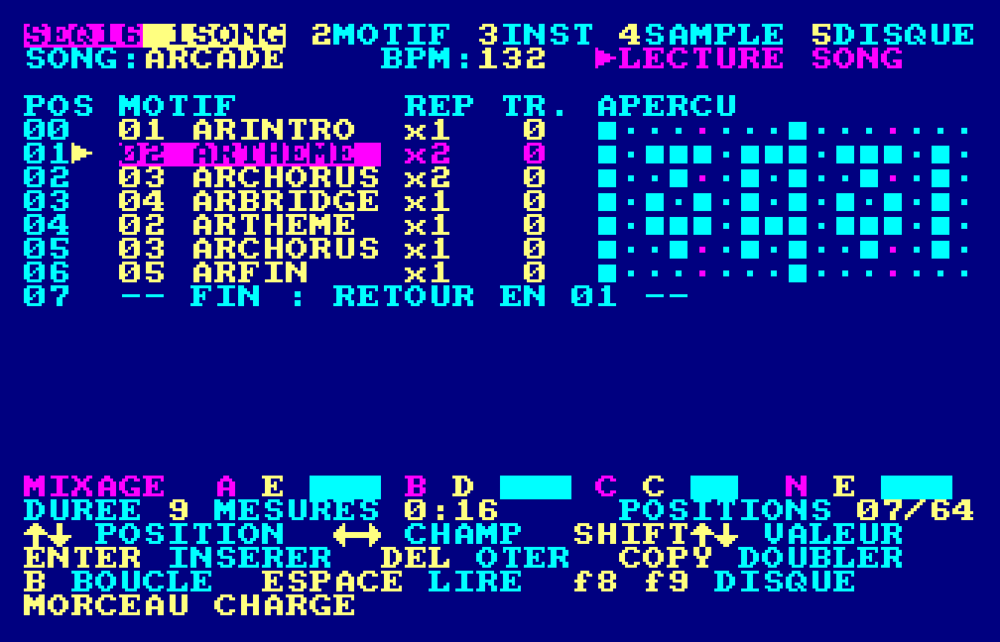
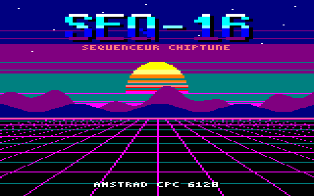
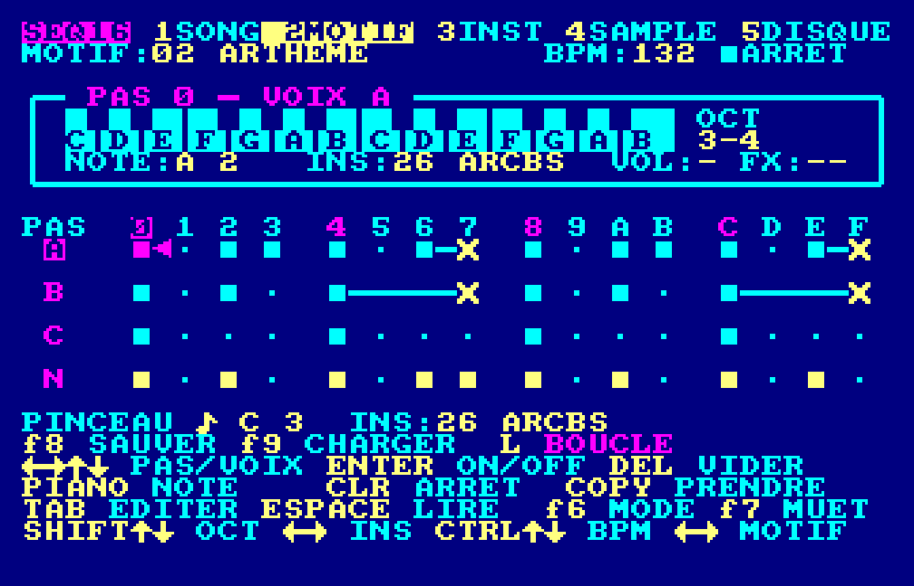
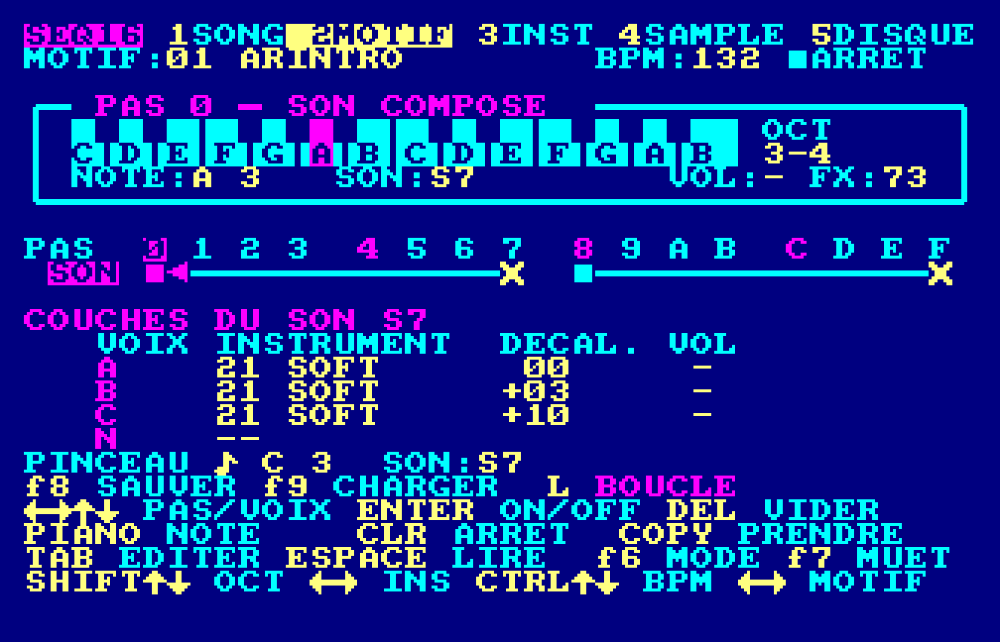
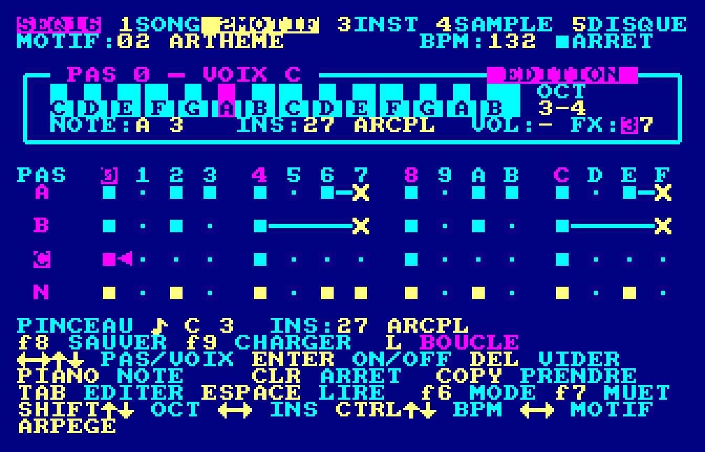
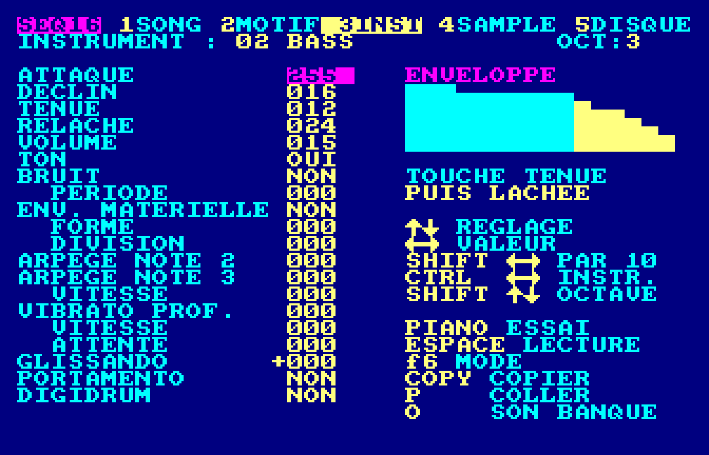
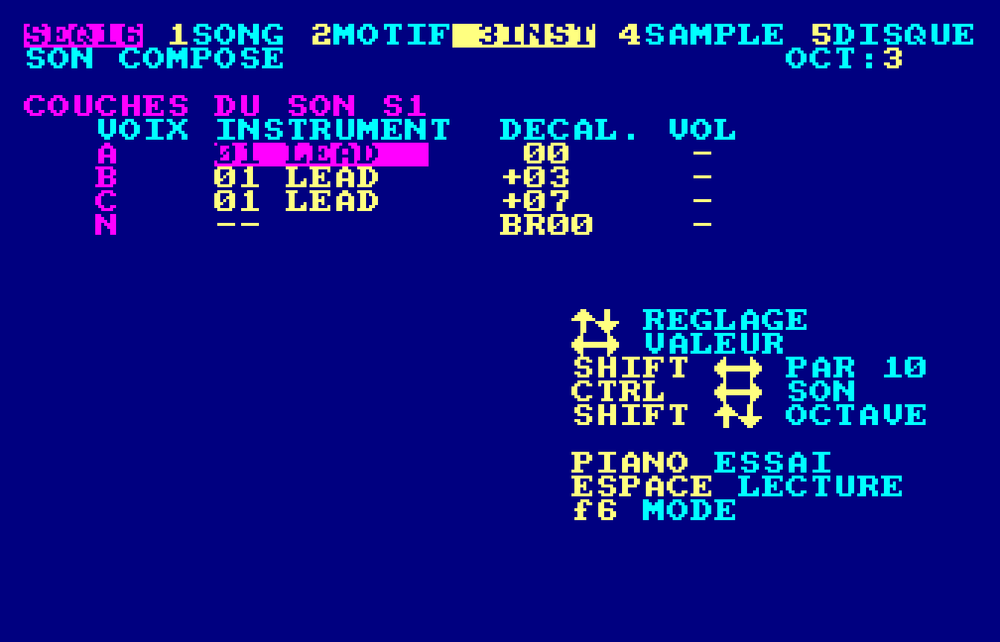
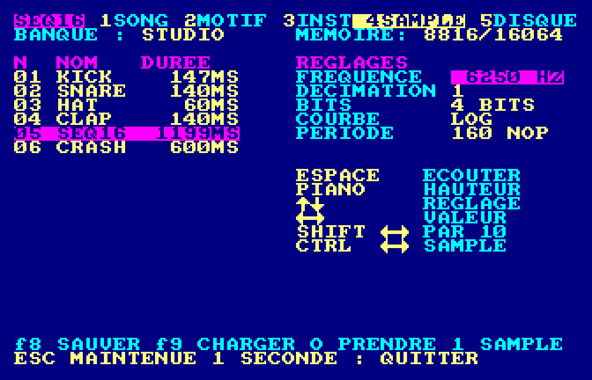
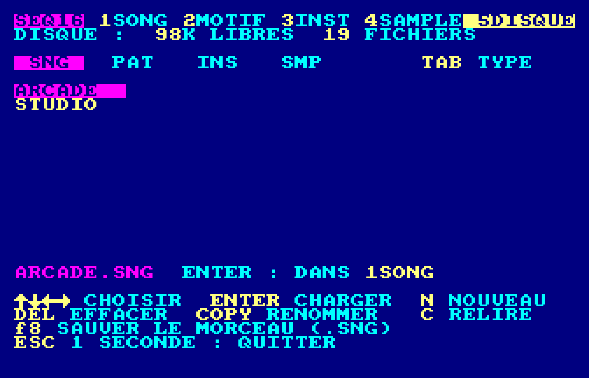
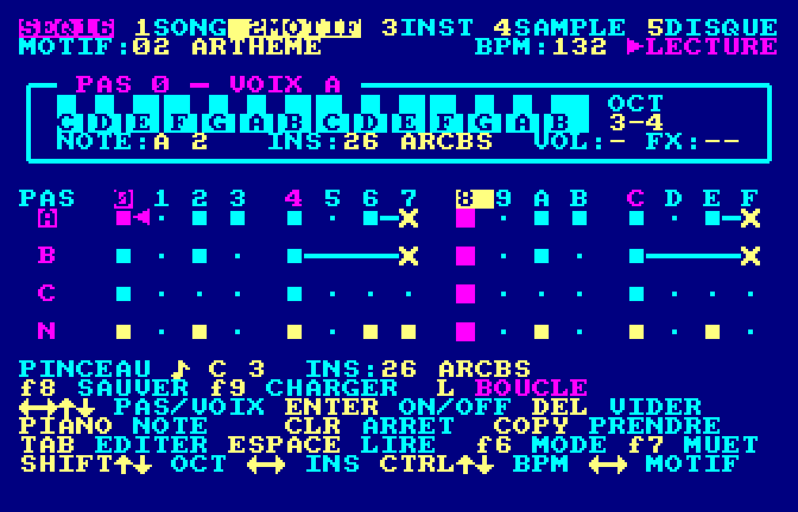

<div align="center">

```
███████╗███████╗ ██████╗        ██╗ ██████╗
██╔════╝██╔════╝██╔═══██╗      ███║██╔════╝
███████╗█████╗  ██║   ██║█████╗╚██║███████╗
╚════██║██╔══╝  ██║▄▄ ██║╚════╝ ██║██╔═══██╗
███████║███████╗╚██████╔╝       ██║╚██████╔╝
╚══════╝╚══════╝ ╚══▀▀═╝        ╚═╝ ╚═════╝
   S E Q U E N C E U R   C H I P T U N E  ·  A M S T R A D   C P C   6 1 2 8

Ready
RUN"SEQ16
█
```

**Un séquenceur chiptune 4 voix (3 tons + bruit) pour Amstrad CPC 6128, écrit en assembleur Z80.**
32 motifs de 16 pas, enchaînés en morceau (64 positions, répétitions, transposition, boucle), 32 instruments, 8 sons composés, 7 effets par pas, et un **sampler** qui joue de vrais sons enregistrés (batterie, voix…) sur la puce sonore du CPC, avec un grain réglable en direct. Le parti pris : la dégradation du son est recherchée.
La disquette est livrée avec **13 banques d'instruments (416 sons), 8 banques de samples (la 9e, `CHIFFRES`, est sur `seq16-samples.dsk`), 125 motifs d'usine** et une **disquette de démonstration** avec deux morceaux complets.


[](https://github.com/ChristopheCruz/CPC-SEQ-16/releases/latest)
[](https://www.buymeacoffee.com/ChristopheCruz)

🇫🇷 Français · [🇬🇧 English](README.md) · [🇪🇸 Español](README.es.md)

🌐 **Site, mode d'emploi et vidéo : [seq16.slr-ai.com](https://seq16.slr-ai.com/fr/)**



</div>

---

## Sommaire

- [Essayer tout de suite](#-essayer-tout-de-suite)
- [La disquette de démonstration](#-la-disquette-de-démonstration)
- [Sur un vrai CPC avec un Gotek](#-sur-un-vrai-cpc-avec-un-gotek)
- [Les cinq panneaux](#️-les-cinq-panneaux)
- [Les touches](#️-les-touches)
  - [f1 — SONG](#f1--song-le-morceau)
  - [f2 — MOTIF](#f2--motif-le-séquenceur)
  - [f3 — INST](#f3--inst-instruments-et-sons-composés)
  - [f4 — SAMPLE](#f4--sample-le-sampler)
  - [f5 — DISQUE](#f5--disque-le-catalogue)
- [Les effets des pas (FX)](#-les-effets-des-pas-fx)
- [Les fichiers](#-les-fichiers)
- [Les banques de sons](#-les-banques-de-sons)
- [Les motifs d'usine](#-les-motifs-dusine)
- [Le sampler : samples et digidrums](#-le-sampler--samples-et-digidrums)
- [La mémoire et le temps réel](#-la-mémoire-et-le-temps-réel)
- [Tester](#-tester)
- [Réassembler](#️-réassembler)
- [Organisation du code](#-organisation-du-code)
- [Feuille de route](#️-feuille-de-route)
- [Remerciements](#-remerciements)
- [Licence](#-licence)

## 💾 Essayer tout de suite

1. Télécharge **[`seq16-fr.dsk`](https://github.com/ChristopheCruz/CPC-SEQ-16/releases/latest)** depuis la dernière release (une copie se trouve aussi dans [`build/`](build/)).
   - **English version:** `seq16-en.dsk`. **Versión en español:** `seq16-es.dsk`. Même programme, mêmes fichiers, mêmes touches : seuls les textes de l'écran changent.
   - **Démonstration :** `build/seq16-demo-fr.dsk` (et `-en`, `-es`) : le programme et deux morceaux complets, voir [La disquette de démonstration](#-la-disquette-de-démonstration).
   - **Banques seules :** `seq16-inst.dsk` (13 banques d'instruments `.INS`) et `seq16-samples.dsk` (9 banques de samples `.SMP`), des disquettes de données sans le programme.
   - **Motifs d'usine :** `seq16-motifs-mono.dsk` (62 motifs en son composé) et `seq16-motifs-poly.dsk` (63 motifs en voix séparées). Voir [Les motifs d'usine](#-les-motifs-dusine).
2. Insère la disquette dans un émulateur (WinAPE, Caprice32, ACE-DL, RetroVirtualMachine…) réglé en **CPC 6128**.
3. Tape :

```basic
RUN"SEQ16
```

L'écran de chargement s'affiche pendant que le programme se charge (`RUN"SEQ16.BIN` le lance directement, sans écran).

<p align="center"></p>

Le programme démarre sur le panneau **MOTIF**, avec **SYNTH**, la song synthwave d'usine (la mineur, 108 BPM, Am - F - C - G : basse en octaves, arpèges, lead avec vibrato, accords en son composé). **ESPACE** joue le motif affiché ; sur **f1 SONG**, **ESPACE** joue toute la song. Elle est aussi sur la disquette (`SYNTH.SNG`), et **N N** (nouveau morceau) la remet.
Pour quitter, maintiens **ESC** une seconde : un simple appui ne suffit pas, pour ne pas perdre son travail par erreur.

SEQ-16 demande un **CPC 6128** (il range les motifs dans la mémoire supplémentaire) : sur un 464, ou un 664 sans extension, il le dit au démarrage.

## 🎮 La disquette de démonstration

`seq16-demo-fr.dsk` contient le programme, deux morceaux, leurs 10 motifs, leurs instruments et leurs samples. Sur le panneau **f1 SONG**, **f9** choisit un morceau, **ESPACE** le joue.

| Morceau | Style | Ce qu'il montre |
|---|---|---|
| **ARCADE** | chiptune, la mineur, 132 BPM, **sans sample** | l'intro et le refrain en **son composé** (une seule voix qui joue un accord), le thème et le pont en voix séparées, et les **7 effets des pas** : vibrato, arpège, basse qui descend, roulement de caisse, accords répétés, basse coupée, lead qui monte, charleston en retard, chute en laser |
| **STUDIO** | ré mineur, 100 BPM, **avec samples** | une batterie en samples (digidrums), un crash, et la voix « SEQ seize », un **sample long** qui ouvre le morceau et revient au break. Sa banque `STUDIO.SMP` se charge avec le morceau |

Pendant la voix de STUDIO, les autres sons s'arrêtent : c'est normal, un sample prend tout le processeur (voir [Les digidrums](#les-digidrums--des-samples-dans-le-morceau)).
La disquette est fabriquée par [`tools/gen_demo.py`](tools/gen_demo.py) ; [`demo/LISTE.md`](demo/LISTE.md) décrit chaque motif.

## 🔌 Sur un vrai CPC avec un Gotek

Pour jouer sur la machine réelle, il faut copier `seq16-fr.dsk` sur la clé USB d'un lecteur Gotek (firmware FlashFloppy ou HxC).
L'outil compagnon **[CPC DISK](https://github.com/ChristopheCruz/CPC-DISK)** s'en charge : c'est un éditeur d'images `.dsk` à l'allure d'écran CPC, en Python pur, sans dépendance. Il sert à :

- ouvrir `seq16-fr.dsk` et parcourir son catalogue AMSDOS ;
- récupérer les morceaux `.SNG` sauvés sur la disquette, ou en ajouter ;
- préparer la clé USB du Gotek.

## 🖥️ Les cinq panneaux

Cinq panneaux, à choisir avec les touches de fonction du pavé numérique. Les onglets en haut de l'écran montrent le panneau en cours.
Dans chaque panneau, **f8** sauve et **f9** charge le fichier qui lui correspond.

<table>
<tr>
<td width="50%" align="center">
<br>
<b>f1 · SONG</b><br>
<sub>L'enchaînement des motifs : 64 positions, répétitions, transposition, boucle, et le mixage des voix.</sub>
</td>
<td width="50%" align="center">
<br>
<b>f2 · MOTIF, voix séparées</b><br>
<sub>Les voix A, B, C et le bruit N sur 16 pas ; en haut, la note du curseur, son instrument, son volume et son effet.</sub>
</td>
</tr>
<tr>
<td width="50%" align="center">
<br>
<b>f2 · MOTIF, son composé</b><br>
<sub>Une seule ligne de notes qui joue un son composé sur les 4 voix à la fois ; ses couches s'affichent dessous.</sub>
</td>
<td width="50%" align="center">
<br>
<b>f2 · Un effet (FX)</b><br>
<sub>TAB : le panneau du pas s'édite ; ici l'effet ARPEGE (37) d'une case.</sub>
</td>
</tr>
<tr>
<td width="50%" align="center">
<br>
<b>f3 · INST, instruments</b><br>
<sub>Enveloppe dessinée en direct, bruit, enveloppe matérielle, arpège, vibrato, glissando, portamento, digidrum.</sub>
</td>
<td width="50%" align="center">
<br>
<b>f3 · INST, sons composés</b><br>
<sub>f6 : les 8 sons composés, voix par voix : instrument, décalage, volume.</sub>
</td>
</tr>
<tr>
<td width="50%" align="center">
<br>
<b>f4 · SAMPLE</b><br>
<sub>La banque de samples à gauche, le grain du sample choisi à droite (ici la banque du morceau STUDIO).</sub>
</td>
<td width="50%" align="center">
<br>
<b>f5 · DISQUE</b><br>
<sub>Le catalogue par type de fichier ; ENTER charge le fichier dans son panneau.</sub>
</td>
</tr>
</table>

<p align="center"><br><sub>f2 · En lecture : le pas joué est suivi à l'écran, la musique ne s'interrompt pas pendant les dessins.</sub></p>

## ⌨️ Les touches

### f1 — SONG (le morceau)

Un morceau enchaîne jusqu'à **64 positions**. Chaque position joue un motif, un certain nombre de fois (1 à 16), transposé de −12 à +12 demi-tons (les voix A, B et C ; le bruit ne bouge pas). Une colonne APERCU montre les pas du motif.

| Touches | Effet |
|---|---|
| ↑/↓ | choisir une position (sous la ligne FIN : le mixage) |
| ←/→ | choisir un champ : motif, répétitions, transposition (dans le mixage : la voix) |
| SHIFT + ↑/↓ | changer la valeur du champ (dans le mixage : le volume de la voix) |
| ENTER | insérer une position |
| DEL | ôter la position |
| COPY | doubler la position |
| B | la boucle part d'ici ; **B sur la position de la boucle la retire** : la ligne FIN dit alors `ARRET` et la lecture s'arrête à la fin du morceau |
| ESPACE | lire le morceau depuis la position du curseur / arrêter |
| f8 / f9 | sauver / charger un morceau `.SNG` |

- **Le repère ►** suit la position jouée ; **↑** marque le départ de la boucle.
- **Le nom d'un motif** est celui de son fichier `.PAT` (sauvé ou chargé) : il apparaît dans SONG et dans MOTIF.
- **La ligne MIXAGE** règle le volume général de chaque voix (A, B, C, N), sauvé avec le morceau. Le circuit sonore envoie la voie A à gauche, la voie C à droite et la voie B des deux côtés : selon l'écoute, une voie peut paraître plus forte que les autres ; on l'équilibre ici.
- **La ligne DUREE** donne la longueur du morceau (mesures, minutes) et le nombre de positions.
- **Dans le panneau MOTIF**, le morceau n'avance pas : le motif affiché boucle, on change de motif soi-même. Au retour dans SONG, le morceau reprend.

### f2 — MOTIF (le séquenceur)

La grille : les voix A, B, C et N (bruit) sur 16 pas, ou une seule ligne `SON` en mode son composé. Au-dessus, le **panneau du pas** : le pas et la voix du curseur, un clavier de 2 octaves, et la note, l'instrument, le volume et l'effet de la case.

| Touches | Effet |
|---|---|
| Flèches | déplacer le curseur (pas / voix) ; on entend la note sur laquelle on arrive |
| Touches du piano | poser une note avec l'instrument du pinceau, l'entendre, passer au pas suivant |
| ENTER | allumer la case avec le pinceau, ou l'éteindre |
| DEL | vider la case |
| CLR | arrêt de note (`X`) |
| COPY | prendre la case comme pinceau (note et instrument) |
| TAB | éditer le panneau du pas : ←/→ choisit NOTE, INS, VOL, puis les deux chiffres du FX (l'effet, sa force) ; ↑/↓ change la valeur ; TAB à nouveau revient à la grille |
| CAPS LOCK | verrouiller l'instrument du pinceau (`VERROU`) |
| ESPACE | lecture / arrêt |
| L | **BOUCLE** (le motif se répète) ou **1 FOIS** (une lecture, puis arrêt) |
| f6 | voix séparées / son composé |
| f7 | rendre muette (ou audible) la voix du curseur |
| SHIFT + ↑/↓ | octave de saisie |
| SHIFT + ←/→ | instrument du pinceau (et de la note sous le curseur) |
| CTRL + ↑/↓ | tempo en BPM |
| CTRL + ←/→ | motif précédent / suivant (32 motifs) ; pendant la lecture, la musique continue |
| f8 / f9 | sauver / charger le motif affiché (`.PAT`) |

Une note tenue est prolongée par un trait jusqu'à son arrêt. Une voix muette s'affiche en jaune pâle.

### f3 — INST (instruments et sons composés)

**f6** passe des instruments aux sons composés, et inversement.

**Les instruments :**

| Touches | Effet |
|---|---|
| ↑/↓ | choisir un réglage |
| ←/→ | changer sa valeur (avec SHIFT : par 10) |
| CTRL + ←/→ | instrument précédent / suivant (32 instruments) |
| SHIFT + ↑/↓ | octave d'essai |
| Touches du piano | essayer l'instrument |
| ESPACE | écouter le motif avec le son modifié |
| COPY | copier l'instrument (réglages et nom) |
| P | coller : l'instrument copié remplace l'instrument affiché |
| O | prendre un son dans une banque `.INS` de la disquette : on choisit la banque, puis l'un de ses 32 sons (flèches, RETURN ; ESC annule) |
| f8 / f9 | sauver / charger une banque d'instruments `.INS` |

- Le dessin de l'enveloppe se met à jour à chaque changement d'attaque, de déclin, de tenue ou de relâche.
- Les instruments 25 à 28 (`USER1` à `USER4`) sont libres pour créer ses propres sons ; les instruments 29 à 32 sont les digidrums d'usine (`DGKICK`, `DGSNAR`, `DGHAT`, `DGCLAP`).
- **Le réglage DIGIDRUM** (le dernier) : à `OUI`, l'instrument joue un sample au lieu d'une note. La ligne `PERIODE` devient alors `SAMPLE` suivi du nom du sample : sa valeur est le numéro du sample dans la banque (0 = le premier). Voir [Les digidrums](#les-digidrums--des-samples-dans-le-morceau).

**Les sons composés (f6) :** un son composé joue jusqu'à 4 instruments à la fois, un par voix, à partir d'une seule note. Le tableau montre ses 4 voix.

| Touches | Effet |
|---|---|
| ↑/↓ | choisir un champ : pour chaque voix, l'instrument, le décalage, le volume |
| ←/→ | changer sa valeur (avec SHIFT : par 10) |
| CTRL + ←/→ | son composé précédent / suivant (S1 à S8) |
| Touches du piano | essayer le son composé |

| Champ | Valeurs |
|---|---|
| INSTRUMENT | `--` (voix inutilisée) ou 01 à 32 |
| DECAL. | décalage en demi-tons, de −24 à +24 ; pour la voix N, la période du bruit (`BR00` à `BR1F`) |
| VOL | `-` (le volume de l'instrument) ou 0 à 15 |

Le même tableau s'affiche sous la grille du panneau MOTIF en mode son composé.

### f4 — SAMPLE (le sampler)

| Touches | Effet |
|---|---|
| ESPACE | écouter le sample choisi (ESPACE à nouveau : arrêt) |
| Touches du piano | écouter le sample plus aigu ou plus grave (±12 demi-tons) |
| CTRL + ←/→ | sample précédent / suivant |
| ↑/↓ | choisir un réglage : fréquence, décimation, bits, courbe |
| ←/→ | changer sa valeur (avec SHIFT : par 10, pour la fréquence) |
| O | prendre un sample dans une autre banque `.SMP` : il s'ajoute à la fin de la banque en mémoire (16 samples et 16 Ko au plus) |
| f8 / f9 | sauver la banque (réglages et samples ajoutés compris) / charger une autre banque `.SMP` |

La première fois que l'on ouvre SAMPLE, la banque `DRUMS.SMP` se charge toute seule. Tout est détaillé plus bas, dans [le mode d'emploi du sampler](#mode-demploi-des-samples-pas-à-pas).

### f5 — DISQUE (le catalogue)

Le catalogue de la disquette, par type de fichier : `SNG` (morceaux), `PAT` (motifs), `INS` (instruments), `SMP` (samples). En haut, la place libre et le nombre de fichiers.

| Touches | Effet |
|---|---|
| Flèches | choisir un fichier |
| TAB | type suivant (SNG, PAT, INS, SMP) |
| ENTER | charger le fichier dans son panneau, qui s'affiche (un `.PAT` va dans le motif affiché) |
| DEL | effacer le fichier (appuyer deux fois ; `\|ERA` d'AMSDOS) |
| COPY | renommer le fichier (`\|REN`) |
| N | nouveau morceau (appuyer deux fois) |
| C | relire la disquette (après en avoir changé) |
| ESPACE | écouter le motif |
| f8 | sauver le morceau `.SNG` |

**Sauver avec f8** (dans n'importe quel panneau) : le nom proposé s'affiche sur la ligne des messages ; tape le nom (8 lettres ou chiffres au plus), puis RETURN ; ESC annule. Si le fichier existe déjà, un second RETURN le remplace.

## ✨ Les effets des pas (FX)

Chaque case d'un motif peut porter un **effet**, noté en hexadécimal comme dans les trackers : le premier chiffre choisit l'effet, le second règle sa force x (0 à F). `--` : aucun effet.

| FX | Effet | Ce qui se passe | Exemple |
|---|---|---|---|
| `1x` | MONTE | la note glisse vers l'aigu, plus vite avec x | `14` montée lente |
| `2x` | DESCEND | la note glisse vers le grave | `2C` chute en laser |
| `3x` | ARPEGE | la note, puis la note + x demi-tons, en alternance rapide | `37` quinte, `3C` octave |
| `4x` | REPETE | la note est rejouée toutes les x images (1/50 s) | `43` roulement de caisse |
| `5x` | COUPE | la note est relâchée après x images | `52` staccato |
| `6x` | RETARD | la note part x images après le pas | `62` swing, fla |
| `7x` | VIBRATO | vibrato de profondeur x sur cette note | `73` |

- **Pour poser un effet** : sur le panneau MOTIF, mets le curseur sur la case, **TAB**, va sur le FX avec **→** (le premier chiffre, puis le second), et change-le avec **↑/↓**. Le nom de l'effet s'affiche sur la ligne des messages.
- **En son composé**, l'effet du pas vaut pour toutes les voix du son.
- REPETE, COUPE et RETARD marchent aussi sur la voix de bruit.
- **COUPE sur un digidrum** raccourcit le sample : `52` sur un KICK l'arrête après 2 images (40 ms au lieu de 148). Un sample bloque toute la musique pendant qu'il joue ; le couper fait perdre moins de pas.
- L'effet ne vaut que pour la note du pas : le piano et l'écoute d'une case restent sans effet.

Le morceau ARCADE de la [disquette de démonstration](#-la-disquette-de-démonstration) utilise les 7 effets.

## 🎵 Les fichiers

| Fichier | Contenu | Panneau |
|---|---|---|
| `.SNG` | **tout le morceau** : les 32 motifs (et leurs noms), les 32 instruments, les 8 sons composés, le mixage, l'enchaînement (positions, boucle), et **la banque de samples** utilisée, s'il y en a une | SONG, DISQUE |
| `.PAT` | un motif seul (260 octets) : son mode, son tempo et ses 16 pas | MOTIF |
| `.INS` | 32 instruments, leurs noms et les 8 sons composés (848 octets) | INST |
| `.SMP` | une banque de samples (16 au plus, 16 Ko au plus), avec leurs réglages | SAMPLE |

- **Un `.SNG` emporte sa banque de samples** (format version 4) : on peut le copier sur une autre disquette sans rien oublier. Au chargement : `MORCEAU ET BANQUE DE SAMPLES CHARGES`.
- Les morceaux des anciens formats (versions 1 à 3) se chargent toujours.
- Si un fichier du même nom existe, AMSDOS garde l'ancien sous l'extension `.BAK`.

## 🎹 Les banques de sons

Les sons par défaut restent **dans le programme** : au démarrage et après **N N** (nouveau morceau, panneau DISQUE), on retrouve toujours les mêmes 32 instruments. Les banques de la disquette s'y ajoutent.

### Banques d'instruments `.INS` (13 banques, 416 sons)

- **Charger une banque entière** : panneau **INST**, **f9** (ou DISQUE, ENTER sur un `.INS`).
- **Prendre un seul son** pour l'instrument affiché : panneau **INST**, touche **O**, puis choisir la banque et le son.
- **Sauver ses propres instruments** : panneau **INST**, **f8**.

| Banque | Contenu |
|---|---|
| `USINE` | les 32 instruments par défaut du programme (pour les retrouver après une autre banque) |
| `BATTERIE` | grosses caisses, caisses claires, charlestons, toms, cymbales, cloche, claves |
| `BASSES` | basses courtes, longues, glissées, « buzzer », sales, wobble |
| `LEADS` | sons de mélodie : vibratos, portamentos, sync, trilles |
| `NAPPES` | nappes lentes, accords tenus, choeurs, orgues |
| `ARPEGES` | accords arpégés à 3 vitesses : majeur, mineur, 7e, sus, diminué… |
| `EFFETS` | lasers, sirènes, pièces, sauts, explosions, moteurs |
| `BUZZER` | l'enveloppe matérielle de l'AY : 4 formes × 3 divisions, et variantes |
| `CLAVIERS` | pianos, cordes pincées, cloches, orgues, vents |
| `CHIPTUNE` | une banque complète pour un morceau de jeu vidéo |
| `PERCUS` | congas, bongos, claves, triangle, tablas, gong |
| `GLISSES` | portamentos, glissandos vers le haut ou vers le bas |
| `BRUITS` | bruit tenu à 10 hauteurs, vent, pluie, mer, train |

Elles sont fabriquées par [`tools/gen_instruments.py`](tools/gen_instruments.py) (`--list` affiche tous les sons).

### Banques de samples `.SMP` (9 banques)

`DRUMS.SMP` reste la banque par défaut : elle se charge toute seule à la première ouverture de SAMPLE.

| Banque | Contenu | Taille |
|---|---|---|
| `DRUMS` | KICK, SNARE, HAT, CLAP (les digidrums d'usine) | 2 Ko |
| `VOIX` | « bonjour », « Amstrad », « SEQ 16 », « 1, 2, 3, 4 » | 13 Ko |
| `BATTERI2` | batterie façon boîte à rythmes : grosse caisse longue, toms, cloche, crash… (12 sons) | 12 Ko |
| `PERCUS` | congas, bongo, claves, triangle, tambourin, agogo, tabla… (12 sons) | 13 Ko |
| `EFFETS` | laser, zap, explosion, pièce, saut, sirène, alarme, OVNI… (12 sons) | 14 Ko |
| `BASSES` | 10 notes de basse (DO), à jouer avec le piano | 15 Ko |
| `NOTES` | pincé, piano, cloche, orgue, cuivre, choeur, orchestre… (10 notes, DO) | 14 Ko |
| `CHIFFRES` | « zéro » à « dix » (seulement sur `seq16-samples.dsk`) | 11 Ko |
| `MOTS` | « allez », « oui », « non », « encore », « stop », « bravo », « CPC »… (14 mots) | 16 Ko |

La disquette de démonstration ajoute `STUDIO.SMP` (DRUMS, la voix SEQ16 et le CRASH de BATTERI2), la banque du morceau STUDIO.
Tous les sons sont **synthétisés** ([`tools/gen_samples.py`](tools/gen_samples.py)) ou **dits par espeak** : aucun échantillon venu d'Internet, donc aucune question de droits.

## 🎼 Les motifs d'usine

Deux disquettes pleines de motifs tout prêts, pour commencer un morceau, apprendre le séquenceur ou emprunter un groove. Chaque motif est un fichier `.PAT`.

| Disquette | Motifs | Contenu |
|---|---|---|
| `seq16-motifs-mono.dsk` | 62 motifs **mono** | mode **son composé** : une seule ligne de notes jouée par l'un des 8 sons composés : riffs, arpèges, basses, accords plaqués, jingles de jeu |
| `seq16-motifs-poly.dsk` | 63 motifs **poly** | mode **voix séparées** : grooves complets (batterie sur N, basse, accords ou mélodie), plus des briques batterie seule et basse + batterie |

Styles : techno, house, electro, hip-hop, trap, rock, funk, reggae, dub, bossa, salsa, drum & bass, synth-pop, synthwave, disco, chiptune et jingles de jeu, blues, jazz, valse, marche, ambient… de 80 à 170 BPM. La liste complète est dans [`patterns/LISTE.md`](patterns/LISTE.md).

**Charger un motif** : sur le panneau **MOTIF**, affiche l'emplacement à remplir (CTRL + ←/→), mets une disquette de motifs, appuie sur **f9**, choisis avec les flèches (en sortant du bord, la page change), RETURN. Le motif remplace celui qui est affiché, avec son mode, son tempo et son nom. On peut aussi passer par le panneau **DISQUE** (TAB jusqu'à `PAT`, puis ENTER).

**Sauver un motif** : sur le panneau **MOTIF**, **f8**, tape un nom, RETURN : le motif affiché est sauvé seul dans `NOM.PAT`, et prend ce nom.

Les motifs sont écrits pour les **instruments et sons composés d'usine** (aussi dans `USINE.INS`). Quatre motifs poly (`DIGIHOP1`, `DIGIHSE1`, `DIGIFNK1`, `DIGIBRK1`) utilisent les digidrums : charge d'abord une banque de samples.
Ils sont fabriqués par [`tools/gen_patterns.py`](tools/gen_patterns.py), qui vérifie aussi que chaque note est dans la tonalité du motif, dans la tessiture de son instrument, et que deux voix ne se heurtent jamais.

## 🥁 Le sampler : samples et digidrums

SEQ-16 joue des **samples** : un panneau **SAMPLE** pour écouter et salir un son, et des **digidrums**, des samples déclenchés au pas comme une note.
Le parti pris est assumé : **la dégradation est recherchée**. Grain, repliement de spectre, souffle et hachures sont des effets voulus et réglables.

Le CPC n'a pas de convertisseur numérique-analogique. Il joue un sample en changeant très vite le **volume** d'une voie de l'AY : 16 niveaux sur une courbe presque logarithmique. C'est ce qui donne le grain.

### Mode d'emploi des samples, pas à pas

**1. Ouvrir le sampler.** Appuie sur **f4**. La première fois, la banque `DRUMS.SMP` se charge toute seule, et ses 4 sons s'affichent à gauche.

**2. Écouter.**
- Choisis un sample avec **CTRL + ←/→**. Le sample choisi est en magenta inversé.
- **ESPACE** le joue à sa hauteur d'origine. ESPACE à nouveau l'arrête.
- **Les touches du piano** le jouent plus aigu ou plus grave : la rangée du haut, à partir de la touche du DO, part de la hauteur d'origine et monte de demi-ton en demi-ton ; la rangée du bas joue une octave plus bas.
- Pendant l'écoute, l'écran ne bouge plus : c'est normal.

**3. Salir le son.** À droite, choisis un réglage avec **↑/↓** et change sa valeur avec **←/→** (pour la fréquence, avec SHIFT, par pas de 10). Réécoute après chaque changement.

| Réglage | Valeurs | Effet |
|---|---|---|
| FREQUENCE | 4 000 à 16 129 Hz | la hauteur et la brillance ; plus bas, c'est plus grave et plus sale |
| DECIMATION | 1, 2, 3, 4, 6, 8 | un échantillon sur N, maintenu N fois : des sifflements métalliques apparaissent |
| BITS | 4, 3, 2, 1 | moins de niveaux ; en 1 bit, il ne reste qu'un « bip » dur et faible |
| COURBE | LOG, LINEAIRE, SATUREE, REPLIEE, INVERSEE | LOG est le son d'origine ; LINEAIRE est plus creux, SATUREE écrête, REPLIEE replie ce qui dépasse, INVERSEE retourne la forme d'onde |
| PERIODE | (information) | la durée d'un échantillon en µs, c'est-à-dire en NOP |

**4. Changer de banque.** **f9**, choisis le fichier `.SMP` avec les flèches, RETURN (ESC annule).

**5. Sauver la banque** avec ses réglages et les samples ajoutés : **f8**.

**6. Fabriquer ses propres sons.** Sur le PC, convertis tes fichiers WAV avec [`tools/wav2smp.py`](#convertir-ses-propres-sons--toolswav2smppy), ou avec l'éditeur graphique de [CPC DISK](#léditeur-graphique-de-banques-sur-pc--longlet-samples-seq-16-de-cpc-disk).

**À savoir** : une banque tient en 16 Ko au plus (environ 4 secondes à 8 kHz, 5 secondes à 6,25 kHz) et contient 16 sons au plus.

### Les digidrums : des samples dans le morceau

Un **digidrum** est un instrument qui joue un sample de la banque chargée au lieu d'une note. Les 4 instruments d'usine 29 à 32 (`DGKICK`, `DGSNAR`, `DGHAT`, `DGCLAP`) jouent les 4 sons de `DRUMS.SMP`.

**Pour en faire un soi-même**, sur le panneau **INST** :

1. Mets le dernier réglage, **DIGIDRUM**, à `OUI`.
2. La ligne `PERIODE` devient `SAMPLE` et affiche le nom du sample. Change sa valeur avec ←/→ : 0 = le premier sample de la banque, 1 = le deuxième…
3. Le **VOLUME** règle la force du sample (15 = plein). Les autres réglages ne servent pas.
4. Essaie-le avec le piano.

**Dans le motif**, pose ce digidrum comme une note :

- **la hauteur** : la note **DO de l'octave 4** joue le sample tel quel ; chaque demi-ton au-dessus ou au-dessous le rend plus aigu ou plus grave, jusqu'à ±12 demi-tons ;
- **la voix** choisit la voie de l'AY : A, B ou C. Sur la voix N (bruit), le sample joue sur la voie C ;
- **une voix muette** (f7) ne joue pas ses digidrums.

**Un sample prend tout le processeur.** Il joue en entier, interruptions coupées. Pendant ce temps :

- l'écran et le clavier ne répondent plus ;
- le séquenceur s'arrête et les autres voix sont **gelées** (leurs enveloppes, arpèges et vibratos ne bougent plus) ;
- à la fin du sample, le séquenceur **rattrape le tempo** : les pas tombés pendant le sample sont joués d'un coup, puis la musique repart à l'heure.

Avec des sons courts (moins de 150 ms, comme ceux de `DRUMS.SMP`), cela ne s'entend presque pas. Un sample long (la voix du morceau STUDIO) coupe les autres sons le temps qu'il joue : c'est le prix de la qualité du sample.
Autre point : quand on change de sample, ou de hauteur ou de volume, le programme doit d'abord **préparer les tables** de lecture du sample, ce qui peut prendre jusqu'à environ 300 ms. Dans un motif qui alterne beaucoup de samples différents, cela peut s'entendre comme un petit accroc.

### L'éditeur graphique de banques (sur PC) : l'onglet SAMPLES SEQ-16 de CPC DISK

Une application de bureau pour fabriquer une banque `.SMP` à partir de fichiers WAV, sans ligne de commande. Elle fait partie de **CPC DISK**, l'éditeur de disquettes : c'est son onglet **SAMPLES SEQ-16**, en français, en anglais ou en espagnol. Un seul programme Windows, `cpc-dsk-gui.exe`, sert donc à faire les banques et à les mettre sur la disquette (et sur la clé du Gotek).

```bat
python tools\smp_gui.py          rem l'éditeur seul, dans sa fenêtre
```

- **À gauche**, la liste des samples (16 au plus) : ajouter des WAV (Ctrl+W, plusieurs à la fois), ouvrir une banque `.SMP` existante (Ctrl+O), retirer, monter, descendre. Une jauge montre la place prise sur les 16 064 octets de la mémoire du CPC ; elle passe au rouge si la banque est trop grande.
- **À droite**, les réglages du sample choisi : nom (6 caractères), fréquence, saturation, coupure des silences, adoucissement, tramage, bits, décimation, courbe, découpe en tranches. La forme d'onde montre l'original en haut et le rendu du CPC en bas.
- **Écouter** l'original ou le rendu du CPC.
- **Sauver .SMP** (Ctrl+S), puis **Ajouter à la disquette**.

Le code est dans CPC DISK (`cpc_dsk/seq16/`) ; `tools/smp_gui.py`, `tools/smp_model.py` et `tools/wav2smp.py` y renvoient.

### Convertir ses propres sons : `tools/wav2smp.py`

Python 3, bibliothèque standard uniquement. Entrée : des WAV mono ou stéréo, 8 ou 16 bits, à n'importe quelle fréquence.

```bat
rem un son par fichier, à 8 kHz (par défaut)
python tools\wav2smp.py kick.wav snare.wav -o samples\MABANK.SMP -v

rem une boucle de batterie découpée en 8 tranches, à 6 kHz
python tools\wav2smp.py boucle.wav --slice 8 --rate 6000 -o samples\BOUCLE.SMP

rem très sale : saturé, 2 bits, un échantillon sur 3
python tools\wav2smp.py voix.wav --drive 4 --bits 2 --decim 3 -o samples\SALE.SMP

rem ajouter la banque à la disquette build\seq16-fr.dsk
python tools\wav2smp.py son.wav -o samples\SON.SMP --dsk

rem voir le contenu d'une banque
python tools\wav2smp.py --info samples\DRUMS.SMP
```

| Option | Effet |
|---|---|
| `--rate` | fréquence de 4 000 à 16 000 Hz. Plus bas, c'est plus sale et plus court en mémoire |
| `--drive` | gain avant écrêtage (1 = rien, 4 = très saturé). Remonte aussi les fins de son |
| `--clean` | ajoute un filtre avant le rééchantillonnage, pour moins de repliement |
| `--bits 4/3/2/1` | moins de niveaux |
| `--dither noise` | tramage : un souffle remplace les marches |
| `--decim` | 1, 2, 3, 4, 6 ou 8 : un échantillon sur N est maintenu N fois. Ce réglage est stocké, il ne détruit rien |
| `--slice N` | découpe chaque WAV en N tranches égales |
| `--names` | noms des samples (6 caractères), séparés par des virgules |
| `--dsk` | ajoute la banque à `build/seq16-fr.dsk` (ou à la disquette indiquée) |
| `--trim` | retire les silences au début et à la fin de chaque son |
| `-v` | affiche la taille et la durée, et prévient au-delà de 16 Ko |

Chaque conversion écrit aussi des WAV d'écoute à côté de la banque, qui simulent le rendu du CPC. Une seconde à 8 kHz occupe 4 Ko.

### Le format `.SMP`

Le format est décrit en détail en tête de `cpc_dsk/seq16/wav2smp.py`, dans CPC DISK :

- un en-tête `SQSM` de 16 octets (version 1) ;
- une fiche de 16 octets par sample : nom, position, longueur, fréquence, boucle, drapeaux, réglages ;
- les données, 2 échantillons de 4 bits par octet.

La fréquence est stockée comme la durée d'un échantillon en NOP (µs), de 62 à 250 : c'est directement le réglage de la boucle de lecture du Z80. Chaque échantillon est un code de niveau de l'AY, de 0 à 15. La table des 16 niveaux de l'AY vient de l'émulateur open source [Ayumi](https://github.com/true-grue/ayumi) (licence MIT).

## 🧠 La mémoire et le temps réel

- **Mémoire principale** : le programme, le morceau en cours et le tampon d'AMSDOS occupent `#3F00` à `#9FFF`. La banque de samples est en mémoire basse (`#0040-#3EFF`, 16 064 octets), la routine de lecture des samples et ses tables en zone haute (`#A000-#A67B`, sous la mémoire d'AMSDOS).
- **Mémoire supplémentaire du 6128** : le **bloc 4** garde les 32 motifs (seul le motif affiché est en mémoire principale, et le motif suivant d'un morceau y est préparé à l'avance) ; le **bloc 5** garde le morceau d'usine, que **N N** relit. Les blocs 6 et 7 sont libres pour la suite.
- **La musique ne s'arrête pas pendant les dessins.** Sur le vrai CPC, le firmware écrit un caractère en 3,5 ms environ : redessiner un écran prend plus d'une seconde. Chaque caractère écrit laisse donc la main au son, et les images de son en retard sont rattrapées : les pas tombent à l'heure, même au changement de motif.
- **Les erreurs de disque** affichent le code d'AMSDOS et le nombre d'octets lus (par exemple `ERREUR DISQUE (DISQUETTE ? NOM ?) 0F03E8`), pour savoir où et pourquoi un chargement a échoué.

## 🧪 Tester

```bat
pip install z80
python -m unittest discover -s tools -p "test_*.py"
```

Plus de 220 tests. La plupart font tourner le vrai `SEQ16.BIN` dans un CPC simulé ([`tools/cpcsim.py`](tools/cpcsim.py)) : chaque routine du firmware y est remplacée par une version simulée qui modifie les registres comme le vrai firmware ; le PPI, l'AY, la mémoire supplémentaire, AMSDOS (avec ses règles : un seul fichier ouvert, fin de fichier « douce » sur l'octet `#1A`…) et l'écran texte sont modélisés, et le temps est compté en NOP. Un CPC « lent » écrit chaque caractère en 3,5 ms, comme le vrai firmware.

Ils vérifient entre autres : la lecture au tempo (pas réguliers au changement de motif, même au rythme réel de l'écran), chaque panneau et ses touches, les effets des pas image par image, les sons composés, la sauvegarde et le chargement de tous les fichiers (morceaux avec leur banque de samples compris), les digidrums, les traductions (chaque texte tient dans la place du français), les motifs d'usine, les morceaux de test et la disquette de démonstration.

Les tests lisent les disquettes de `build/` et `build/seq16.sym` : relance `build.bat` après toute modification de `src/`.

## 🛠️ Réassembler

Sous Windows :

1. Place `rasm.exe` dans `tools\` (dépôt [EdouardBERGE/rasm](https://github.com/EdouardBERGE/rasm), page *Releases*).
2. Si tu modifies les instruments et motifs d'usine dans `tools/gen_factory.py`, lance d'abord `python tools\gen_factory.py`.
3. Si tu modifies les sons de batterie (`tools/gen_drums.py`) ou les courbes (`tools/wav2smp.py`), lance `python tools\gen_drums.py` ou `python tools\gen_smp_tables.py`.
4. Si tu modifies les banques : `python tools\gen_instruments.py` (banques `.INS`) et `python tools\gen_samples.py` (banques `.SMP` ; il faut espeak pour les voix).
5. Lance `build.bat`. Il assemble `src/main.asm`, fabrique `build\seq16-fr.dsk` avec toutes les banques, puis les versions anglaise et espagnole, les disquettes de banques et de motifs, les morceaux de test (`build\seq16-songs.dsk`) et la démonstration (`build\seq16-demo-fr.dsk`).
6. Pour refaire les captures d'écran (README et site) : `python tools\snapshots.py` ; pour la vidéo : `python tools\make_video.py fr` (il faut ffmpeg et numpy).

**Les traductions** sont dans [`tools/lang.py`](tools/lang.py) : le source reste en français, et le script en fait une copie par langue où chaque texte affiché est remplacé. Une traduction n'est jamais plus longue que le français (elle est complétée par des espaces) : les trois programmes ont la même taille et les mêmes adresses. Si tu ajoutes un texte au source, ajoute sa traduction ; `python tools/lang.py --check` signale les textes oubliés ou trop longs.

**Il faut aussi le projet CPC DISK**, l'éditeur de disquettes : SEQ-16 utilise sa bibliothèque (`cpc_dsk`) pour écrire sur les disquettes. Place-le à côté de ce projet :

```
_Codes/
├── CPC-SEQ-16/    ce projet
└── CPC-DISK/      l'éditeur de disquettes (ou AmstradCPC, son ancien nom)
```

`tools/cpcdisk.py` le trouve tout seul. Autres possibilités : `pip install -e ../CPC-DISK`, ou la variable d'environnement `CPC_DISK` qui donne son dossier.

## 📁 Organisation du code

| Fichier | Rôle |
|---|---|
| [`src/main.asm`](src/main.asm) | le démarrage, la boucle principale, les touches, le panneau INST, la disquette, la carte de la mémoire |
| [`src/grid.asm`](src/grid.asm) | le panneau MOTIF : la grille, le panneau du pas, l'édition, les couches d'un son composé |
| [`src/songpanel.asm`](src/songpanel.asm) | le panneau SONG : l'enchaînement, la lecture du morceau, le mixage |
| [`src/panels.asm`](src/panels.asm) | f8 / f9 dans chaque panneau |
| [`src/diskpanel.asm`](src/diskpanel.asm) | le panneau DISQUE : catalogue, chargement, effacer, renommer |
| [`src/sngio.asm`](src/sngio.asm) | le `.SNG` version 4 (morceau et banque de samples), lu et écrit octet par octet |
| [`src/song.asm`](src/song.asm) | le morceau en mémoire, les motifs dans le bloc 4 |
| [`src/bank.asm`](src/bank.asm) | la mémoire supplémentaire du 6128 (blocs 4 et 5) |
| [`src/boot.asm`](src/boot.asm) | ce qui ne sert qu'au démarrage : la construction du morceau d'usine (SYNTH, décompressé depuis [`src/factory_song.asm`](src/factory_song.asm), fait par `tools/gen_synth.py`), rangé dans le bloc 5 |
| [`src/seq.asm`](src/seq.asm) | le séquenceur : format du motif, lecture au tempo, BOUCLE / 1 FOIS |
| [`src/sound.asm`](src/sound.asm) | le moteur de son (4 voix, enveloppes, arpège, vibrato, glissando, effets des pas) |
| [`src/factory.asm`](src/factory.asm) | instruments, sons et motifs d'usine (fichier généré) |
| [`src/tables.asm`](src/tables.asm) | tables des notes et des volumes (fichier généré) |
| [`src/firmware.asm`](src/firmware.asm) | les adresses des routines système du CPC utilisées |
| [`src/sample.asm`](src/sample.asm), [`src/smptables.asm`](src/smptables.asm) | la lecture des samples : accès direct à l'AY, chargement d'une banque ; courbes et hauteurs (généré) |
| [`src/smpscreen.asm`](src/smpscreen.asm) | le panneau SAMPLE, la liste de choix des fichiers |
| [`src/banks.asm`](src/banks.asm), [`src/hizone.asm`](src/hizone.asm) | copier / coller d'instruments, banques `.INS` et `.SMP`, digidrums ; routines recopiées en zone haute |
| [`tools/cpcsim.py`](tools/cpcsim.py), `tools/test_*.py` | le CPC simulé et les tests |
| [`tools/lang.py`](tools/lang.py) | les versions anglaise et espagnole |
| [`tools/gen_patterns.py`](tools/gen_patterns.py), [`tools/gen_songs.py`](tools/gen_songs.py), [`tools/gen_demo.py`](tools/gen_demo.py) | les motifs d'usine, les morceaux de test, la disquette de démonstration |
| [`tools/gen_factory.py`](tools/gen_factory.py), [`tools/gen_tables.py`](tools/gen_tables.py), [`tools/gen_instruments.py`](tools/gen_instruments.py), [`tools/gen_samples.py`](tools/gen_samples.py), [`tools/gen_drums.py`](tools/gen_drums.py) | les fichiers générés et les banques |
| [`tools/snapshots.py`](tools/snapshots.py), [`tools/make_video.py`](tools/make_video.py) | les captures d'écran et la vidéo, tournées dans le CPC simulé |
| [`tools/amsdsk.py`](tools/amsdsk.py), [`tools/cpcdisk.py`](tools/cpcdisk.py) | écrire sur une disquette `.dsk`, avec la bibliothèque de CPC DISK |
| [`samples/`](samples/), [`instruments/`](instruments/), [`patterns/`](patterns/), [`songs/`](songs/), [`demo/`](demo/) | banques, motifs, morceaux de test, démonstration |
| [`build/`](build/) | les disquettes prêtes à l'emploi |
| [`snapshots/`](snapshots/) | les captures d'écran de ce README |

## 🗺️ Feuille de route

- [x] Motifs de 16 pas, 32 motifs, 4 voix, son composé
- [x] Cinq panneaux, f8 / f9 partout, panneau DISQUE (catalogue, effacer, renommer)
- [x] Enchaînement des motifs en morceau : 64 positions, répétitions, transposition, boucle
- [x] Édition des sons composés à l'écran
- [x] Les 7 effets des pas (FX)
- [x] `.SNG` qui emporte sa banque de samples
- [x] Copier-coller d'instruments, 13 banques d'instruments, 9 banques de samples, 125 motifs d'usine
- [x] Samples : convertisseur, lecture sur CPC, panneau SAMPLE, digidrums, éditeur graphique sur PC
- [x] Disquette de démonstration
- [ ] Renommer les instruments
- [ ] Copier-coller de blocs de pas
- [ ] Samples : tables gardées dans la mémoire supplémentaire, mode HACHÉ, finitions du panneau SAMPLE

## 🙏 Remerciements

SEQ-16 repose sur le travail d'autres personnes. Merci à elles.

**Outils et bibliothèques**
- [RASM](https://github.com/EdouardBERGE/rasm), l'assembleur Z80 d'Édouard Bergé : il assemble le programme et écrit la disquette.
- [z80](https://github.com/kosarev/z80), l'émulateur Z80 pour Python d'Ivan Kosarev : il fait tourner le CPC simulé des tests.
- [Ayumi](https://github.com/true-grue/ayumi), l'émulateur d'AY-3-8912 de Peter Sovietov (licence MIT) : sa table de volumes sert au convertisseur de samples.
- [eSpeak NG](https://github.com/espeak-ng/espeak-ng) : les voix des banques de samples `VOIX`, `CHIFFRES` et `MOTS`.
- [CPC DISK](https://github.com/ChristopheCruz/CPC-DISK) : la bibliothèque disque, et l'éditeur de banques de samples (son onglet SAMPLES SEQ-16).
- [Python](https://www.python.org/) et [tkinter](https://docs.python.org/3/library/tkinter.html) : les outils, les tests et l'éditeur.
- Polices [Press Start 2P](https://fonts.google.com/specimen/Press+Start+2P) de CodeMan38 et [VT323](https://fonts.google.com/specimen/VT323) de Peter Hull ([SIL Open Font License 1.1](https://openfontlicense.org/)).

**Documentation et références**
- [CPCWiki](https://www.cpcwiki.eu/) : le firmware du CPC, la puce sonore AY-3-8912, AMSDOS et le format des images DSK.
- [Un exemple de chargeur](https://cpcwiki.eu/index.php/Programming:An_example_loader) et l'[Amstrad Whole Memory Guide](https://cpcwiki.eu/index.php/Amstrad_Whole_Memory_Guide_-_The_machine_pack) (CPCWiki), et le [manuel du firmware du 6128](https://archive.org/stream/SOFT968TheAmstrad6128FirmwareManual/SOFT968%20-%20The%20Amstrad%206128%20Firmware%20manual_djvu.txt) (SOFT968, archive.org) : la routine `MC START PROGRAM`, qui lance le programme après l'écran de chargement.
- [HxC2001](https://hxc2001.com/) et [FlashFloppy](https://github.com/keirf/FlashFloppy) : les firmwares du Gotek et leur documentation.

**Tests**
- [WinAPE](http://www.winape.net/) : l'émulateur qui a servi à essayer les disquettes.

## 📜 Licence

[MIT](LICENSE) : tu peux utiliser, copier, modifier et partager SEQ-16, banques de sons et motifs d'usine compris, à condition de garder la mention du copyright. Amstrad et CPC sont des marques de leurs propriétaires respectifs ; SEQ-16 est un projet indépendant.

---

<div align="center">

<sub>Fait avec ♥ pour le CPC · voir aussi <a href="https://github.com/ChristopheCruz/CPC-DISK">CPC DISK</a>, l'éditeur de disquettes <code>.dsk</code></sub>

</div>
