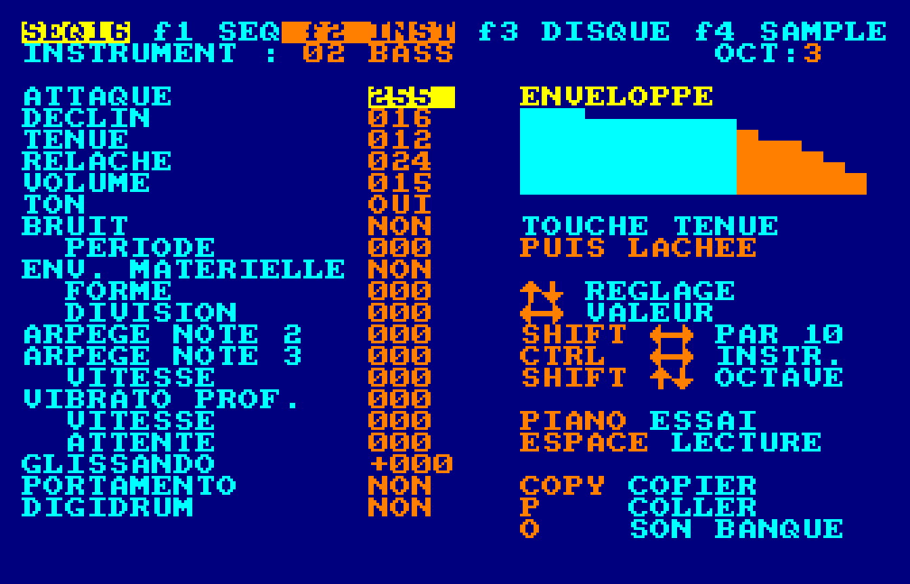

<div align="center">

```
███████╗███████╗ ██████╗        ██╗ ██████╗
██╔════╝██╔════╝██╔═══██╗      ███║██╔════╝
███████╗█████╗  ██║   ██║█████╗╚██║███████╗
╚════██║██╔══╝  ██║▄▄ ██║╚════╝ ██║██╔═══██╗
███████║███████╗╚██████╔╝       ██║╚██████╔╝
╚══════╝╚══════╝ ╚══▀▀═╝        ╚═╝ ╚═════╝
   S E Q U E N C E U R   C H I P T U N E  ·  A M S T R A D   C P C   6 1 2 8

Ready
RUN"SEQ16
█
```

**Un séquenceur chiptune 4 voix (3 tons + bruit) pour Amstrad CPC 6128, écrit en assembleur Z80.**
16 pas par motif, 32 motifs, 32 instruments, sauvegarde des morceaux sur disquette.
Et un **sampler** : l'écran **f4** joue de vrais sons enregistrés (batterie, voix…) sur la puce sonore du CPC, avec un grain réglable en direct (fréquence, décimation, bits, courbe). Le parti pris : la dégradation du son est recherchée.


[](https://github.com/ChristopheCruz/seq-16/releases/latest)
[](https://www.buymeacoffee.com/ChristopheCruz)


</div>

---

## Sommaire

- [Essayer tout de suite](#-essayer-tout-de-suite)
- [Sur un vrai CPC avec un Gotek](#-sur-un-vrai-cpc-avec-un-gotek)
- [Les écrans](#️-les-écrans)
- [Les touches](#️-les-touches)
- [Le format des morceaux](#-le-format-des-morceaux)
- [Le sampler : samples et digidrums](#-le-sampler--samples-et-digidrums)
  - [Mode d'emploi des samples, pas à pas](#mode-demploi-des-samples-pas-à-pas)
- [Réassembler](#️-réassembler)
- [Organisation du code](#-organisation-du-code)
- [Feuille de route](#️-feuille-de-route)

## 💾 Essayer tout de suite

1. Télécharge **[`seq16.dsk`](https://github.com/ChristopheCruz/seq-16/releases/latest)** depuis la dernière release (une copie se trouve aussi dans [`build/`](build/)).
2. Insère la disquette dans un émulateur (WinAPE, Caprice32, ACE-DL, RetroVirtualMachine…) réglé en **CPC 6128**.
3. Tape :

```basic
RUN"SEQ16
```

Pour quitter, maintiens **ESC** une seconde. Un simple appui ne suffit pas, pour ne pas perdre son travail par erreur.

La disquette contient aussi deux banques de samples : `DRUMS.SMP` (4 sons de batterie) et `VOIX.SMP` (4 mots en français). Appuie sur **f4** pour les écouter.

## 🔌 Sur un vrai CPC avec un Gotek

Pour jouer sur la machine réelle, il faut copier `seq16.dsk` sur la clé USB d'un lecteur Gotek (firmware FlashFloppy ou HxC).
L'outil compagnon **[CPC DISK](https://github.com/ChristopheCruz/AmstradCPC)** s'en charge : c'est un éditeur d'images `.dsk` à l'allure d'écran CPC, en Python pur, sans dépendance. Il sert à :

- ouvrir `seq16.dsk` et parcourir son catalogue AMSDOS ;
- récupérer les morceaux `.SNG` sauvés sur la disquette, ou en ajouter ;
- préparer la clé USB du Gotek.

## 🖥️ Les écrans

Quatre écrans, à choisir avec les touches de fonction du pavé numérique : **f1** séquenceur, **f2** instrument, **f3** disque, **f4** sampler (voir [Le sampler](#-le-sampler--samples-et-digidrums)).

<table>
<tr>
<td width="50%" align="center">
<br>
<b>f1 · Séquenceur, voix séparées</b><br>
<sub>Les voix A, B, C et le bruit N sur 16 pas : note, octave, instrument.</sub>
</td>
<td width="50%" align="center">
<br>
<b>f1 · Séquenceur, son composé</b><br>
<sub>Une seule ligne qui joue un son composé sur les 4 voix à la fois.</sub>
</td>
</tr>
<tr>
<td width="50%" align="center">
<br>
<b>f2 · Instrument</b><br>
<sub>Enveloppe dessinée en direct, bruit, enveloppe matérielle, arpège, vibrato, glissando, portamento.</sub>
</td>
<td width="50%" align="center">
<br>
<b>f3 · Mixage et disque</b><br>
<sub>Volume et sourdine de chaque voix, sauvegarde et chargement des morceaux.</sub>
</td>
</tr>
<tr>
<td width="50%" align="center">
<br>
<b>f1 · En lecture</b><br>
<sub>Le pas joué est suivi à l'écran pendant la lecture.</sub>
</td>
<td width="50%" align="center">
<br>
<b>f3 · Catalogue</b><br>
<sub>Le contenu de la disquette, sans quitter le programme.</sub>
</td>
</tr>
</table>

**f4 · Sampler (Sample Composer)** : la banque de sons à gauche, le grain du son choisi à droite.

```
SEQ16 f1 SEQ f2 INST f3 DISQUE f4 SAMPLE
BANQUE : DRUMS      MEMOIRE: 2037/16320

N  NOM   DUREE      REGLAGES
01 KICK    147MS    FREQUENCE   6250 HZ
02 SNARE   140MS    DECIMATION 1
03 HAT      60MS    BITS       4 BITS
04 CLAP    140MS    COURBE     LOG
                    PERIODE    160 NOP
```

## ⌨️ Les touches

### f1 — Séquenceur

| Touches | Effet |
|---|---|
| Flèches | déplacer le curseur ; on entend la note sur laquelle on arrive |
| Touches du piano | poser une note, l'entendre, passer au pas suivant |
| DEL | effacer la case |
| TAB (ou CLR) | arrêt de note (`--`) |
| CAPS LOCK | verrouiller l'instrument de saisie |
| ESPACE | lecture / arrêt |
| f5 | voix séparées / son composé |
| f7 | rendre muette (ou audible) la voix du curseur |
| SHIFT + ↑/↓ | octave de saisie |
| SHIFT + ←/→ | instrument de saisie (et de la note sous le curseur) |
| CTRL + ↑/↓ | tempo en BPM |
| CTRL + ←/→ | motif précédent / suivant (32 motifs) |

Une voix muette affiche `MUET` à gauche de la grille.

### f2 — Instrument

| Touches | Effet |
|---|---|
| ↑/↓ | choisir un réglage |
| ←/→ | changer sa valeur (avec SHIFT : par 10) |
| CTRL + ←/→ | instrument précédent / suivant (32 instruments) |
| SHIFT + ↑/↓ | octave d'essai |
| Touches du piano | essayer l'instrument |
| ESPACE | écouter le motif avec le son modifié |

Le dessin de l'enveloppe se met à jour à chaque changement d'attaque, de déclin, de tenue ou de relâche.
Les instruments 25 à 32 (`USER1` à `USER8`) sont libres pour créer ses propres sons.

### f3 — Mixage et disque

| Touches | Effet |
|---|---|
| ↑/↓ | choisir une voix (A, B, C, N) ou le nom de fichier |
| ←/→ | volume de la voix (0 à 15) |
| RETURN ou f7 | muet / audible (sur la ligne du nom : saisir le nom) |
| S | sauver le morceau |
| L | charger le morceau |
| C | afficher le catalogue de la disquette |
| D | choisir une banque de samples `.SMP` sur la disquette (pour l'écran f4) : flèches, puis RETURN ; ESC annule |
| N | nouveau morceau (appuyer deux fois) |
| ESPACE | écouter le motif pendant le réglage |

**Le nom de fichier** : descends sur la ligne `NOM`, appuie sur RETURN, tape le nom (8 lettres ou chiffres au plus), puis RETURN.
La première lettre tapée remplace l'ancien nom ; DEL corrige. L'extension `.SNG` est ajoutée toute seule.

**Le volume des voix** : le circuit sonore du CPC envoie la voie A à gauche, la voie C à droite et la voie B des deux côtés.
Selon l'écoute (haut-parleur interne, une seule oreillette, ampli branché sur une seule sortie), une voie peut paraître plus forte que les autres : on l'équilibre ici, et le réglage est sauvé avec le morceau.

### f4 — Sampler

| Touches | Effet |
|---|---|
| ESPACE | écouter le sample choisi (ESPACE à nouveau : arrêt) |
| Touches du piano | écouter le sample plus aigu ou plus grave (±12 demi-tons) |
| CTRL + ←/→ | sample précédent / suivant |
| ↑/↓ | choisir un réglage : fréquence, décimation, bits, courbe |
| ←/→ | changer sa valeur (avec SHIFT : par 10, pour la fréquence) |

Pour changer de banque : écran **f3**, touche **D**, choisir le fichier `.SMP` avec les flèches, puis RETURN.
La première fois que l'on ouvre f4, la banque `DRUMS.SMP` se charge toute seule.
Tout est détaillé plus bas, dans le [mode d'emploi du sampler](#mode-demploi-des-samples-pas-à-pas).

## 🎵 Le format des morceaux

Un fichier `.SNG` (environ 9 Ko) contient **tout le morceau** :

- les 32 motifs ;
- les 32 instruments et leurs noms ;
- les 8 sons composés ;
- les volumes et les voix muettes.

Si un fichier du même nom existe, AMSDOS garde l'ancien sous l'extension `.BAK`.

## 🥁 Le sampler : samples et digidrums

SEQ-16 va apprendre à jouer des **samples** : un écran **f4 Sample Composer** pour écouter, découper et salir un son, et des **digidrums**, des samples déclenchés au pas comme une note.
Le parti pris est assumé : **la dégradation est recherchée**. Grain, repliement de spectre, souffle et hachures sont des effets voulus et réglables.

Le CPC n'a pas de convertisseur numérique-analogique. Il joue un sample en changeant très vite le **volume** d'une voie de l'AY : 16 niveaux sur une courbe presque logarithmique. C'est ce qui donne le grain.

### Mode d'emploi des samples, pas à pas

**1. Lancer.** Insère `seq16.dsk` et tape `RUN"SEQ16`.

**2. Ouvrir l'écran des samples.** Appuie sur **f4**, la touche 4 du pavé numérique. La première fois, la banque `DRUMS.SMP` se charge toute seule, et ses 4 sons s'affichent à gauche.

**3. Écouter.**
- Choisis un sample avec **CTRL + ←/→**. Le sample choisi est en jaune inversé.
- **ESPACE** le joue à sa hauteur d'origine. ESPACE à nouveau l'arrête.
- **Les touches du piano** le jouent plus aigu ou plus grave :
  - la rangée du haut, à partir de la touche du DO, part de la hauteur d'origine et monte de demi-ton en demi-ton ;
  - la rangée du bas joue une octave plus bas.
- Pendant l'écoute, l'écran ne bouge plus : c'est normal.

**4. Salir le son.** À droite, choisis un réglage avec **↑/↓** et change sa valeur avec **←/→** (pour la fréquence, avec SHIFT, par pas de 10). Réécoute après chaque changement.
- **FREQUENCE** : plus bas, c'est plus grave et plus sale.
- **DECIMATION** : de 2 à 8, des sifflements métalliques apparaissent.
- **BITS** : de 3 à 1, le son devient de plus en plus « bip ».
- **COURBE** : SATUREE, REPLIEE, LINEAIRE et INVERSEE déforment le son ; LOG est le son d'origine.

**5. Changer de banque.**
1. Va sur l'écran **f3** et appuie sur **D**.
2. La liste des fichiers `.SMP` de la disquette s'affiche en bas. Choisis avec les flèches.
3. **RETURN** charge la banque, **ESC** annule.
4. Reviens sur **f4**.

Le champ NOM de l'écran f3 sert seulement aux morceaux `.SNG`.

**6. Fabriquer ses propres sons.** Sur le PC, convertis tes fichiers WAV avec [`tools/wav2smp.py`](#convertir-ses-propres-sons--toolswav2smppy). Par exemple, pour un enregistrement de voix :

```bat
python tools\wav2smp.py mavoix.wav --trim --rate 6250 -o samples\MAVOIX.SMP --dsk
```

- La banque est ajoutée directement à `build\seq16.dsk`.
- Le script écrit aussi un WAV d'écoute, qui permet d'entendre le résultat sur le PC avant de copier la disquette.
- On peut aussi ajouter le fichier `.SMP` sur une disquette avec [CPC DISK](https://github.com/ChristopheCruz/AmstradCPC).

**À savoir**
- **Taille d'une banque** : 16 Ko au plus, soit environ 4 secondes à 8 kHz, ou 5 secondes à 6,25 kHz. Une banque contient 16 sons au plus.
- **Les réglages ne sont pas encore sauvés.** Ils sont perdus quand on recharge la banque. La sauvegarde des banques viendra en phase 6.
- **Si le motif jouait** pendant une écoute, il se fige le temps du sample, puis repart.

### Où on en est : phase 2, les samples jouent sur le CPC

| Phase | Contenu | État |
|---|---|---|
| 1 | convertisseur `wav2smp.py`, WAV d'écoute, banque d'usine de synthèse | ✅ fait |
| 2 | lecture sur CPC (accès direct à l'AY), écran f4, choix de la banque (f3 + D) | ✅ fait |
| 3 | mémoire supplémentaire du 6128, jauge, repli 464 | à venir |
| 4 | digidrums dans le séquenceur (mode BLOQUANT), `.SNG` version 2 | à venir |
| 5 | lecture directe du clavier, mode HACHÉ | à venir |
| 6 | finitions de f4 : forme d'onde, découpe, boucle, gravure, sauvegarde | à venir |

### L'écran f4 : Sample Composer

Appuie sur **f4**. La première fois, le programme charge tout seul la banque d'usine `DRUMS.SMP`, qui se trouve sur la disquette.

```
SEQ16 f1 SEQ f2 INST f3 DISQUE f4 SAMPLE
BANQUE : DRUMS      MEMOIRE: 2037/16320

N  NOM   DUREE      REGLAGES
01 KICK    147MS    FREQUENCE   6250 HZ
02 SNARE   140MS    DECIMATION 1
03 HAT      60MS    BITS       4 BITS
04 CLAP    140MS    COURBE     LOG
                    PERIODE    160 NOP
```

| Touches | Effet |
|---|---|
| ESPACE | écouter le sample choisi (ESPACE à nouveau : arrêt) |
| Touches du piano | écouter le sample à cette hauteur. La rangée du haut, à partir de la touche du DO, joue la hauteur d'origine ; la rangée du bas, une octave plus bas |
| ↑/↓ | choisir un réglage |
| ←/→ | changer sa valeur (avec SHIFT : par 10, pour la fréquence) |
| CTRL + ←/→ | sample précédent / suivant |
| f3, puis **D** | choisir une autre banque parmi les fichiers `.SMP` de la disquette |

Les réglages sont ceux de la fiche du sample, en mémoire. Ils ne touchent pas aux données.

| Réglage | Valeurs | Effet |
|---|---|---|
| FREQUENCE | 4 000 à 16 129 Hz | la hauteur et la brillance ; plus bas, c'est plus sale. → monte, ← descend |
| DECIMATION | 1, 2, 3, 4, 6, 8 | un échantillon sur N, maintenu N fois : repliement de spectre marqué |
| BITS | 4, 3, 2, 1 | moins de niveaux. En 1 bit, il ne reste que les niveaux 0 et 8 : un « bip » dur et faible |
| COURBE | LINEAIRE, LOG, SATUREE, REPLIEE, INVERSEE | une table de 16 valeurs entre le sample et le volume (voir plus bas) |
| PERIODE | (information) | la durée d'un échantillon en µs, c'est-à-dire en NOP |

**Pendant une écoute, l'écran ne répond plus** : le processeur ne fait que jouer le sample, interruptions coupées.
Les autres voies de l'AY continuent de sonner avec leurs derniers réglages. Si le motif jouait, ses enveloppes, arpèges et vibratos sont **gelés** jusqu'à la fin du sample. C'est voulu.

Les courbes :

- **LOG** est le rendu fidèle, celui des WAV d'écoute.
- **LINEAIRE** traite chaque valeur comme une amplitude linéaire, écrite telle quelle dans l'AY qui, lui, est logarithmique. Le son est plus creux et distordu.
- **SATUREE** multiplie le signal par 2,5 et écrête.
- **REPLIEE** multiplie aussi par 2,5, puis replie ce qui dépasse.
- **INVERSEE** retourne la forme d'onde.

### Ce qu'on doit entendre

1. **f4, puis ESPACE** sur chaque son. Ils doivent ressembler aux WAV de [`samples/ecoute/`](samples/ecoute/), à la même hauteur.
2. **FREQUENCE** : de 6 250 Hz à 4 000 Hz, le kick devient plus grave et plus « baveux ». Vers 16 000 Hz, il devient aigu et court comme un tom.
3. **DECIMATION 4 ou 8** sur le charley : un sifflement métallique apparaît, c'est le repliement de spectre.
4. **BITS 1** : le charley devient un grésillement métallique et faible, et le kick un « pop » de haut-parleur.
5. **COURBE SATUREE** : la caisse claire devient un mur de bruit. **REPLIEE** donne un timbre « cassé », **LINEAIRE** un son plus mou.
6. **Le piano** : la rangée du haut monte demi-ton par demi-ton. Un demi-ton un peu faux fait partie du charme.
7. **ESPACE pendant l'écoute** l'arrête. Pour l'entendre, prends un long sample ou mets la fréquence au plus bas.
8. Après une écoute, **f1 puis ESPACE** : le séquenceur doit jouer normalement.

### Limites connues et points à surveiller

- **La mémoire basse.** La banque est chargée en `#0040-#3FFF`. Après `RUN"`, cette zone, celle des programmes BASIC, est libre et se lit en RAM (la ROM basse n'y est pas visible). Si les sons étaient remplacés par un bruit continu, c'est que la ROM basse était visible pendant la lecture.
- **La place pour la routine** (`#A000-#A5FF`) est prise sous la mémoire réservée par AMSDOS (au-dessus de `#A67B` sur 6128). Le programme le vérifie au démarrage. Si f4 affiche `PAS ASSEZ DE MEMOIRE`, c'est que cette hypothèse est fausse sur ta machine.
- **La cadence** est calculée avec la table des durées propre au CPC. Elle est exacte dans le simulateur, mais il faut comparer la hauteur du kick avec le WAV d'écoute.
- **Au-dessus d'environ 6 kHz** (moins de 167 NOP par échantillon), le test de la touche ESPACE allonge un échantillon sur 256. Cela peut donner un très léger grésillement, environ 31 fois par seconde à 8 kHz.
- **Un « toc » au début ou à la fin** de l'écoute est possible, quand le volume passe du réglage du moteur au premier échantillon.
- **La liste des banques** (f3, puis D) lit le répertoire de la disquette avec la commande cachée « lecture de secteur » d'AMSDOS (`#84`). Elle ne fonctionne que sur le **lecteur A**.
- **Les niveaux de l'AY** viennent de l'émulateur Ayumi. La sortie du CPC passe par un filtre et par l'ampli interne : le rendu peut différer un peu des WAV d'écoute.

### La banque d'usine `DRUMS.SMP`

Quatre sons fabriqués **par synthèse** dans [`tools/gen_drums.py`](tools/gen_drums.py) (sinus à hauteur descendante, bruit filtré). Aucun échantillon trouvé sur Internet, donc aucune question de droits.
La banque fait 2 037 octets.

| N° | Nom | Durée | Fréquence | À écouter dans [`samples/ecoute/`](samples/ecoute/) |
|---|---|---|---|---|
| 0 | KICK | 148 ms | 6 250 Hz | une grosse caisse sourde, avec un léger « toc » d'attaque granuleux |
| 1 | SNARE | 140 ms | 8 000 Hz | une caisse claire sèche et sale, comme une radio mal réglée |
| 2 | HAT | 60 ms | 12 500 Hz | un charley court et métallique, qui « crépite » plus qu'il ne siffle |
| 3 | CLAP | 140 ms | 8 000 Hz | trois claquements rapprochés, puis une courte queue qui s'éteint par paliers |

Les fichiers `*_ecoute.wav` simulent le rendu du CPC (mêmes niveaux de l'AY, même fréquence).
Les sons de synthèse d'origine, propres, sont dans [`samples/synth/`](samples/synth/), pour comparer ou les reconvertir autrement.

**Ce qui doit s'entendre** :

- Les fins de son s'arrêtent **par marches**, pas en douceur : sous un certain seuil, le signal tombe d'un coup sur le niveau de repos. C'est la courbe de l'AY.
- Le charley a une **brillance râpeuse**, due au repliement de spectre (aucun filtre).
- Rien ne doit **claquer** au début ni à la fin du fichier.

### Convertir ses propres sons : `tools/wav2smp.py`

Python 3, bibliothèque standard uniquement. Entrée : des WAV mono ou stéréo, 8 ou 16 bits, à n'importe quelle fréquence.

```bat
rem un son par fichier, à 8 kHz (par défaut)
python tools\wav2smp.py kick.wav snare.wav -o samples\MABANK.SMP -v

rem une boucle de batterie découpée en 8 tranches, à 6 kHz
python tools\wav2smp.py boucle.wav --slice 8 --rate 6000 -o samples\BOUCLE.SMP

rem très sale : saturé, 2 bits, un échantillon sur 3
python tools\wav2smp.py voix.wav --drive 4 --bits 2 --decim 3 -o samples\SALE.SMP

rem ajouter la banque à la disquette build\seq16.dsk
python tools\wav2smp.py son.wav -o samples\SON.SMP --dsk

rem voir le contenu d'une banque
python tools\wav2smp.py --info samples\DRUMS.SMP
```

| Option | Effet |
|---|---|
| `--rate` | fréquence de 4 000 à 16 000 Hz. Plus bas, c'est plus sale et plus long en mémoire |
| `--drive` | gain avant écrêtage (1 = rien, 4 = très saturé). Remonte aussi les fins de son |
| `--clean` | ajoute un filtre avant le rééchantillonnage, pour moins de repliement |
| `--bits 4/3/2/1` | moins de niveaux. En 1 bit, il ne reste que 2 niveaux, et le son devient un « bip » dur et faible |
| `--dither noise` | tramage : un souffle remplace les marches |
| `--decim` | 1, 2, 3, 4, 6 ou 8 : un échantillon sur N est maintenu N fois. Ce réglage est stocké, il ne détruit rien |
| `--slice N` | découpe chaque WAV en N tranches égales |
| `--names` | noms des samples (6 caractères), séparés par des virgules |
| `--dsk` | ajoute la banque à `build/seq16.dsk` (ou à la disquette indiquée) |
| `--trim` | retire les silences au début et à la fin de chaque son |
| `-v` | affiche la taille et la durée, et prévient au-delà de 16 Ko (mémoire principale) ou de 64 Ko (6128) |

Chaque conversion écrit aussi les WAV d'écoute à côté de la banque.
Pour la place : une seconde à 8 kHz occupe 4 Ko. Une banque contient 16 samples au plus, 16 Ko au plus chacun.
Pour l'instant, une banque doit tenir dans les 16 320 octets de la mémoire principale, soit environ 4 secondes à 8 kHz. La mémoire du 6128 viendra en phase 3.

### La banque de voix `VOIX.SMP`

Quatre mots en français, fabriqués avec le synthétiseur vocal libre **espeak**. Les sources sont dans [`samples/voix/`](samples/voix/).

| N° | Nom | Durée | Ce qu'on entend |
|---|---|---|---|
| 0 | BONJOU | 0,52 s | « Bonjour » |
| 1 | AMSTRA | 0,67 s | « Amstrad » |
| 2 | SEQ16 | 1,20 s | « Séquenceur seize » |
| 3 | COMPTE | 1,76 s | « Un, deux, trois, quatre » |

Pour l'écouter sur le CPC : écran **f3**, touche **D**, choisis **VOIX** avec les flèches, RETURN, puis **f4**.
La voix est à 6 250 Hz. Elle doit rester compréhensible, avec un grain de « jouet parlant ». En BITS 2 ou avec la courbe SATUREE, elle devient un robot très sale.
La banque fait 12 951 octets. Elle a été fabriquée ainsi :

```bat
python tools\wav2smp.py samples\voix\bonjour.wav samples\voix\amstrad.wav samples\voix\seq16.wav samples\voix\compte.wav --names BONJOU,AMSTRA,SEQ16,COMPTE --trim --rate 6250 -o samples\VOIX.SMP --preview-dir samples\ecoute
```

### Le format `.SMP`

Le format est décrit en détail en tête de [`tools/wav2smp.py`](tools/wav2smp.py) :

- un en-tête `SQSM` de 16 octets (version 1) ;
- une fiche de 16 octets par sample : nom, position, longueur, fréquence, boucle, drapeaux, réglages ;
- les données, 2 échantillons de 4 bits par octet.

Trois choix faits pendant la phase 1 :

- **La fréquence** est stockée comme la durée d'un échantillon en NOP (µs), de 62 à 250. C'est directement le réglage de la boucle de lecture du Z80.
- **Un sample ne chevauche jamais une frontière de 16 Ko**, pour que la lecture n'ait pas à changer de bloc mémoire en cours de route.
- **Chaque échantillon est un code de niveau de l'AY**, de 0 à 15. Écrit tel quel dans le registre de volume, il redonne le son au plus près. Le silence correspond au niveau 12.

La table des 16 niveaux de l'AY vient de l'émulateur open source [Ayumi](https://github.com/true-grue/ayumi) (licence MIT).

### Tester

```bat
pip install z80
python -m unittest discover -s tools -p "test_*.py"
```

**Le convertisseur** : 24 tests, sans dépendance. Ils vérifient :

- un sinus converti puis relu, et sa taille ;
- le respect des 16 niveaux de l'AY, des bits et de la décimation ;
- l'en-tête et les fiches de la banque ;
- le découpage en tranches ;
- l'écriture sur la disquette, relue ensuite ;
- que `DRUMS.SMP` correspond bien au script et fait moins de 4 Ko ;
- que les tables de l'assembleur sont celles du convertisseur.

**Le programme du CPC** : 17 tests dans [`tools/test_player.py`](tools/test_player.py), qui font tourner le vrai `SEQ16.BIN` dans un simulateur Z80 (paquet `z80`). Le banc d'essai [`tools/cpcsim.py`](tools/cpcsim.py) :

- remplace chaque routine du firmware par une version simulée, qui modifie les registres comme le vrai firmware ;
- modélise le PPI et l'AY ;
- compte le temps en NOP, avec les durées propres au CPC ;
- garde l'écran texte en mémoire.

Ces tests vérifient :

- la fréquence réelle : l'écart entre deux écritures du volume vaut exactement la durée voulue, aussi avec le piano ;
- que chaque valeur écrite correspond aux données, après décimation, bits et courbe ;
- que le bon registre est sélectionné pour les voies A, B et C ;
- que le mixeur, le volume, les registres « bis » du firmware et les interruptions sont restaurés à la fin ;
- l'arrêt par ESPACE, et les erreurs de chargement (fichier absent, trop grand, pas une banque) ;
- l'écran f4 et ses touches, le chargement par f3 + D ;
- que sauver et recharger un `.SNG` marche toujours.

Les tests lisent `build/seq16.dsk` et `build/seq16.sym` : relance `build.bat` après toute modification de `src/`.

## 🛠️ Réassembler

Sous Windows :

1. Place `rasm.exe` dans `tools\` (dépôt [EdouardBERGE/rasm](https://github.com/EdouardBERGE/rasm), page *Releases*).
2. Si tu modifies les instruments et motifs d'usine dans `tools/gen_factory.py`, lance d'abord :
   ```bat
   python tools\gen_factory.py
   ```
3. Si tu modifies les sons de batterie dans `tools/gen_drums.py`, lance `python tools\gen_drums.py`. Si tu modifies les courbes dans `tools/wav2smp.py`, lance `python tools\gen_smp_tables.py`.
4. Lance `build.bat` : il assemble `src/main.asm`, fabrique `build\seq16.dsk` et y ajoute `samples\DRUMS.SMP` (il faut Python 3).

## 📁 Organisation du code

| Fichier | Rôle |
|---|---|
| [`src/main.asm`](src/main.asm) | les trois écrans, le curseur, la saisie, la disquette |
| [`src/song.asm`](src/song.asm) | le morceau : organisation en mémoire, remise à zéro |
| [`src/seq.asm`](src/seq.asm) | le séquenceur : format du motif, lecture au tempo |
| [`src/sound.asm`](src/sound.asm) | le moteur de son (4 voix, volumes, voix muettes) |
| [`src/factory.asm`](src/factory.asm) | instruments, sons et motifs d'usine (fichier généré) |
| [`src/tables.asm`](src/tables.asm) | tables des notes et des volumes (fichier généré) |
| [`src/firmware.asm`](src/firmware.asm) | les adresses des routines système du CPC utilisées |
| [`src/sample.asm`](src/sample.asm) | la lecture des samples : accès direct à l'AY, chargement d'une banque |
| [`src/smpscreen.asm`](src/smpscreen.asm) | l'écran f4 (Sample Composer) |
| [`src/smptables.asm`](src/smptables.asm) | courbes et hauteurs des samples (fichier généré) |
| [`tools/gen_factory.py`](tools/gen_factory.py), [`tools/gen_tables.py`](tools/gen_tables.py) | les scripts qui génèrent ces fichiers |
| [`tools/wav2smp.py`](tools/wav2smp.py) | convertit des WAV en banque de samples `.SMP` (et WAV d'écoute) |
| [`tools/gen_drums.py`](tools/gen_drums.py) | fabrique la banque d'usine `DRUMS.SMP` par synthèse |
| [`tools/amsdsk.py`](tools/amsdsk.py) | ajoute un fichier sur une disquette `.dsk` (ou en affiche le catalogue) |
| [`tools/gen_smp_tables.py`](tools/gen_smp_tables.py) | génère `src/smptables.asm` |
| [`tools/test_wav2smp.py`](tools/test_wav2smp.py) | les tests du convertisseur |
| [`tools/cpcsim.py`](tools/cpcsim.py), [`tools/test_player.py`](tools/test_player.py) | le CPC simulé et les tests du programme |
| [`samples/`](samples/) | les banques `DRUMS.SMP` et `VOIX.SMP`, leurs sons d'origine et leurs WAV d'écoute |
| [`build.bat`](build.bat) | assemble et fabrique la disquette |
| [`build/seq16.dsk`](build/seq16.dsk) | la disquette prête à l'emploi |
| [`snapshots/`](snapshots/) | les captures d'écran de ce README |

## 🗺️ Feuille de route

- [x] **Étape 6 : instruments, mixage et disquette** ← version actuelle
- [ ] Étape 7 : édition des sons composés à l'écran
- [ ] Étape 8 : enchaînement des motifs en morceau
- [ ] Renommer les instruments
- [ ] Étape 10 : copier-coller de blocs
- [x] Samples, phase 1 : convertisseur et banque d'usine (sur PC)
- [x] Samples, phase 2 : lecture sur CPC, écran f4 minimal
- [ ] Samples, phases 3 à 6 : mémoire du 6128, digidrums, mode HACHÉ, finitions de f4

---

<div align="center">

<sub>Fait avec ♥ pour le CPC · voir aussi <a href="https://github.com/ChristopheCruz/AmstradCPC">CPC DISK</a>, l'éditeur de disquettes <code>.dsk</code></sub>

</div>
