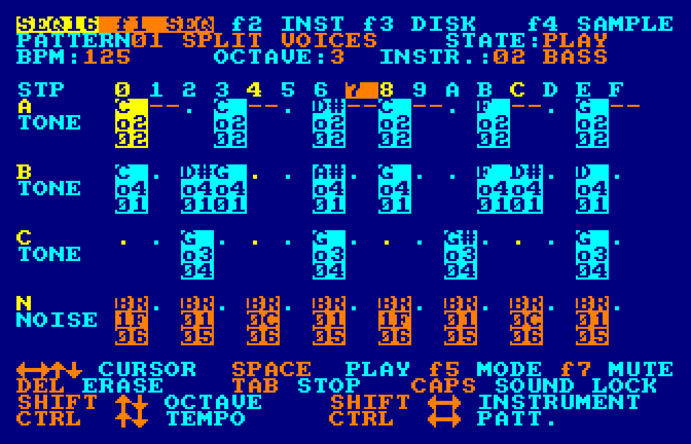
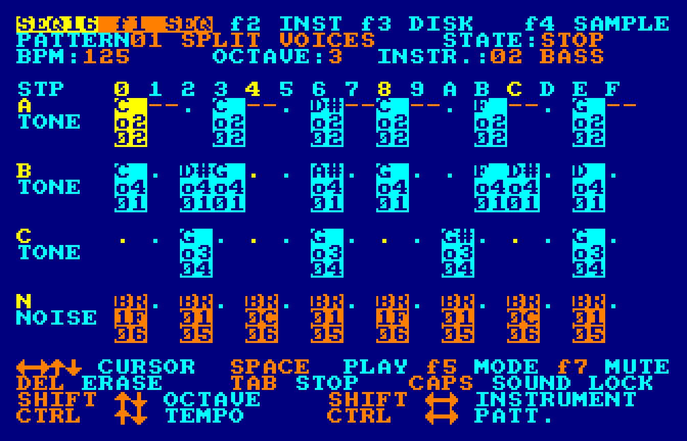
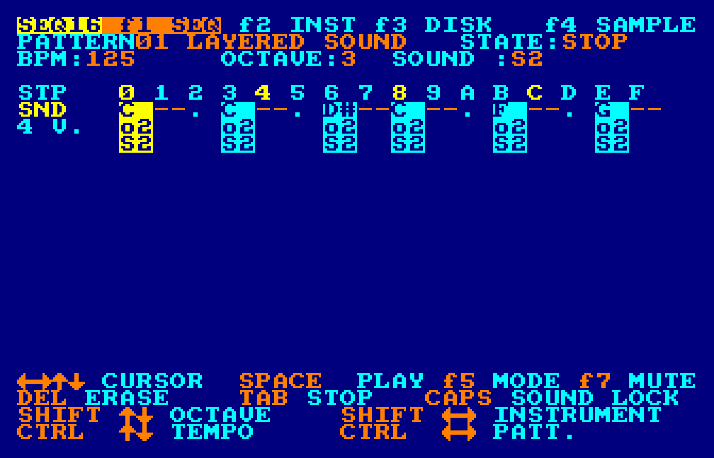
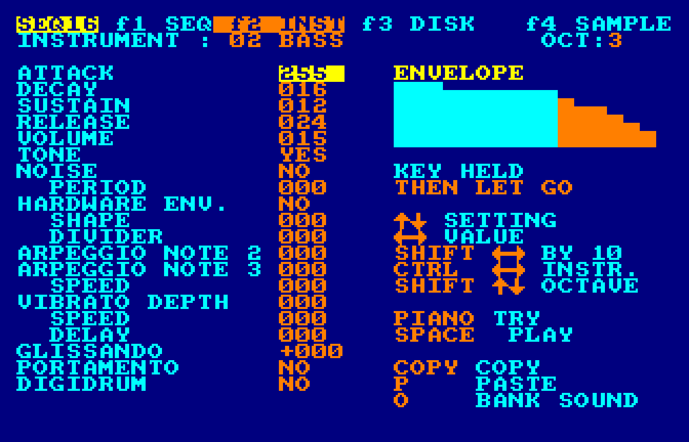
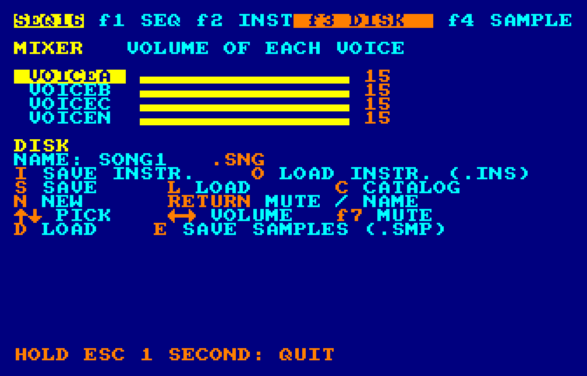
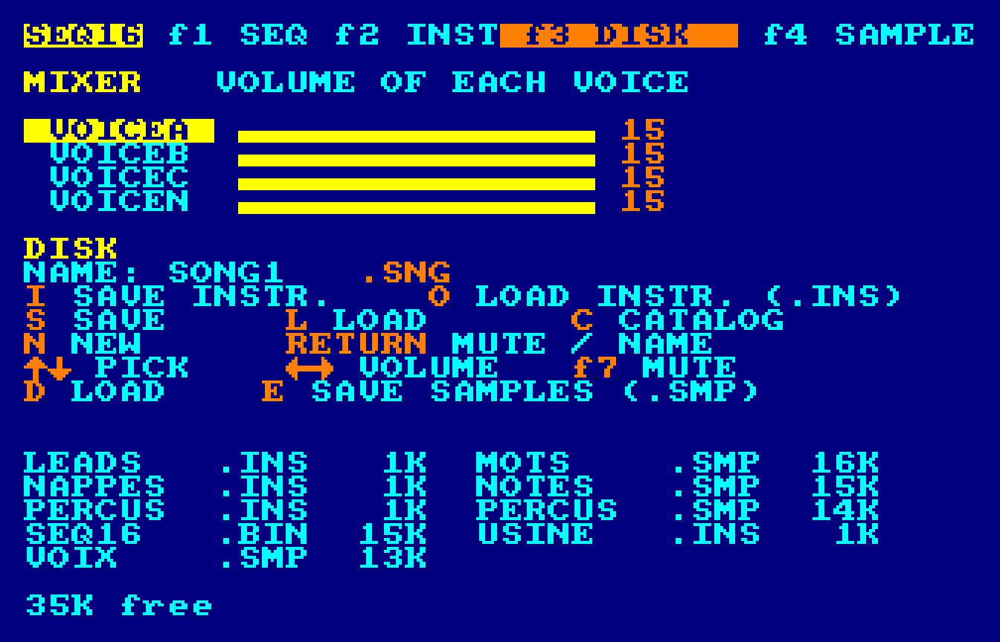
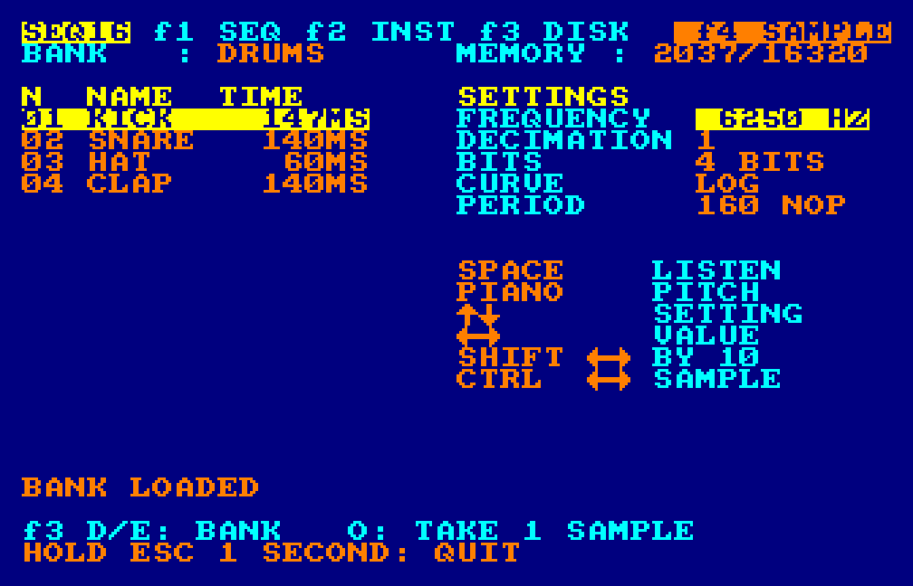

<div align="center">

```
███████╗███████╗ ██████╗        ██╗ ██████╗
██╔════╝██╔════╝██╔═══██╗      ███║██╔════╝
███████╗█████╗  ██║   ██║█████╗╚██║███████╗
╚════██║██╔══╝  ██║▄▄ ██║╚════╝ ██║██╔═══██╗
███████║███████╗╚██████╔╝       ██║╚██████╔╝
╚══════╝╚══════╝ ╚══▀▀═╝        ╚═╝ ╚═════╝
   C H I P T U N E   S E Q U E N C E R  ·  A M S T R A D   C P C   6 1 2 8

Ready
RUN"SEQ16
█
```

**A 4-voice chiptune sequencer (3 tones + noise) for the Amstrad CPC 6128, written in Z80 assembly.**
16 steps per pattern, 32 patterns, 32 instruments, songs saved to floppy disk.
And a **sampler**: the **f4** screen plays real recorded sounds (drums, voices…) on the CPC's sound chip, with a grain you tweak live (frequency, decimation, bits, curve). The idea: degrading the sound is the whole point.
Samples also play **inside songs** (digidrums), and the disk ships with **13 instrument banks (416 sounds) and 9 sample banks**.


[](https://github.com/ChristopheCruz/CPC-SEQ-16/releases/latest)
[](https://www.buymeacoffee.com/ChristopheCruz)

[🇫🇷 Français](README.fr.md) · 🇬🇧 English · [🇪🇸 Español](README.es.md)



</div>

---

## Contents

- [Try it right now](#-try-it-right-now)
- [On a real CPC with a Gotek](#-on-a-real-cpc-with-a-gotek)
- [The screens](#️-the-screens)
- [The keys](#️-the-keys)
- [The song format](#-the-song-format)
- [The sound banks](#-the-sound-banks)
- [The sampler: samples and digidrums](#-the-sampler-samples-and-digidrums)
  - [Samples, step by step](#samples-step-by-step)
  - [Digidrums: samples in the song](#digidrums-samples-in-the-song)
  - [The graphical bank editor (on PC)](#the-graphical-bank-editor-on-pc-the-samples-seq-16-tab-of-cpc-disk)
- [Rebuilding](#️-rebuilding)
- [Code layout](#-code-layout)
- [Roadmap](#️-roadmap)
- [Acknowledgements](#-acknowledgements)

## 💾 Try it right now

1. Download **[`seq16-en.dsk`](https://github.com/ChristopheCruz/CPC-SEQ-16/releases/latest)** from the latest release (a copy is also in [`build/`](build/)).
   - **Version française :** `seq16.dsk`. **Versión en español:** `seq16-es.dsk`. Same program, same banks, same keys: only the on-screen texts change.
   - **Banks only:** `seq16-sons.dsk` (13 instrument banks `.INS`) and `seq16-samples.dsk` (9 sample banks `.SMP`), data disks without the program: swap disks, then load a bank (f3: **O** or **D**).
2. Put the disk in an emulator (WinAPE, Caprice32, ACE-DL, RetroVirtualMachine…) set to **CPC 6128**.
3. Type:

```basic
RUN"SEQ16
```

To quit, hold **ESC** for one second. A single press isn't enough, so you can't lose your work by mistake.

The disk also holds ready-made sound banks (see [The sound banks](#-the-sound-banks)):

- **9 sample banks** `.SMP`: drums, percussion, effects, basses, notes, voices… Press **f4** to listen to them.
- **13 instrument banks** `.INS` of 32 sounds each. On **f3**, the **O** key loads one; on **f2**, the **O** key takes a single sound.

## 🔌 On a real CPC with a Gotek

To play on the real machine, copy `seq16-en.dsk` to the USB stick of a Gotek drive (FlashFloppy or HxC firmware).
The companion tool **[CPC DISK](https://github.com/ChristopheCruz/CPC-DISK)** takes care of that: it's a `.dsk` image editor that looks like a CPC screen, in pure Python, with no dependencies. Use it to:

- open `seq16-en.dsk` and browse its AMSDOS catalog;
- get the `.SNG` songs saved on the disk, or add some;
- prepare the Gotek's USB stick.

## 🖥️ The screens

Four screens, picked with the function keys on the numeric keypad: **f1** sequencer, **f2** instrument, **f3** disk, **f4** sampler (see [The sampler](#-the-sampler-samples-and-digidrums)).

<table>
<tr>
<td width="50%" align="center">
<br>
<b>f1 · Sequencer, split voices</b><br>
<sub>Voices A, B, C and noise N over 16 steps: note, octave, instrument.</sub>
</td>
<td width="50%" align="center">
<br>
<b>f1 · Sequencer, layered sound</b><br>
<sub>A single line that plays a layered sound on all 4 voices at once.</sub>
</td>
</tr>
<tr>
<td width="50%" align="center">
<br>
<b>f2 · Instrument</b><br>
<sub>Envelope drawn live, noise, hardware envelope, arpeggio, vibrato, glissando, portamento.</sub>
</td>
<td width="50%" align="center">
<br>
<b>f3 · Mixer and disk</b><br>
<sub>Volume and mute for each voice, saving and loading songs.</sub>
</td>
</tr>
<tr>
<td width="50%" align="center">
<br>
<b>f1 · Playing</b><br>
<sub>The step being played is followed on screen during playback.</sub>
</td>
<td width="50%" align="center">
<br>
<b>f3 · Catalog</b><br>
<sub>The contents of the disk, without leaving the program.</sub>
</td>
</tr>
</table>

<sub>The screenshots show the English version (`seq16-en.dsk`); the French and Spanish disks show the same screens with their own labels.</sub>

**f4 · Sampler (Sample Composer)**: the sound bank on the left, the grain of the chosen sound on the right.

<p align="center"></p>

## ⌨️ The keys

### f1 — Sequencer

| Keys | Effect |
|---|---|
| Arrows | move the cursor; you hear the note you land on |
| Piano keys | enter a note, hear it, move to the next step |
| DEL | clear the cell |
| TAB (or CLR) | note off (`--`) |
| CAPS LOCK | lock the input instrument |
| SPACE | play / stop |
| f5 | split voices / layered sound |
| f7 | mute (or unmute) the voice under the cursor |
| SHIFT + ↑/↓ | input octave |
| SHIFT + ←/→ | input instrument (and that of the note under the cursor) |
| CTRL + ↑/↓ | tempo in BPM |
| CTRL + ←/→ | previous / next pattern (32 patterns) |

A muted voice shows `MUTE` to the left of the grid.

### f2 — Instrument

| Keys | Effect |
|---|---|
| ↑/↓ | pick a setting |
| ←/→ | change its value (with SHIFT: by 10) |
| CTRL + ←/→ | previous / next instrument (32 instruments) |
| SHIFT + ↑/↓ | test octave |
| Piano keys | try the instrument |
| SPACE | listen to the pattern with the modified sound |
| COPY | copy the instrument (settings and name) |
| P | paste: the copied instrument replaces the one on screen |
| O | take a sound from a `.INS` bank on the disk: pick the bank, then one of its 32 sounds (arrows, RETURN; ESC cancels) |

The envelope drawing updates on every change of attack, decay, sustain or release.
Instruments 25 to 28 (`USER1` to `USER4`) are free for making your own sounds. Instruments 29 to 32 are the factory digidrums (`DGKICK`, `DGSNAR`, `DGHAT`, `DGCLAP`).

**Copying a sound into another instrument**: pick the source instrument (CTRL + ←/→), press **COPY**, go to the target instrument, press **P**.

**The DIGIDRUM setting** (the last one): set to `YES`, the instrument plays a sample instead of a note. The `PERIOD` line then becomes `SAMPLE` followed by the sample's name: its value is the sample's number in the bank (0 = the first one). See [Digidrums](#digidrums-samples-in-the-song).

### f3 — Mixer and disk

| Keys | Effect |
|---|---|
| ↑/↓ | pick a voice (A, B, C, N) or the file name |
| ←/→ | voice volume (0 to 15) |
| RETURN or f7 | mute / unmute (on the name line: type the name) |
| S | save the song |
| L | load the song |
| C | show the disk catalog |
| I | save the instruments: the 32 instruments and the 8 layered sounds, into `NAME.INS` |
| O | load a `.INS` instrument bank (arrows, then RETURN; ESC cancels). Patterns don't change |
| D | pick a `.SMP` sample bank on the disk (for the f4 screen): arrows, then RETURN; ESC cancels |
| E | save the sample bank (with the settings made on f4), under its own name: `DRUMS.SMP`… |
| N | new song (press twice) |
| SPACE | listen to the pattern while adjusting |

**The file name**: go down to the `NAME` line, press RETURN, type the name (8 letters or digits at most), then RETURN.
The first letter you type replaces the old name; DEL corrects. The `.SNG` extension is added automatically.

**Voice volume**: the CPC's sound chip sends channel A to the left, channel C to the right and channel B to both sides.
Depending on how you listen (internal speaker, a single earphone, an amp plugged into a single output), one channel can sound louder than the others: you balance it here, and the setting is saved with the song.

### f4 — Sampler

| Keys | Effect |
|---|---|
| SPACE | listen to the chosen sample (SPACE again: stop) |
| Piano keys | listen to the sample higher or lower (±12 semitones) |
| CTRL + ←/→ | previous / next sample |
| ↑/↓ | pick a setting: frequency, decimation, bits, curve |
| ←/→ | change its value (with SHIFT: by 10, for the frequency) |
| O | take a sample from another `.SMP` bank: it is added at the end of the bank in memory (16 samples and 16 KB at most) |

To change bank: screen **f3**, key **D**, pick the `.SMP` file with the arrows, then RETURN.
To save the bank (settings and added samples included): screen **f3**, key **E**.
The first time you open f4, the `DRUMS.SMP` bank loads by itself.
Everything is detailed further down, in the [sampler guide](#samples-step-by-step).

## 🎵 The song format

A `.SNG` file (about 9 KB) holds **the whole song**:

- the 32 patterns;
- the 32 instruments and their names;
- the 8 layered sounds;
- the volumes and muted voices;
- the name of the sample bank used (format **version 2**).

When a version 2 song is loaded, its sample bank is reloaded if it isn't the one in memory (message `SONG AND SAMPLE BANK LOADED`). If it isn't on the disk, the song loads anyway.
Songs in the old format (version 1, saved before digidrums) still load.

If a file with the same name exists, AMSDOS keeps the old one with the `.BAK` extension.

## 🎹 The sound banks

The default sounds stay **inside the program**: at startup and after **N** (new song), you always get the same 32 instruments. The banks on the disk come on top of them.

### `.INS` instrument banks (13 banks, 416 sounds)

A `.INS` bank holds 32 instruments, their names and 8 layered sounds (848 bytes). You can:

- **load a whole bank**: screen **f3**, key **O**;
- **take a single sound** for the instrument on screen: screen **f2**, key **O**, then pick the bank and the sound;
- **save your own instruments**: screen **f3**, key **I** (file `NAME.INS`, with the name from the NAME line).

The bank names are French file names, kept as is in every version.

| Bank | Contents |
|---|---|
| `USINE` (factory) | the program's 32 default instruments (to get them back after loading another bank) |
| `BATTERIE` (drums) | kick drums, snares, hi-hats, toms, cymbals, cowbell, claves |
| `BASSES` | short, long, sliding, "buzzer", dirty and wobble basses |
| `LEADS` | melody sounds: vibratos, portamentos, sync, trills |
| `NAPPES` (pads) | slow pads, held chords, choirs, organs |
| `ARPEGES` | arpeggiated chords at 3 speeds: major, minor, 7th, sus, diminished… |
| `EFFETS` (effects) | lasers, sirens, coins, jumps, explosions, engines |
| `BUZZER` | the AY's hardware envelope: 4 shapes × 3 dividers, and variants |
| `CLAVIERS` (keyboards) | pianos, plucked strings, bells, organs, winds |
| `CHIPTUNE` | a complete bank for a video game tune |
| `PERCUS` | congas, bongos, claves, triangle, tablas, gong |
| `GLISSES` (slides) | portamentos, glissandos up or down |
| `BRUITS` (noises) | noise held at 10 pitches, wind, rain, sea, train |

They are made by [`tools/gen_instruments.py`](tools/gen_instruments.py) (`--list` shows every sound).

### `.SMP` sample banks (9 banks)

`DRUMS.SMP` stays the default bank: it loads by itself the first time you open f4.

| Bank | Contents | Size |
|---|---|---|
| `DRUMS` | KICK, SNARE, HAT, CLAP (the factory digidrums) | 2 KB |
| `VOIX` (voices) | "bonjour", "Amstrad", "SEQ 16", "1, 2, 3, 4" (spoken in French) | 13 KB |
| `BATTERI2` | drum-machine style kit: long kick, toms, cowbell, crash… (12 sounds) | 12 KB |
| `PERCUS` | congas, bongo, claves, triangle, tambourine, agogo, tabla… (12 sounds) | 13 KB |
| `EFFETS` (effects) | laser, zap, explosion, coin, jump, siren, alarm, UFO… (12 sounds) | 14 KB |
| `BASSES` | 10 bass notes (C), to play with the f4 piano | 15 KB |
| `NOTES` | plucked, piano, bell, organ, brass, choir, orchestra… (10 notes, C) | 14 KB |
| `CHIFFRES` (numbers) | "zéro" to "dix" (zero to ten, in French) | 11 KB |
| `MOTS` (words) | "allez", "oui", "non", "encore", "stop", "bravo", "CPC"… (14 French words) | 16 KB |

All the sounds are **synthesized** ([`tools/gen_samples.py`](tools/gen_samples.py)) or **spoken by espeak**: no samples taken from the Internet, so no rights issues.
On f4, the **O** key takes a sample from one of these banks and adds it to the bank in memory. **f3 + E** saves the result.

## 🥁 The sampler: samples and digidrums

SEQ-16 plays **samples**: an **f4 Sample Composer** screen to listen to a sound and dirty it up, and **digidrums**, samples triggered on a step like a note.
The idea is deliberate: **degradation is the goal**. Grain, aliasing, hiss and choppiness are intended, adjustable effects.

The CPC has no digital-to-analog converter. It plays a sample by changing the **volume** of an AY channel very fast: 16 levels on an almost logarithmic curve. That's what gives the grain.

### Samples, step by step

**1. Start.** Insert `seq16-en.dsk` and type `RUN"SEQ16`.

**2. Open the samples screen.** Press **f4**, the 4 key on the numeric keypad. The first time, the `DRUMS.SMP` bank loads by itself, and its 4 sounds show up on the left.

**3. Listen.**
- Pick a sample with **CTRL + ←/→**. The chosen sample is in inverted yellow.
- **SPACE** plays it at its original pitch. SPACE again stops it.
- **The piano keys** play it higher or lower:
  - the top row, starting from the C key, starts at the original pitch and goes up semitone by semitone;
  - the bottom row plays an octave lower.
- While it plays, the screen freezes: that's normal.

**4. Dirty up the sound.** On the right, pick a setting with **↑/↓** and change its value with **←/→** (for the frequency, with SHIFT, in steps of 10). Listen again after each change.
- **FREQUENCY**: lower means deeper and dirtier.
- **DECIMATION**: from 2 to 8, metallic whistles appear.
- **BITS**: from 3 down to 1, the sound becomes more and more "beep".
- **CURVE**: CLIPPED, FOLDED, LINEAR and INVERTED distort the sound; LOG is the original sound.

**5. Change bank.**
1. Go to the **f3** screen and press **D**.
2. The list of `.SMP` files on the disk shows up at the bottom. Pick with the arrows.
3. **RETURN** loads the bank, **ESC** cancels.
4. Go back to **f4**.

The NAME field on the f3 screen is only for `.SNG` songs.

**6. Make your own sounds.** On the PC, convert your WAV files with [`tools/wav2smp.py`](#converting-your-own-sounds-toolswav2smppy). For example, for a voice recording:

```bat
python tools\wav2smp.py mavoix.wav --trim --rate 6250 -o samples\MAVOIX.SMP --dsk
```

- The bank is added straight to `build\seq16.dsk`.
- The script also writes a preview WAV, so you can hear the result on the PC before copying the disk.
- You can also add the `.SMP` file to a disk with [CPC DISK](https://github.com/ChristopheCruz/CPC-DISK).

**Good to know**
- **Bank size**: 16 KB at most, i.e. about 4 seconds at 8 kHz, or 5 seconds at 6.25 kHz. A bank holds 16 sounds at most.
- **Settings are not saved yet.** They are lost when you reload the bank. Bank saving will come in phase 6.
- **If the pattern was playing** during a preview, it freezes for the length of the sample, then resumes.

### Where we are: phase 4, digidrums play in the song

| Phase | Contents | Status |
|---|---|---|
| 1 | `wav2smp.py` converter, preview WAVs, synthesized factory bank | ✅ done |
| 2 | playback on the CPC (direct AY access), f4 screen, bank selection (f3 + D) | ✅ done |
| 3 | extra 6128 memory, gauge, 464 fallback | to come |
| 4 | digidrums in the sequencer (BLOCKING mode), `.SNG` version 2, factory instruments | ✅ done |
| 5 | direct keyboard reading, CHOPPED mode | to come |
| 6 | f4 finishing touches: waveform, trimming, loop, burning (`.SMP` saving and adding a sample are already there) | to come |

### Digidrums: samples in the song

A **digidrum** is an instrument that plays a sample from the loaded bank instead of a note. The 4 factory instruments 29 to 32 (`DGKICK`, `DGSNAR`, `DGHAT`, `DGCLAP`) play the 4 sounds of `DRUMS.SMP`.

**To make one yourself**, on the **f2** screen:

1. Set the last setting, **DIGIDRUM**, to `YES`.
2. The `PERIOD` line becomes `SAMPLE` and shows the sample's name. Change its value with ←/→: 0 = the first sample in the bank, 1 = the second…
3. **VOLUME** sets the sample's strength (15 = full, below that: softer). The other settings aren't used.
4. Try it with the piano: the sample plays right away.

**In the sequencer**, enter this digidrum like a note:

- **the pitch**: the note **C in octave 4** (top row of the piano, input octave 3) plays the sample as is; each semitone above or below makes it higher or lower, up to ±12 semitones;
- **the voice** picks the AY channel: A, B or C. On voice N (noise), the sample plays on channel C, at its original pitch;
- **a muted voice** (f7) doesn't play its digidrums.

**BLOCKING mode.** The sample plays in full at the end of the frame, with interrupts disabled. Then the sequencer **catches up with the tempo**: it moves forward as many frames as the sample lasted, so the following steps land on time. During the sample:

- the screen and keyboard stop responding;
- the other voices **keep sounding**, but their envelopes, arpeggios and vibratos are **frozen**. This freeze is part of the sound: it isn't corrected.

Keep digidrums **short: under 150 ms** (the 4 sounds of `DRUMS.SMP` are). A longer sample makes the interface and the other voices "stutter".

### The graphical bank editor (on PC): the SAMPLES SEQ-16 tab of CPC DISK

A desktop application for making a `.SMP` bank from WAV files, with no command line. It's part of **CPC DISK**, the disk editor: it's its **SAMPLES SEQ-16** tab, in French, English or Spanish. A single Windows program, `cpc-dsk-gui.exe`, therefore makes the banks and puts them on the disk (and on the Gotek's stick).

```bat
python tools\smp_gui.py          rem the editor alone, in its own window
```

- **On the left**, the list of samples (16 at most): add WAVs (Ctrl+W, several at once), open an existing `.SMP` bank (Ctrl+O), remove, move up, move down. A gauge shows the space used out of the 16,320 bytes of CPC memory; it turns red if the bank is too big.
- **On the right**, the settings of the chosen sample: name (6 characters), frequency, saturation, silence trimming, smoothing, dithering, bits, decimation, curve, slicing. The waveform shows the original at the top and the CPC rendering at the bottom.
- **Listen** to the original or the CPC rendering.
- **Save .SMP** (Ctrl+S), then **Add to disk**: in CPC DISK, the disk open in the Disk tab is offered directly.

For an opened `.SMP` bank, there's no original WAV any more: you can change the name, frequency, bits, decimation and curve, but not the settings that require reconverting the sound.

The code lives in CPC DISK (`cpc_dsk/seq16/`); `tools/smp_gui.py`, `tools/smp_model.py` and `tools/wav2smp.py` point to it (see [Rebuilding](#️-rebuilding)).

### The f4 screen: Sample Composer

Press **f4**. The first time, the program loads the factory bank `DRUMS.SMP` by itself; it's on the disk.

```
SEQ16 f1 SEQ f2 INST f3 DISK   f4 SAMPLE
BANK   : DRUMS      MEMORY : 2037/16320

N  NAME  TIME       SETTINGS
01 KICK    147MS    FREQUENCY   6250 HZ
02 SNARE   140MS    DECIMATION 1
03 HAT      60MS    BITS       4 BITS
04 CLAP    140MS    CURVE      LOG
                    PERIOD     160 NOP
```

| Keys | Effect |
|---|---|
| SPACE | listen to the chosen sample (SPACE again: stop) |
| Piano keys | listen to the sample at that pitch. The top row, starting from the C key, plays the original pitch; the bottom row, an octave lower |
| ↑/↓ | pick a setting |
| ←/→ | change its value (with SHIFT: by 10, for the frequency) |
| CTRL + ←/→ | previous / next sample |
| f3, then **D** | pick another bank among the `.SMP` files on the disk |

The settings are those of the sample's record, in memory. They don't touch the data.

| Setting | Values | Effect |
|---|---|---|
| FREQUENCY | 4,000 to 16,129 Hz | pitch and brightness; lower is dirtier. → goes up, ← goes down |
| DECIMATION | 1, 2, 3, 4, 6, 8 | one sample out of N, held N times: strong aliasing |
| BITS | 4, 3, 2, 1 | fewer levels. At 1 bit, only levels 0 and 8 are left: a harsh, weak "beep" |
| CURVE | LINEAR, LOG, CLIPPED, FOLDED, INVERTED | a 16-value table between the sample and the volume (see below) |
| PERIOD | (information) | the length of one sample in µs, i.e. in NOPs |

**While a sample plays, the screen stops responding**: the processor does nothing but play the sample, with interrupts disabled.
The other AY channels keep sounding with their last settings. If the pattern was playing, its envelopes, arpeggios and vibratos are **frozen** until the end of the sample. That's on purpose.

The curves:

- **LOG** is the faithful rendering, the one of the preview WAVs.
- **LINEAR** treats each value as a linear amplitude, written as is into the AY, which is logarithmic. The sound is hollower and distorted.
- **CLIPPED** multiplies the signal by 2.5 and clips it.
- **FOLDED** also multiplies by 2.5, then folds back whatever goes over.
- **INVERTED** flips the waveform.

### What you should hear

1. **f4, then SPACE** on each sound. They should sound like the WAVs in [`samples/ecoute/`](samples/ecoute/), at the same pitch.
2. **FREQUENCY**: from 6,250 Hz down to 4,000 Hz, the kick gets deeper and more "smeared". Around 16,000 Hz, it gets high and short like a tom.
3. **DECIMATION 4 or 8** on the hi-hat: a metallic whistle appears, that's aliasing.
4. **BITS 1**: the hi-hat becomes a weak metallic sizzle, and the kick a speaker "pop".
5. **CURVE CLIPPED**: the snare becomes a wall of noise. **FOLDED** gives a "broken" tone, **LINEAR** a softer sound.
6. **The piano**: the top row goes up semitone by semitone. A slightly out-of-tune semitone is part of the charm.
7. **SPACE during playback** stops it. To hear it, take a long sample or set the frequency to its lowest.
8. After a preview, **f1 then SPACE**: the sequencer should play normally.

### Known limits and things to watch

- **Low memory.** The bank is loaded at `#0040-#3FFF`. After `RUN"`, this area, the one for BASIC programs, is free and reads as RAM (the lower ROM isn't visible there). If the sounds were replaced by a continuous noise, the lower ROM was visible during playback.
- **The space for the routine** (`#A000-#A67B`) is taken just below the memory reserved by AMSDOS (above `#A67B` on a 6128). The program checks this at startup. If f4 shows `NOT ENOUGH MEMORY`, that assumption is wrong on your machine: samples, digidrums and the O key on f2 are then disabled, everything else works.
- **Memory is full.** Only a few bytes are free below `#A000` and a few dozen in the high area. Phase 3 (extra 6128 memory) will have to free some before adding features.
- **Instrument banks are read byte by byte** (AMSDOS `CAS IN CHAR`), since there's no room for a copy of the file in memory. This is tested in the simulator, not yet on the real machine.
- **Tempo catch-up** is computed from the sample's theoretical length (number of samples × length of one sample). Over 32 bars, a small drift is still possible: to be checked by ear, with a sampled drum loop.
- **The sample rate** is computed with the CPC's own timing table. It's exact in the simulator, but the kick's pitch needs comparing with the preview WAV.
- **Above about 6 kHz** (under 167 NOPs per sample), the SPACE key test lengthens one sample out of 256. This can give a very slight sizzle, about 31 times a second at 8 kHz.
- **A "click" at the start or end** of playback is possible, when the volume goes from the engine's setting to the first sample.
- **The bank list** (f3, then D) reads the disk directory with AMSDOS's hidden "read sector" command (`#84`). It only works on **drive A**.
- **The AY levels** come from the Ayumi emulator. The CPC's output goes through a filter and the internal amp: the result may differ a bit from the preview WAVs.

### The factory bank `DRUMS.SMP`

Four sounds made **by synthesis** in [`tools/gen_drums.py`](tools/gen_drums.py) (sine with falling pitch, filtered noise). No samples found on the Internet, so no rights issues.
The bank is 2,037 bytes.

| No. | Name | Length | Frequency | To hear in [`samples/ecoute/`](samples/ecoute/) |
|---|---|---|---|---|
| 0 | KICK | 148 ms | 6,250 Hz | a muffled kick drum, with a slight grainy attack "click" |
| 1 | SNARE | 140 ms | 8,000 Hz | a dry, dirty snare, like a badly tuned radio |
| 2 | HAT | 60 ms | 12,500 Hz | a short, metallic hi-hat that "crackles" more than it hisses |
| 3 | CLAP | 140 ms | 8,000 Hz | three close claps, then a short tail that dies out in steps |

The `*_ecoute.wav` files simulate the CPC rendering (same AY levels, same frequency).
The clean original synthesized sounds are in [`samples/synth/`](samples/synth/), for comparing or reconverting them differently.

**What you should hear**:

- Sound endings stop **in steps**, not smoothly: below a certain threshold, the signal suddenly drops to the rest level. That's the AY's curve.
- The hi-hat has a **raspy brightness**, due to aliasing (no filter).
- Nothing should **click** at the start or end of the file.

### Converting your own sounds: `tools/wav2smp.py`

Python 3, standard library only. Input: mono or stereo WAVs, 8 or 16 bits, at any sample rate.

```bat
rem one sound per file, at 8 kHz (default)
python tools\wav2smp.py kick.wav snare.wav -o samples\MABANK.SMP -v

rem a drum loop cut into 8 slices, at 6 kHz
python tools\wav2smp.py boucle.wav --slice 8 --rate 6000 -o samples\BOUCLE.SMP

rem very dirty: saturated, 2 bits, one sample out of 3
python tools\wav2smp.py voix.wav --drive 4 --bits 2 --decim 3 -o samples\SALE.SMP

rem add the bank to the disk build\seq16.dsk
python tools\wav2smp.py son.wav -o samples\SON.SMP --dsk

rem show the contents of a bank
python tools\wav2smp.py --info samples\DRUMS.SMP
```

| Option | Effect |
|---|---|
| `--rate` | frequency from 4,000 to 16,000 Hz. Lower is dirtier and fits more time in memory |
| `--drive` | gain before clipping (1 = none, 4 = very saturated). Also brings up sound endings |
| `--clean` | adds a filter before resampling, for less aliasing |
| `--bits 4/3/2/1` | fewer levels. At 1 bit, only 2 levels are left, and the sound becomes a harsh, weak "beep" |
| `--dither noise` | dithering: a hiss replaces the steps |
| `--decim` | 1, 2, 3, 4, 6 or 8: one sample out of N is held N times. This setting is stored, it destroys nothing |
| `--slice N` | cuts each WAV into N equal slices |
| `--names` | sample names (6 characters), separated by commas |
| `--dsk` | adds the bank to `build/seq16.dsk` (or to the disk given) |
| `--trim` | removes silences at the start and end of each sound |
| `-v` | shows size and length, and warns above 16 KB (main memory) or 64 KB (6128) |

Each conversion also writes the preview WAVs next to the bank.
For space: one second at 8 kHz takes 4 KB. A bank holds 16 samples at most, 16 KB at most each.
For now, a bank must fit in the 16,320 bytes of main memory, i.e. about 4 seconds at 8 kHz. The 6128's memory will come in phase 3.

### The voice bank `VOIX.SMP`

Four words in French, made with the free speech synthesizer **espeak**. The sources are in [`samples/voix/`](samples/voix/).

| No. | Name | Length | What you hear |
|---|---|---|---|
| 0 | BONJOU | 0.52 s | "Bonjour" (hello) |
| 1 | AMSTRA | 0.67 s | "Amstrad" |
| 2 | SEQ16 | 1.20 s | "Séquenceur seize" (sequencer sixteen) |
| 3 | COMPTE | 1.76 s | "Un, deux, trois, quatre" (one, two, three, four) |

To hear it on the CPC: screen **f3**, key **D**, pick **VOIX** with the arrows, RETURN, then **f4**.
The voice is at 6,250 Hz. It should stay understandable, with a "talking toy" grain. At BITS 2 or with the CLIPPED curve, it becomes a very dirty robot.
The bank is 12,951 bytes. It was made like this:

```bat
python tools\wav2smp.py samples\voix\bonjour.wav samples\voix\amstrad.wav samples\voix\seq16.wav samples\voix\compte.wav --names BONJOU,AMSTRA,SEQ16,COMPTE --trim --rate 6250 -o samples\VOIX.SMP --preview-dir samples\ecoute
```

### The `.SMP` format

The format is described in detail at the top of `cpc_dsk/seq16/wav2smp.py`, in CPC DISK:

- a 16-byte `SQSM` header (version 1);
- a 16-byte record per sample: name, position, length, frequency, loop, flags, settings;
- the data, 2 four-bit samples per byte.

Three choices made during phase 1:

- **The frequency** is stored as the length of one sample in NOPs (µs), from 62 to 250. That's directly the setting of the Z80 playback loop.
- **A sample never crosses a 16 KB boundary**, so playback never has to switch memory blocks midway.
- **Each sample is an AY level code**, from 0 to 15. Written as is into the volume register, it gives back the sound as closely as possible. Silence is level 12.

The table of the AY's 16 levels comes from the open-source emulator [Ayumi](https://github.com/true-grue/ayumi) (MIT license).

### Testing

```bat
pip install z80
python -m unittest discover -s tools -p "test_*.py"
```

**The converter**: 24 tests, no dependencies. They check:

- a sine converted then read back, and its size;
- that the AY's 16 levels, the bits and the decimation are respected;
- the bank's header and records;
- slicing;
- writing to the disk, then reading back;
- that `DRUMS.SMP` matches the script and is under 4 KB;
- that the assembler's tables are the converter's.

**The CPC program**: 17 tests in [`tools/test_player.py`](tools/test_player.py), which run the real `SEQ16.BIN` in a Z80 simulator (`z80` package). The test bench [`tools/cpcsim.py`](tools/cpcsim.py):

- replaces each firmware routine with a simulated version, which changes the registers like the real firmware;
- models the PPI and the AY;
- counts time in NOPs, with the CPC's own timings;
- keeps the text screen in memory.

These tests check:

- the real frequency: the gap between two volume writes is exactly the intended length, also with the piano;
- that each value written matches the data, after decimation, bits and curve;
- that the right register is selected for channels A, B and C;
- that the mixer, the volume, the firmware's "alternate" registers and the interrupts are restored at the end;
- stopping with SPACE, and loading errors (missing file, too big, not a bank);
- the f4 screen and its keys, loading via f3 + D;
- that saving and reloading a `.SNG` still works.

**Instruments and digidrums**: 24 more tests in the simulator.

- [`tools/test_banks.py`](tools/test_banks.py) (10 tests): copy / paste, saving and loading a `.INS` bank, taking a single sound (and cancelling), a file that isn't a bank, the 13 banks of the real disk.
- [`tools/test_digidrum.py`](tools/test_digidrum.py) (14 tests):
  - the digidrum plays the right values on the right voice, at the right pitch and volume;
  - a muted voice stays silent;
  - the sequencer catches up exactly the sample's length;
  - the f2 display and piano;
  - a version 1 `.SNG` loads, a version 2 one reloads its bank;
  - f3 + E saves the bank;
  - f4 + O adds a sample taken from another bank, and refuses if there's no room.

**Languages**: [`tools/test_lang.py`](tools/test_lang.py) (7 tests: each translation fits in the space of the French text, no text forgotten; the English and Spanish versions start in the simulator and show their texts on all four screens, at the same addresses as the French version).

**Without the simulator**: [`tools/test_insbank.py`](tools/test_insbank.py) (6 tests: format and bounds of the 416 sounds, USINE bank = factory instruments) and [`tools/test_smp_gui.py`](tools/test_smp_gui.py) (17 tests of the graphical editor; the window ones are skipped without a display).

The tests read `build/seq16.dsk` and `build/seq16.sym`: run `build.bat` again after any change to `src/`.

## 🛠️ Rebuilding

On Windows:

1. Put `rasm.exe` in `tools\` (repository [EdouardBERGE/rasm](https://github.com/EdouardBERGE/rasm), *Releases* page).
2. If you change the factory instruments and patterns in `tools/gen_factory.py`, first run:
   ```bat
   python tools\gen_factory.py
   ```
3. If you change the drum sounds in `tools/gen_drums.py`, run `python tools\gen_drums.py`. If you change the curves in `tools/wav2smp.py`, run `python tools\gen_smp_tables.py`.
4. If you change the banks: `python tools\gen_instruments.py` (`.INS` banks, also to be rerun after `gen_factory.py`) and `python tools\gen_samples.py` (`.SMP` banks; you need espeak for the voices).
5. Run `build.bat`: it assembles `src/main.asm`, builds `build\seq16.dsk` and adds all the `.SMP` and `.INS` banks to it (you need Python 3). It also builds the English and Spanish versions, `build\seq16-en.dsk` and `build\seq16-es.dsk`.

**The translations** are in [`tools/lang.py`](tools/lang.py): the source stays in French, and the script makes one copy per language where every displayed text is replaced. A translation is never longer than the French (it's padded with spaces): the three programs have the same size and the same addresses, which matters with full memory. If you add a text to the source, add its translation; `python tools/lang.py --check` reports forgotten or too-long texts.

**You also need the CPC DISK project**, the disk editor: SEQ-16 uses its library (`cpc_dsk`) to write to disks. Put it next to this project, on a version that contains `cpc_dsk/core/amsdos.py`:

```
_Codes/
├── CPC-SEQ-16/    this project
└── CPC-DISK/      the disk editor (or AmstradCPC, its former name)
```

`tools/cpcdisk.py` finds it by itself. Other options: `pip install -e ../CPC-DISK`, or the `CPC_DISK` environment variable giving its folder.

## 📁 Code layout

| File | Role |
|---|---|
| [`src/main.asm`](src/main.asm) | the three screens, the cursor, input, the disk |
| [`src/song.asm`](src/song.asm) | the song: memory layout, reset |
| [`src/seq.asm`](src/seq.asm) | the sequencer: pattern format, playback at tempo |
| [`src/sound.asm`](src/sound.asm) | the sound engine (4 voices, volumes, muted voices) |
| [`src/factory.asm`](src/factory.asm) | factory instruments, sounds and patterns (generated file) |
| [`src/tables.asm`](src/tables.asm) | note and volume tables (generated file) |
| [`src/firmware.asm`](src/firmware.asm) | the addresses of the CPC system routines used |
| [`src/sample.asm`](src/sample.asm) | sample playback: direct AY access, loading a bank |
| [`src/smpscreen.asm`](src/smpscreen.asm) | the f4 screen (Sample Composer), the file picker list |
| [`src/banks.asm`](src/banks.asm) | instrument copy / paste, `.INS` banks, `.SMP` saving, digidrums |
| [`src/hizone.asm`](src/hizone.asm) | routines copied to the high area: taking a sound or a sample from a bank, playing a digidrum |
| [`src/smptables.asm`](src/smptables.asm) | sample curves and pitches (generated file) |
| [`tools/gen_factory.py`](tools/gen_factory.py), [`tools/gen_tables.py`](tools/gen_tables.py) | the scripts that generate these files |
| [`tools/gen_drums.py`](tools/gen_drums.py) | builds the factory bank `DRUMS.SMP` by synthesis |
| [`tools/gen_samples.py`](tools/gen_samples.py) | builds the other `.SMP` banks (synthesis, espeak) |
| [`tools/gen_instruments.py`](tools/gen_instruments.py), [`tools/insbank.py`](tools/insbank.py) | builds the `.INS` instrument banks; the `.INS` format |
| [`tools/smp_gui.py`](tools/smp_gui.py), [`tools/smp_model.py`](tools/smp_model.py), [`tools/wav2smp.py`](tools/wav2smp.py) | pointers to the bank editor and the converter, which live in CPC DISK (`cpc_dsk/seq16/`) |
| [`tools/amsdsk.py`](tools/amsdsk.py), [`tools/cpcdisk.py`](tools/cpcdisk.py) | adds a file to a `.dsk` disk (or shows its catalog), with the CPC DISK library |
| [`tools/gen_smp_tables.py`](tools/gen_smp_tables.py) | generates `src/smptables.asm` |
| [`tools/test_wav2smp.py`](tools/test_wav2smp.py) | the converter's tests |
| [`tools/cpcsim.py`](tools/cpcsim.py), [`tools/test_player.py`](tools/test_player.py), [`tools/test_banks.py`](tools/test_banks.py), [`tools/test_digidrum.py`](tools/test_digidrum.py) | the simulated CPC and the program's tests |
| [`tools/test_insbank.py`](tools/test_insbank.py), [`tools/test_smp_gui.py`](tools/test_smp_gui.py) | the tests of the `.INS` banks and of the graphical editor |
| [`tools/lang.py`](tools/lang.py), [`tools/test_lang.py`](tools/test_lang.py) | the English and Spanish versions (translations, build) and their tests |
| [`samples/`](samples/) | the `.SMP` banks, their original sounds and their preview WAVs |
| [`instruments/`](instruments/) | the `.INS` instrument banks |
| [`build.bat`](build.bat) | assembles and builds the disk |
| [`build/seq16.dsk`](build/seq16.dsk) | the ready-to-use disk |
| [`snapshots/`](snapshots/) | the screenshots of this README |

## 🗺️ Roadmap

- [x] **Step 6: instruments, mixer and disk** ← current version
- [ ] Step 7: editing layered sounds on screen
- [ ] Step 8: chaining patterns into a song
- [ ] Renaming instruments
- [ ] Step 10: block copy-paste
- [x] Instrument copy-paste, `.INS` instrument banks (13 banks, 416 sounds)
- [x] Samples, phase 1: converter and factory bank (on PC)
- [x] Samples, phase 2: playback on the CPC, minimal f4 screen
- [x] Samples, phase 4: digidrums in the sequencer, `.SNG` version 2, `.SMP` saving, 9 sample banks
- [x] Graphical `.SMP` bank editor on PC
- [ ] Samples, phases 3, 5 and 6: 6128 memory, CHOPPED mode, f4 finishing touches

## 🙏 Acknowledgements

SEQ-16 is built on the work of others. Thank you to them.

**Tools and libraries**
- [RASM](https://github.com/EdouardBERGE/rasm), the Z80 assembler by Édouard Bergé: assembles the program and writes the disk.
- [z80](https://github.com/kosarev/z80), the Z80 emulator for Python by Ivan Kosarev: runs the simulated CPC used by the tests.
- [Ayumi](https://github.com/true-grue/ayumi), the AY-3-8912 emulator by Peter Sovietov (MIT licence): its DAC volume table is used by the sample converter.
- [eSpeak NG](https://github.com/espeak-ng/espeak-ng): the voices of the `VOIX`, `CHIFFRES` and `MOTS` sample banks.
- [CPC DISK](https://github.com/ChristopheCruz/CPC-DISK): the disk library, and the sample-bank editor (its SAMPLES SEQ-16 tab).
- [Python](https://www.python.org/) and [tkinter](https://docs.python.org/3/library/tkinter.html): the tools, the tests and the editor.
- Fonts [Press Start 2P](https://fonts.google.com/specimen/Press+Start+2P) by CodeMan38 and [VT323](https://fonts.google.com/specimen/VT323) by Peter Hull ([SIL Open Font License 1.1](https://openfontlicense.org/)).

**Documentation and references**
- [CPCWiki](https://www.cpcwiki.eu/): the CPC firmware, the AY-3-8912 sound chip, AMSDOS and the DSK image format.
- [HxC2001](https://hxc2001.com/) and [FlashFloppy](https://github.com/keirf/FlashFloppy): the Gotek firmwares and their documentation.

**Testing**
- [WinAPE](http://www.winape.net/): the emulator used to try the disks.

---

<div align="center">

<sub>Made with ♥ for the CPC · see also <a href="https://github.com/ChristopheCruz/CPC-DISK">CPC DISK</a>, the <code>.dsk</code> disk editor</sub>

</div>
