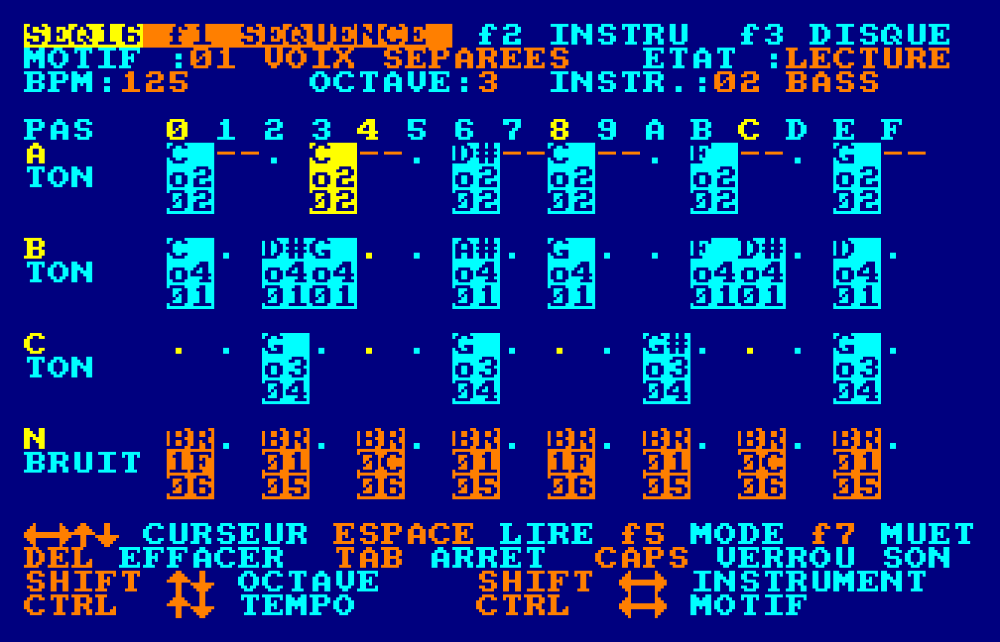
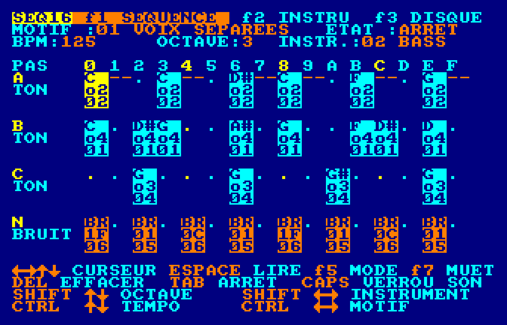
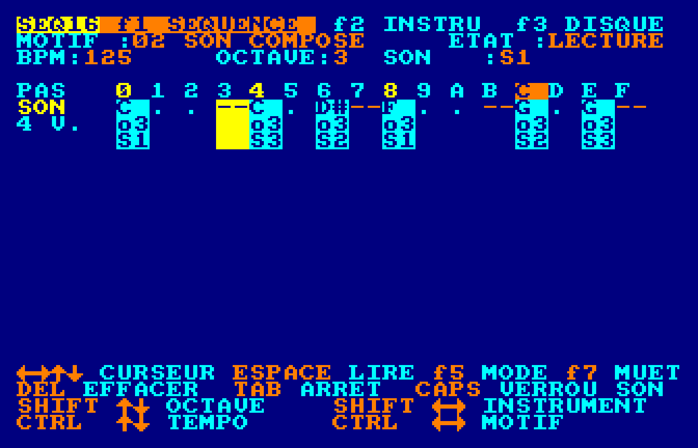
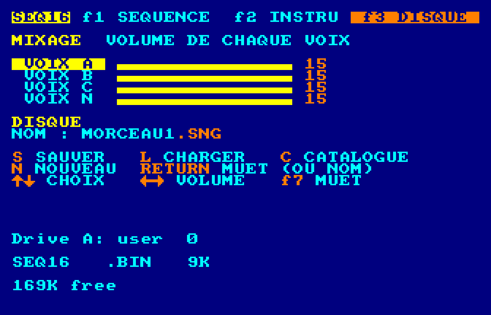

<div align="center">

```
███████╗███████╗ ██████╗        ██╗ ██████╗
██╔════╝██╔════╝██╔═══██╗      ███║██╔════╝
███████╗█████╗  ██║   ██║█████╗╚██║███████╗
╚════██║██╔══╝  ██║▄▄ ██║╚════╝ ██║██╔═══██╗
███████║███████╗╚██████╔╝       ██║╚██████╔╝
╚══════╝╚══════╝ ╚══▀▀═╝        ╚═╝ ╚═════╝
   S E Q U E N C E U R   C H I P T U N E  ·  A M S T R A D   C P C   6 1 2 8

Ready
RUN"SEQ16
█
```

**Un séquenceur chiptune 4 voix (3 tons + bruit) pour Amstrad CPC 6128, écrit en assembleur Z80.**
16 pas par motif, 32 motifs, 32 instruments, sauvegarde des morceaux sur disquette.


[](https://github.com/ChristopheCruz/seq-16/releases/latest)
[](https://www.buymeacoffee.com/ChristopheCruz)



</div>

---

## Sommaire

- [Essayer tout de suite](#-essayer-tout-de-suite)
- [Sur un vrai CPC avec un Gotek](#-sur-un-vrai-cpc-avec-un-gotek)
- [Les écrans](#️-les-écrans)
- [Les touches](#️-les-touches)
- [Le format des morceaux](#-le-format-des-morceaux)
- [Réassembler](#️-réassembler)
- [Organisation du code](#-organisation-du-code)
- [Feuille de route](#️-feuille-de-route)

## 💾 Essayer tout de suite

1. Télécharge **[`seq16.dsk`](https://github.com/ChristopheCruz/seq-16/releases/latest)** depuis la dernière release (une copie se trouve aussi dans [`build/`](build/)).
2. Insère la disquette dans un émulateur (WinAPE, Caprice32, ACE-DL, RetroVirtualMachine…) réglé en **CPC 6128**.
3. Tape :

```basic
RUN"SEQ16
```

Pour quitter, maintiens **ESC** une seconde. Un simple appui ne suffit pas, pour ne pas perdre son travail par erreur.

## 🔌 Sur un vrai CPC avec un Gotek

Pour jouer sur la machine réelle, il faut copier `seq16.dsk` sur la clé USB d'un lecteur Gotek (firmware FlashFloppy ou HxC).
L'outil compagnon **[CPC DISK](https://github.com/ChristopheCruz/AmstradCPC)** s'en charge : c'est un éditeur d'images `.dsk` à l'allure d'écran CPC, en Python pur, sans dépendance. Il sert à :

- ouvrir `seq16.dsk` et parcourir son catalogue AMSDOS ;
- récupérer les morceaux `.SNG` sauvés sur la disquette, ou en ajouter ;
- préparer la clé USB du Gotek.

## 🖥️ Les écrans

Trois écrans, à choisir avec les touches de fonction du pavé numérique : **f1** séquenceur, **f2** instrument, **f3** disque.

<table>
<tr>
<td width="50%" align="center">
<br>
<b>f1 · Séquenceur, voix séparées</b><br>
<sub>Les voix A, B, C et le bruit N sur 16 pas : note, octave, instrument.</sub>
</td>
<td width="50%" align="center">
<br>
<b>f1 · Séquenceur, son composé</b><br>
<sub>Une seule ligne qui joue un son composé sur les 4 voix à la fois.</sub>
</td>
</tr>
<tr>
<td width="50%" align="center">
<br>
<b>f2 · Instrument</b><br>
<sub>Enveloppe dessinée en direct, bruit, enveloppe matérielle, arpège, vibrato, glissando, portamento.</sub>
</td>
<td width="50%" align="center">
<br>
<b>f3 · Mixage et disque</b><br>
<sub>Volume et sourdine de chaque voix, sauvegarde et chargement des morceaux.</sub>
</td>
</tr>
<tr>
<td width="50%" align="center">
<br>
<b>f1 · En lecture</b><br>
<sub>Le pas joué est suivi à l'écran pendant la lecture.</sub>
</td>
<td width="50%" align="center">
<br>
<b>f3 · Catalogue</b><br>
<sub>Le contenu de la disquette, sans quitter le programme.</sub>
</td>
</tr>
</table>

## ⌨️ Les touches

### f1 — Séquenceur

| Touches | Effet |
|---|---|
| Flèches | déplacer le curseur ; on entend la note sur laquelle on arrive |
| Touches du piano | poser une note, l'entendre, passer au pas suivant |
| DEL | effacer la case |
| TAB (ou CLR) | arrêt de note (`--`) |
| CAPS LOCK | verrouiller l'instrument de saisie |
| ESPACE | lecture / arrêt |
| f5 | voix séparées / son composé |
| f7 | rendre muette (ou audible) la voix du curseur |
| SHIFT + ↑/↓ | octave de saisie |
| SHIFT + ←/→ | instrument de saisie (et de la note sous le curseur) |
| CTRL + ↑/↓ | tempo en BPM |
| CTRL + ←/→ | motif précédent / suivant (32 motifs) |

Une voix muette affiche `MUET` à gauche de la grille.

### f2 — Instrument

| Touches | Effet |
|---|---|
| ↑/↓ | choisir un réglage |
| ←/→ | changer sa valeur (avec SHIFT : par 10) |
| CTRL + ←/→ | instrument précédent / suivant (32 instruments) |
| SHIFT + ↑/↓ | octave d'essai |
| Touches du piano | essayer l'instrument |
| ESPACE | écouter le motif avec le son modifié |

Le dessin de l'enveloppe se met à jour à chaque changement d'attaque, de déclin, de tenue ou de relâche.
Les instruments 25 à 32 (`USER1` à `USER8`) sont libres pour créer ses propres sons.

### f3 — Mixage et disque

| Touches | Effet |
|---|---|
| ↑/↓ | choisir une voix (A, B, C, N) ou le nom de fichier |
| ←/→ | volume de la voix (0 à 15) |
| RETURN ou f7 | muet / audible (sur la ligne du nom : saisir le nom) |
| S | sauver le morceau |
| L | charger le morceau |
| C | afficher le catalogue de la disquette |
| N | nouveau morceau (appuyer deux fois) |
| ESPACE | écouter le motif pendant le réglage |

**Le nom de fichier** : descends sur la ligne `NOM`, appuie sur RETURN, tape le nom (8 lettres ou chiffres au plus), puis RETURN.
La première lettre tapée remplace l'ancien nom ; DEL corrige. L'extension `.SNG` est ajoutée toute seule.

**Le volume des voix** : le circuit sonore du CPC envoie la voie A à gauche, la voie C à droite et la voie B des deux côtés.
Selon l'écoute (haut-parleur interne, une seule oreillette, ampli branché sur une seule sortie), une voie peut paraître plus forte que les autres : on l'équilibre ici, et le réglage est sauvé avec le morceau.

## 🎵 Le format des morceaux

Un fichier `.SNG` (environ 9 Ko) contient **tout le morceau** :

- les 32 motifs ;
- les 32 instruments et leurs noms ;
- les 8 sons composés ;
- les volumes et les voix muettes.

Si un fichier du même nom existe, AMSDOS garde l'ancien sous l'extension `.BAK`.

## 🛠️ Réassembler

Sous Windows :

1. Place `rasm.exe` dans `tools\` (dépôt [EdouardBERGE/rasm](https://github.com/EdouardBERGE/rasm), page *Releases*).
2. Si tu modifies les instruments et motifs d'usine dans `tools/gen_factory.py`, lance d'abord :
   ```bat
   python tools\gen_factory.py
   ```
3. Lance `build.bat` : il assemble `src/main.asm` et fabrique `build\seq16.dsk`.

## 📁 Organisation du code

| Fichier | Rôle |
|---|---|
| [`src/main.asm`](src/main.asm) | les trois écrans, le curseur, la saisie, la disquette |
| [`src/song.asm`](src/song.asm) | le morceau : organisation en mémoire, remise à zéro |
| [`src/seq.asm`](src/seq.asm) | le séquenceur : format du motif, lecture au tempo |
| [`src/sound.asm`](src/sound.asm) | le moteur de son (4 voix, volumes, voix muettes) |
| [`src/factory.asm`](src/factory.asm) | instruments, sons et motifs d'usine (fichier généré) |
| [`src/tables.asm`](src/tables.asm) | tables des notes et des volumes (fichier généré) |
| [`src/firmware.asm`](src/firmware.asm) | les adresses des routines système du CPC utilisées |
| [`tools/gen_factory.py`](tools/gen_factory.py), [`tools/gen_tables.py`](tools/gen_tables.py) | les scripts qui génèrent ces fichiers |
| [`build.bat`](build.bat) | assemble et fabrique la disquette |
| [`build/seq16.dsk`](build/seq16.dsk) | la disquette prête à l'emploi |
| [`snapshots/`](snapshots/) | les captures d'écran de ce README |

## 🗺️ Feuille de route

- [x] **Étape 6 : instruments, mixage et disquette** ← version actuelle
- [ ] Étape 7 : édition des sons composés à l'écran
- [ ] Étape 8 : enchaînement des motifs en morceau
- [ ] Renommer les instruments
- [ ] Étape 10 : copier-coller de blocs

---

<div align="center">

<sub>Fait avec ♥ pour le CPC · voir aussi <a href="https://github.com/ChristopheCruz/AmstradCPC">CPC DISK</a>, l'éditeur de disquettes <code>.dsk</code></sub>

</div>
