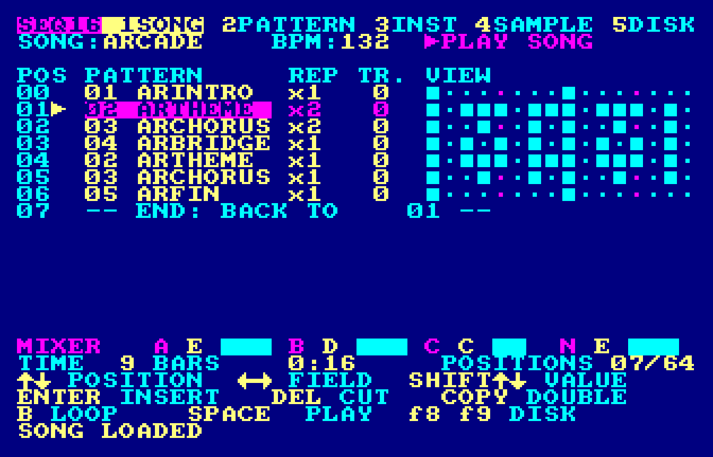
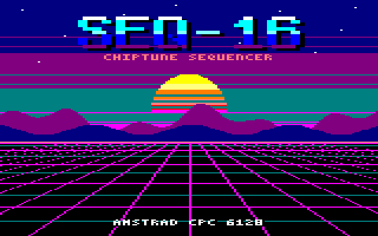
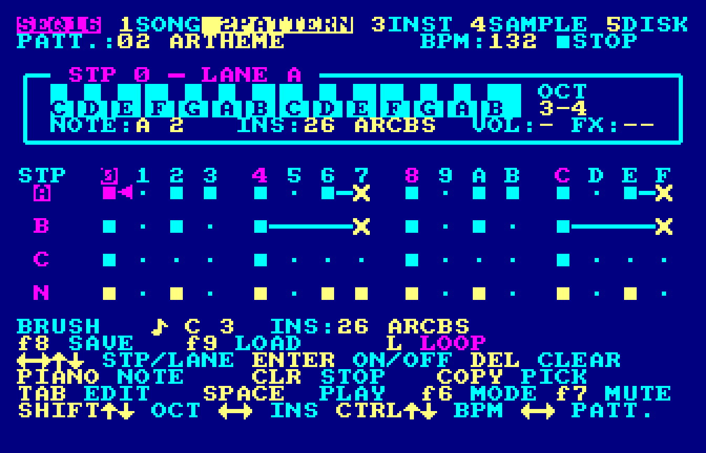
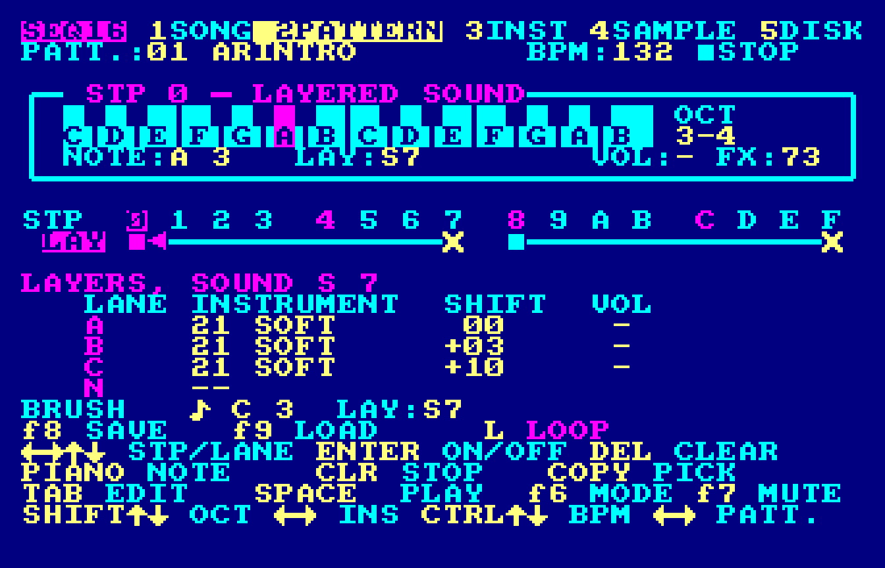
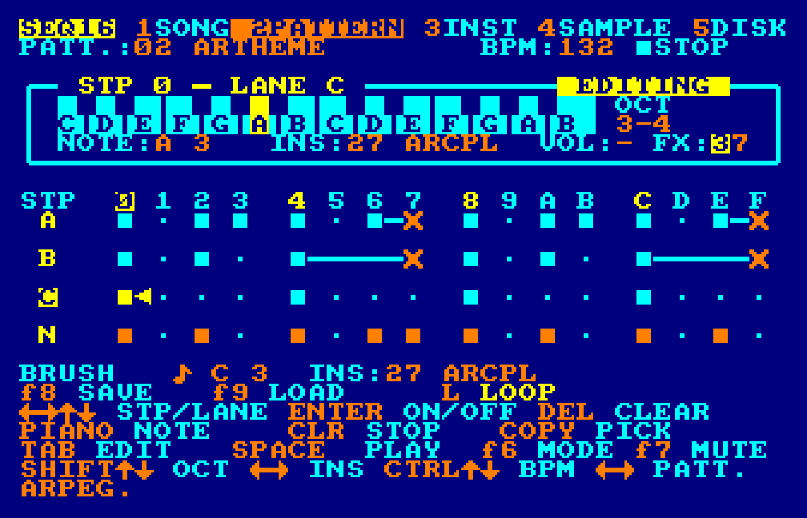
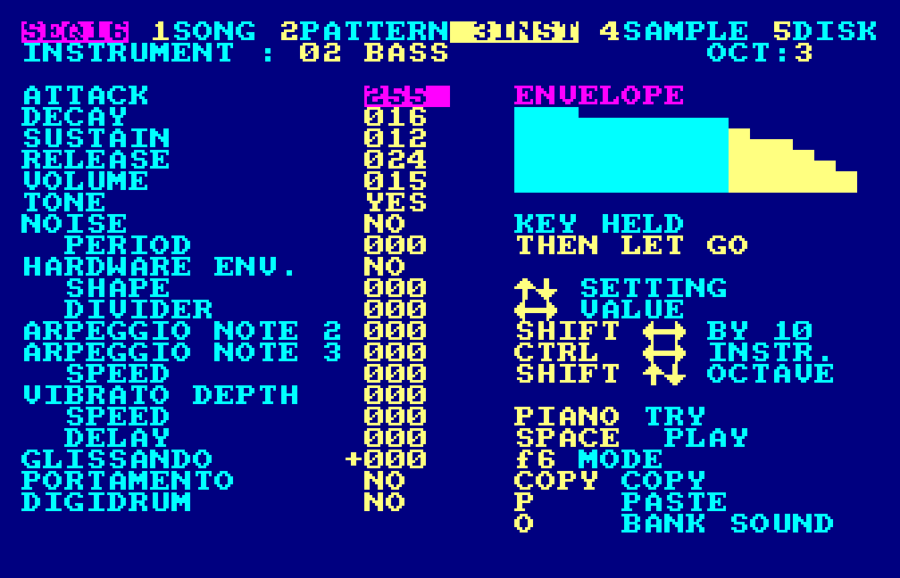
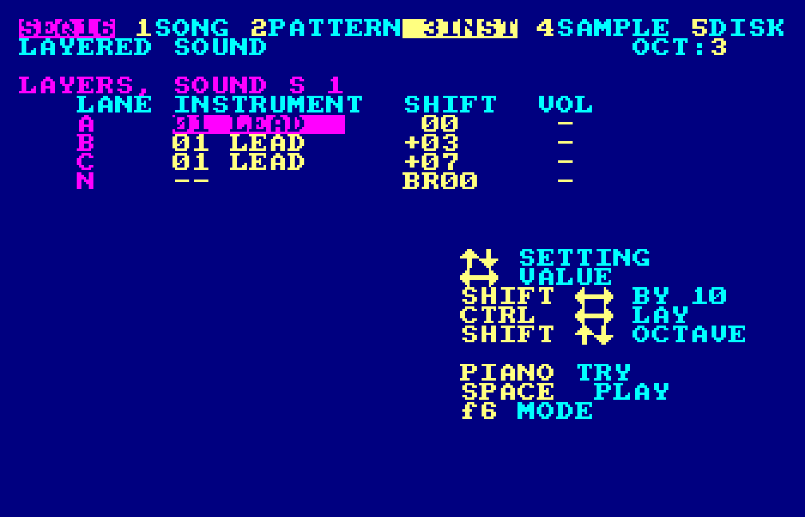
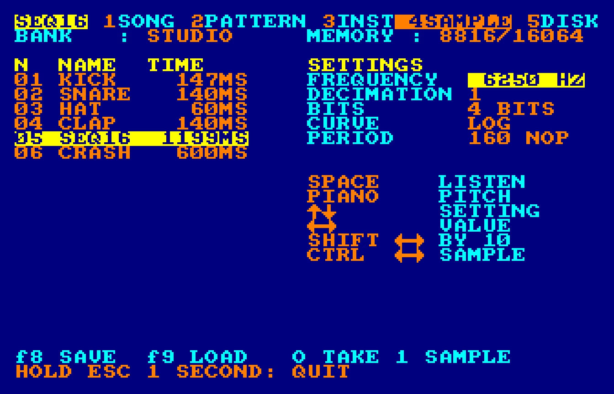
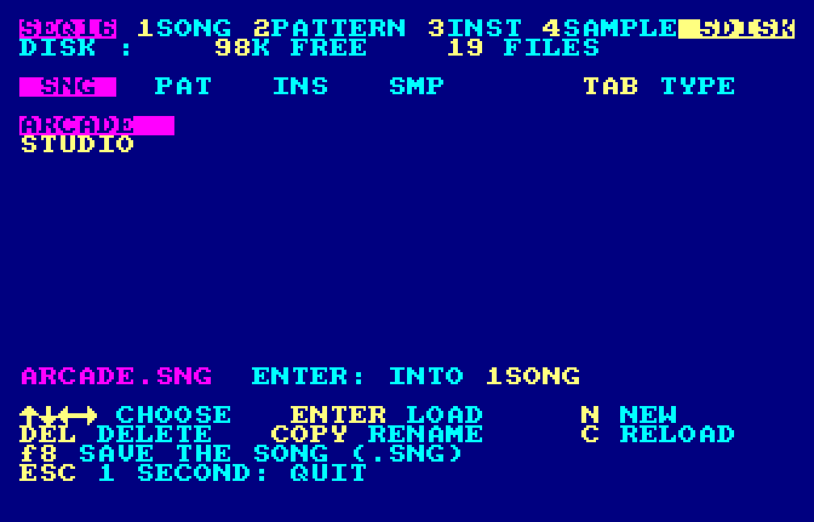
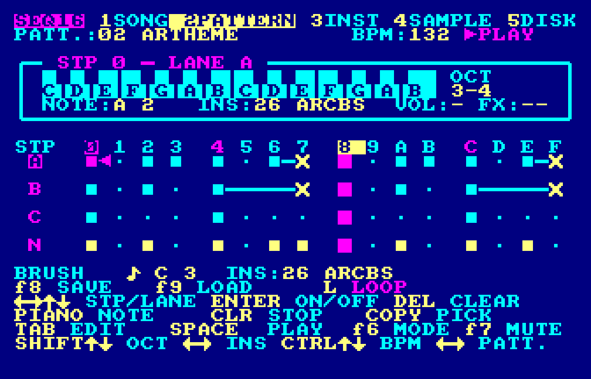

<div align="center">

```
███████╗███████╗ ██████╗        ██╗ ██████╗
██╔════╝██╔════╝██╔═══██╗      ███║██╔════╝
███████╗█████╗  ██║   ██║█████╗╚██║███████╗
╚════██║██╔══╝  ██║▄▄ ██║╚════╝ ██║██╔═══██╗
███████║███████╗╚██████╔╝       ██║╚██████╔╝
╚══════╝╚══════╝ ╚══▀▀═╝        ╚═╝ ╚═════╝
   C H I P T U N E   S E Q U E N C E R  ·  A M S T R A D   C P C   6 1 2 8

Ready
RUN"SEQ16
█
```

**A 4-voice chiptune sequencer (3 tones + noise) for the Amstrad CPC 6128, written in Z80 assembly.**
32 patterns of 16 steps, chained into a song (64 positions, repeats, transposition, loop), 32 instruments, 8 layered sounds, 7 per-step effects, and a **sampler** that plays real recorded sounds (drums, voices…) on the CPC sound chip, with a grain you can tweak live. The point: the degraded sound is the goal.
The disk comes with **13 instrument banks (416 sounds), 8 sample banks (the 9th, `CHIFFRES`, is on `seq16-samples.dsk`), 125 factory patterns** and a **demo disk** with two complete songs.


[](https://github.com/ChristopheCruz/CPC-SEQ-16/releases/latest)
[](https://www.buymeacoffee.com/ChristopheCruz)

[🇫🇷 Français](README.fr.md) · 🇬🇧 English · [🇪🇸 Español](README.es.md)

🌐 **Website, manual and video: [seq16.slr-ai.com](https://seq16.slr-ai.com/)**



</div>

---

## Contents

- [Try it now](#-try-it-now)
- [The demo disk](#-the-demo-disk)
- [On a real CPC with a Gotek](#-on-a-real-cpc-with-a-gotek)
- [The five panels](#️-the-five-panels)
- [Keys](#️-keys)
  - [f1 — SONG](#f1--song-the-song)
  - [f2 — PATTERN](#f2--pattern-the-sequencer)
  - [f3 — INST](#f3--inst-instruments-and-layered-sounds)
  - [f4 — SAMPLE](#f4--sample-the-sampler)
  - [f5 — DISK](#f5--disk-the-catalogue)
- [Per-step effects (FX)](#-per-step-effects-fx)
- [Files](#-files)
- [Sound banks](#-sound-banks)
- [Factory patterns](#-factory-patterns)
- [The sampler: samples and digidrums](#-the-sampler-samples-and-digidrums)
- [Memory and real time](#-memory-and-real-time)
- [Testing](#-testing)
- [Building](#️-building)
- [Code layout](#-code-layout)
- [Roadmap](#️-roadmap)
- [Thanks](#-thanks)
- [License](#-license)

## 💾 Try it now

1. Download **[`seq16-en.dsk`](https://github.com/ChristopheCruz/CPC-SEQ-16/releases/latest)** from the latest release (a copy is also in [`build/`](build/)).
   - **Version française :** `seq16-fr.dsk` (`build/seq16-fr.dsk`). **Versión en español:** `seq16-es.dsk`. Same program, same files, same keys: only the screen texts change.
   - **Demo:** `seq16-demo-en.dsk` (also `seq16-demo-fr.dsk` in French and `-es`), in the same release: the program and two complete songs, see [The demo disk](#-the-demo-disk).
   - **Banks only:** `seq16-inst.dsk` (13 instrument banks `.INS`) and `seq16-samples.dsk` (9 sample banks `.SMP`), data disks without the program.
   - **Factory patterns:** `seq16-motifs-mono.dsk` (62 layered-sound patterns) and `seq16-motifs-poly.dsk` (63 split-voice patterns). See [Factory patterns](#-factory-patterns).
2. Put the disk in an emulator (WinAPE, Caprice32, ACE-DL, RetroVirtualMachine…) set to **CPC 6128**.
3. Type:

```basic
RUN"SEQ16
```

The loading screen shows while the program loads (`RUN"SEQ16.BIN` starts it directly, without the screen).

<p align="center"></p>

The program starts on the **PATTERN** panel, with **SYNTH**, the factory synthwave song (A minor, 108 BPM, Am - F - C - G: octave bass, arpeggios, lead with vibrato, layered-sound chords). **SPACE** plays the pattern on screen; on **f1 SONG**, **SPACE** plays the whole song. It is also on the disk (`SYNTH.SNG`), and **N N** (new song) brings it back.
To quit, hold **ESC** for one second: a single press is not enough, so you cannot lose your work by mistake.

SEQ-16 needs a **CPC 6128** (it keeps the patterns in the extra memory): on a 464, or a 664 without expansion, it says so at startup.

## 🎮 The demo disk

`seq16-demo-en.dsk` holds the program, two songs, their 10 patterns, their instruments and their samples. On the **f1 SONG** panel, **f9** picks a song and **SPACE** plays it.

| Song | Style | What it shows |
|---|---|---|
| **ARCADE** | chiptune, A minor, 132 BPM, **no samples** | intro and chorus in **layered sound** (one voice playing a chord), theme and bridge in split voices, and all **7 per-step effects**: vibrato, arpeggio, falling bass, snare roll, repeated chords, cut bass, rising lead, delayed hi-hat, laser drop |
| **STUDIO** | D minor, 100 BPM, **with samples** | sampled drums (digidrums), a crash, and the voice "SEQ seize", a **long sample** that opens the song and comes back at the break. Its bank `STUDIO.SMP` loads with the song |

While the STUDIO voice plays, the other sounds stop: that is normal, a sample takes the whole processor (see [Digidrums](#digidrums-samples-in-the-song)).
The disk is built by [`tools/gen_demo.py`](tools/gen_demo.py); [`demo/LISTE.md`](demo/LISTE.md) describes each pattern (in French).

## 🔌 On a real CPC with a Gotek

To play on the real machine, copy `seq16-en.dsk` to the USB stick of a Gotek drive (FlashFloppy or HxC firmware).
The companion tool **[CPC DISK](https://github.com/ChristopheCruz/CPC-DISK)** does it: a `.dsk` image editor that looks like a CPC screen, pure Python, no dependencies. Use it to:

- open `seq16-en.dsk` and browse its AMSDOS catalogue;
- get the `.SNG` songs saved on the disk, or add some;
- prepare the Gotek's USB stick.

## 🖥️ The five panels

Five panels, picked with the function keys on the numeric keypad. The tabs at the top of the screen show the current panel.
In every panel, **f8** saves and **f9** loads the matching file.

<table>
<tr>
<td width="50%" align="center">
<br>
<b>f1 · SONG</b><br>
<sub>The chain of patterns: 64 positions, repeats, transposition, loop, and the voice mixer.</sub>
</td>
<td width="50%" align="center">
<br>
<b>f2 · PATTERN, split voices</b><br>
<sub>Voices A, B, C and noise N over 16 steps; at the top, the cursor note, its instrument, volume and effect.</sub>
</td>
</tr>
<tr>
<td width="50%" align="center">
<br>
<b>f2 · PATTERN, layered sound</b><br>
<sub>A single line of notes playing a layered sound on all 4 voices at once; its layers are shown below.</sub>
</td>
<td width="50%" align="center">
<br>
<b>f2 · An effect (FX)</b><br>
<sub>TAB: the step panel becomes editable; here a cell's ARPEG. effect (37).</sub>
</td>
</tr>
<tr>
<td width="50%" align="center">
<br>
<b>f3 · INST, instruments</b><br>
<sub>Live envelope drawing, noise, hardware envelope, arpeggio, vibrato, glissando, portamento, digidrum.</sub>
</td>
<td width="50%" align="center">
<br>
<b>f3 · INST, layered sounds</b><br>
<sub>f6: the 8 layered sounds, voice by voice: instrument, shift, volume.</sub>
</td>
</tr>
<tr>
<td width="50%" align="center">
<br>
<b>f4 · SAMPLE</b><br>
<sub>The sample bank on the left, the grain of the chosen sample on the right (here the STUDIO song's bank).</sub>
</td>
<td width="50%" align="center">
<br>
<b>f5 · DISK</b><br>
<sub>The catalogue by file type; ENTER loads the file into its panel.</sub>
</td>
</tr>
</table>

<p align="center"><br><sub>f2 · Playing: the played step is followed on screen, and the music never stops while the screen is redrawn.</sub></p>

## ⌨️ Keys

### f1 — SONG (the song)

A song chains up to **64 positions**. Each position plays a pattern a number of times (1 to 16), transposed by −12 to +12 semitones (voices A, B and C; the noise does not move). A VIEW column shows the pattern's steps.

| Keys | Action |
|---|---|
| ↑/↓ | pick a position (below the END line: the mixer) |
| ←/→ | pick a field: pattern, repeats, transposition (in the mixer: the voice) |
| SHIFT + ↑/↓ | change the field's value (in the mixer: the voice volume) |
| ENTER | insert a position |
| DEL | remove the position |
| COPY | double the position |
| B | the loop starts here; **B on the loop position removes it**: the END line then says `STOP` and playback stops at the end of the song |
| SPACE | play the song from the cursor position / stop |
| f8 / f9 | save / load a `.SNG` song |

- **The ► marker** follows the played position; **↑** marks the start of the loop.
- **A pattern's name** is the name of its `.PAT` file (saved or loaded): it shows in SONG and in PATTERN.
- **The MIXER line** sets the overall volume of each voice (A, B, C, N), saved with the song. The sound chip sends channel A to the left, channel C to the right and channel B to both: depending on how you listen, one channel may sound louder than the others; balance it here.
- **The TIME line** gives the song length (bars, minutes) and the number of positions.
- **On the PATTERN panel**, the song does not move on: the displayed pattern loops, and you change pattern yourself. Back in SONG, the song carries on.

### f2 — PATTERN (the sequencer)

The grid: voices A, B, C and N (noise) over 16 steps, or a single `LAY` line in layered-sound mode. Above it, the **step panel**: the cursor's step and voice, a 2-octave keyboard, and the cell's note, instrument, volume and effect.

| Keys | Action |
|---|---|
| Arrows | move the cursor (step / voice); you hear the note you land on |
| Piano keys | put a note with the brush instrument, hear it, move to the next step |
| ENTER | turn the cell on with the brush, or off |
| DEL | clear the cell |
| CLR | note stop (`X`) |
| COPY | pick the cell as the brush (note and instrument) |
| TAB | edit the step panel: ←/→ picks NOTE, INS, VOL, then the two FX digits (the effect, its strength); ↑/↓ changes the value; TAB again goes back to the grid |
| CAPS LOCK | lock the brush instrument |
| SPACE | play / stop |
| L | **LOOP** (the pattern repeats) or **ONCE** (one play, then stop) |
| f6 | split voices / layered sound |
| f7 | mute (or unmute) the cursor's voice |
| SHIFT + ↑/↓ | input octave |
| SHIFT + ←/→ | brush instrument (and the note under the cursor) |
| CTRL + ↑/↓ | tempo in BPM |
| CTRL + ←/→ | previous / next pattern (32 patterns); while playing, the music goes on |
| f8 / f9 | save / load the displayed pattern (`.PAT`) |

A held note is drawn as a line up to its stop. A muted voice shows in pale yellow.

### f3 — INST (instruments and layered sounds)

**f6** switches between instruments and layered sounds.

**Instruments:**

| Keys | Action |
|---|---|
| ↑/↓ | pick a setting |
| ←/→ | change its value (with SHIFT: by 10) |
| CTRL + ←/→ | previous / next instrument (32 instruments) |
| SHIFT + ↑/↓ | test octave |
| Piano keys | try the instrument |
| SPACE | hear the pattern with the changed sound |
| COPY | copy the instrument (settings and name) |
| P | paste: the copied instrument replaces the displayed one |
| O | take one sound from an `.INS` bank on the disk: pick the bank, then one of its 32 sounds (arrows, RETURN; ESC cancels) |
| f8 / f9 | save / load an `.INS` instrument bank |

- The envelope drawing updates on every change of attack, decay, sustain or release.
- Instruments 25 to 28 (`USER1` to `USER4`) are free for your own sounds; instruments 29 to 32 are the factory digidrums (`DGKICK`, `DGSNAR`, `DGHAT`, `DGCLAP`).
- **The DIGIDRUM setting** (the last one): set to `YES`, the instrument plays a sample instead of a note. The `PERIOD` line then becomes `SAMPLE` followed by the sample's name: its value is the sample number in the bank (0 = the first one). See [Digidrums](#digidrums-samples-in-the-song).

**Layered sounds (f6):** a layered sound plays up to 4 instruments at once, one per voice, from a single note. The table shows its 4 voices.

| Keys | Action |
|---|---|
| ↑/↓ | pick a field: for each voice, the instrument, the shift, the volume |
| ←/→ | change its value (with SHIFT: by 10) |
| CTRL + ←/→ | previous / next layered sound (S1 to S8) |
| Piano keys | try the layered sound |

| Field | Values |
|---|---|
| INSTRUMENT | `--` (voice not used) or 01 to 32 |
| SHIFT | shift in semitones, −24 to +24; for voice N, the noise period (`BR00` to `BR1F`) |
| VOL | `-` (the instrument's volume) or 0 to 15 |

The same table shows under the PATTERN grid in layered-sound mode.

### f4 — SAMPLE (the sampler)

| Keys | Action |
|---|---|
| SPACE | hear the chosen sample (SPACE again: stop) |
| Piano keys | hear the sample higher or lower (±12 semitones) |
| CTRL + ←/→ | previous / next sample |
| ↑/↓ | pick a setting: frequency, decimation, bits, curve |
| ←/→ | change its value (with SHIFT: by 10, for the frequency) |
| O | take a sample from another `.SMP` bank: it is added at the end of the bank in memory (16 samples and 16 KB at most) |
| f8 / f9 | save the bank (settings and added samples included) / load another `.SMP` bank |

The first time you open SAMPLE, the `DRUMS.SMP` bank loads by itself. Everything is detailed below, in the [sampler guide](#using-samples-step-by-step).

### f5 — DISK (the catalogue)

The disk catalogue, by file type: `SNG` (songs), `PAT` (patterns), `INS` (instruments), `SMP` (samples). At the top, the free space and the number of files.

| Keys | Action |
|---|---|
| Arrows | pick a file |
| TAB | next type (SNG, PAT, INS, SMP) |
| ENTER | load the file into its panel, which then shows (a `.PAT` goes into the displayed pattern) |
| DEL | delete the file (press twice; AMSDOS `\|ERA`) |
| COPY | rename the file (`\|REN`) |
| N | new song (press twice) |
| C | read the disk again (after changing it) |
| SPACE | hear the pattern |
| f8 | save the `.SNG` song |

**Saving with f8** (in any panel): the suggested name shows on the message line; type the name (8 letters or digits at most), then RETURN; ESC cancels. If the file already exists, a second RETURN replaces it.

## ✨ Per-step effects (FX)

Every cell of a pattern can carry an **effect**, written in hexadecimal as in trackers: the first digit picks the effect, the second sets its strength x (0 to F). `--`: no effect.

| FX | Effect | What happens | Example |
|---|---|---|---|
| `1x` | UP | the note slides up, faster with x | `14` slow rise |
| `2x` | DOWN | the note slides down | `2C` laser drop |
| `3x` | ARPEG. | the note, then the note + x semitones, alternating fast | `37` fifth, `3C` octave |
| `4x` | REPEAT | the note is played again every x frames (1/50 s) | `43` snare roll |
| `5x` | CUT | the note is released after x frames | `52` staccato |
| `6x` | DELAY | the note starts x frames after the step | `62` swing, flam |
| `7x` | VIBRATO | vibrato of depth x on this note | `73` |

- **To set an effect**: on the PATTERN panel, put the cursor on the cell, **TAB**, move to the FX with **→** (first digit, then second), and change it with **↑/↓**. The effect's name shows on the message line.
- **In layered sound**, the step's effect applies to all the voices of the sound.
- REPEAT, CUT and DELAY also work on the noise voice.
- **CUT on a digidrum** shortens the sample: `52` on a KICK stops it after 2 frames (40 ms instead of 148). A sample stops all the music while it plays; cutting it loses fewer steps.
- The effect only applies to the step's note: the piano and cell previews have no effect.

The ARCADE song on the [demo disk](#-the-demo-disk) uses all 7 effects.

## 🎵 Files

| File | Content | Panel |
|---|---|---|
| `.SNG` | **the whole song**: the 32 patterns (and their names), the 32 instruments, the 8 layered sounds, the mixer, the chain (positions, loop), and **the sample bank** it uses, if any | SONG, DISK |
| `.PAT` | one pattern (260 bytes): its mode, tempo and 16 steps | PATTERN |
| `.INS` | 32 instruments, their names and the 8 layered sounds (848 bytes) | INST |
| `.SMP` | a sample bank (16 samples, 16 KB at most), with their settings | SAMPLE |

- **A `.SNG` carries its sample bank** (format version 4): you can copy it to another disk without forgetting anything.
- Songs in the older formats (versions 1 to 3) still load.
- If a file with the same name exists, AMSDOS keeps the old one with the `.BAK` extension.

## 🎹 Sound banks

The default sounds stay **inside the program**: at startup and after **N N** (new song, DISK panel), you always get the same 32 instruments. The disk banks add to them.

### Instrument banks `.INS` (13 banks, 416 sounds)

- **Load a whole bank**: **INST** panel, **f9** (or DISK, ENTER on an `.INS`).
- **Take a single sound** for the displayed instrument: **INST** panel, key **O**, then pick the bank and the sound.
- **Save your own instruments**: **INST** panel, **f8**.

| Bank | Content |
|---|---|
| `USINE` | the program's 32 default instruments (to get them back after another bank) |
| `BATTERIE` | kicks, snares, hi-hats, toms, cymbals, cowbell, claves |
| `BASSES` | short, long, sliding, "buzzer", dirty and wobble basses |
| `LEADS` | melody sounds: vibratos, portamentos, sync, trills |
| `NAPPES` | slow pads, held chords, choirs, organs |
| `ARPEGES` | arpeggiated chords at 3 speeds: major, minor, 7th, sus, diminished… |
| `EFFETS` | lasers, sirens, coins, jumps, explosions, engines |
| `BUZZER` | the AY hardware envelope: 4 shapes × 3 dividers, and variants |
| `CLAVIERS` | pianos, plucked strings, bells, organs, winds |
| `CHIPTUNE` | a complete bank for a video game tune |
| `PERCUS` | congas, bongos, claves, triangle, tablas, gong |
| `GLISSES` | portamentos, upward or downward glissandos |
| `BRUITS` | held noise at 10 pitches, wind, rain, sea, train |

They are built by [`tools/gen_instruments.py`](tools/gen_instruments.py) (`--list` shows every sound).

### Sample banks `.SMP` (9 banks)

`DRUMS.SMP` stays the default bank: it loads by itself the first time you open SAMPLE.

| Bank | Content | Size |
|---|---|---|
| `DRUMS` | KICK, SNARE, HAT, CLAP (the factory digidrums) | 2 KB |
| `VOIX` | "bonjour", "Amstrad", "SEQ 16", "1, 2, 3, 4" (in French) | 13 KB |
| `BATTERI2` | drum-machine kit: long kick, toms, cowbell, crash… (12 sounds) | 12 KB |
| `PERCUS` | congas, bongo, claves, triangle, tambourine, agogo, tabla… (12 sounds) | 13 KB |
| `EFFETS` | laser, zap, explosion, coin, jump, siren, alarm, UFO… (12 sounds) | 14 KB |
| `BASSES` | 10 bass notes (C), to play with the piano | 15 KB |
| `NOTES` | pluck, piano, bell, organ, brass, choir, orchestra… (10 notes, C) | 14 KB |
| `CHIFFRES` | "zéro" to "dix" (French numbers; only on `seq16-samples.dsk`) | 11 KB |
| `MOTS` | "allez", "oui", "non", "encore", "stop", "bravo", "CPC"… (14 French words) | 16 KB |

The demo disk adds `STUDIO.SMP` (DRUMS, the SEQ16 voice and the BATTERI2 CRASH), the STUDIO song's bank.
Every sound is **synthesized** ([`tools/gen_samples.py`](tools/gen_samples.py)) or **spoken by espeak**: no sample taken from the Internet, so no rights question.

## 🎼 Factory patterns

Two disks full of ready-made patterns, to start a song, learn the sequencer or borrow a groove. Each pattern is a `.PAT` file.

| Disk | Patterns | Content |
|---|---|---|
| `seq16-motifs-mono.dsk` | 62 **mono** patterns | **layered sound** mode: a single line of notes played by one of the 8 layered sounds: riffs, arpeggios, basses, block chords, game jingles |
| `seq16-motifs-poly.dsk` | 63 **poly** patterns | **split voices** mode: full grooves (drums on N, bass, chords or melody), plus drums-only and bass + drums bricks |

Styles: techno, house, electro, hip-hop, trap, rock, funk, reggae, dub, bossa, salsa, drum & bass, synth-pop, synthwave, disco, chiptune and game jingles, blues, jazz, waltz, march, ambient… from 80 to 170 BPM. The full list is in [`patterns/LISTE.md`](patterns/LISTE.md) (in French).

**Loading a pattern**: on the **PATTERN** panel, show the slot to fill (CTRL + ←/→), insert a pattern disk, press **f9**, choose with the arrows (going past the edge turns the page), RETURN. The pattern replaces the displayed one, with its mode, tempo and name. You can also use the **DISK** panel (TAB to `PAT`, then ENTER).

**Saving a pattern**: on the **PATTERN** panel, **f8**, type a name, RETURN: the displayed pattern is saved alone in `NAME.PAT`, and takes that name.

The patterns are written for the **factory instruments and layered sounds** (also in `USINE.INS`). Four poly patterns (`DIGIHOP1`, `DIGIHSE1`, `DIGIFNK1`, `DIGIBRK1`) use the digidrums: load a sample bank first.
They are built by [`tools/gen_patterns.py`](tools/gen_patterns.py), which also checks that every note is in the pattern's key, in its instrument's range, and that two voices never clash.

## 🥁 The sampler: samples and digidrums

SEQ-16 plays **samples**: a **SAMPLE** panel to listen to a sound and dirty it up, and **digidrums**, samples triggered on a step like a note.
The choice is deliberate: **degradation is the goal**. Grain, aliasing, hiss and choppiness are wanted, adjustable effects.

The CPC has no digital-to-analogue converter. It plays a sample by changing the **volume** of an AY channel very fast: 16 levels on an almost logarithmic curve. That is where the grain comes from.

### Using samples, step by step

**1. Open the sampler.** Press **f4**. The first time, the `DRUMS.SMP` bank loads by itself and its 4 sounds show on the left.

**2. Listen.**
- Pick a sample with **CTRL + ←/→**. The chosen sample is in inverted magenta.
- **SPACE** plays it at its original pitch. SPACE again stops it.
- **The piano keys** play it higher or lower: the top row, from the C key, starts at the original pitch and goes up semitone by semitone; the bottom row plays one octave lower.
- While it plays, the screen freezes: that is normal.

**3. Dirty the sound.** On the right, pick a setting with **↑/↓** and change its value with **←/→** (for the frequency, with SHIFT, in steps of 10). Listen again after each change.

| Setting | Values | Effect |
|---|---|---|
| FREQUENCY | 4,000 to 16,129 Hz | pitch and brightness; lower is deeper and dirtier |
| DECIMATION | 1, 2, 3, 4, 6, 8 | one sample in N, held N times: metallic whistles appear |
| BITS | 4, 3, 2, 1 | fewer levels; in 1 bit, only a hard, faint "beep" is left |
| CURVE | LOG, LINEAR, CLIPPED, FOLDED, INVERTED | LOG is the original sound; LINEAR is hollower, CLIPPED saturates and clips, FOLDED folds what goes over, INVERTED flips the waveform |
| PERIOD | (information) | the length of one sample in µs, that is in NOPs |

**4. Change bank.** **f9**, pick the `.SMP` file with the arrows, RETURN (ESC cancels).

**5. Save the bank** with its settings and added samples: **f8**.

**6. Make your own sounds.** On the PC, convert your WAV files with [`tools/wav2smp.py`](#converting-your-own-sounds-toolswav2smppy), or with the graphical editor in [CPC DISK](#the-graphical-bank-editor-on-pc-the-samples-seq-16-tab-of-cpc-disk).

**Good to know**: a bank holds 16 KB at most (about 4 seconds at 8 kHz, 5 seconds at 6.25 kHz) and 16 sounds at most.

### Digidrums: samples in the song

A **digidrum** is an instrument that plays a sample from the loaded bank instead of a note. The 4 factory instruments 29 to 32 (`DGKICK`, `DGSNAR`, `DGHAT`, `DGCLAP`) play the 4 sounds of `DRUMS.SMP`.

**To make your own**, on the **INST** panel:

1. Set the last setting, **DIGIDRUM**, to `YES`.
2. The `PERIOD` line becomes `SAMPLE` and shows the sample's name. Change its value with ←/→: 0 = the first sample in the bank, 1 = the second…
3. **VOLUME** sets the sample's strength (15 = full). The other settings are not used.
4. Try it with the piano.

**In the pattern**, put this digidrum like a note:

- **the pitch**: the note **C in octave 4** plays the sample as it is; each semitone above or below makes it higher or lower, up to ±12 semitones;
- **the voice** picks the AY channel: A, B or C. On voice N (noise), the sample plays on channel C;
- **a muted voice** (f7) does not play its digidrums.

**A sample takes the whole processor.** It plays in full, with interrupts off. Meanwhile:

- the screen and keyboard do not respond;
- the sequencer stops and the other voices are **frozen** (their envelopes, arpeggios and vibratos stop moving);
- when the sample ends, the sequencer **catches up the tempo**: the steps that fell during the sample are played at once, then the music goes on in time.

With short sounds (under 150 ms, like those of `DRUMS.SMP`), you can hardly hear it. A long sample (the voice in the STUDIO song) cuts the other sounds while it plays: that is the price of the sample's quality.
Another point: when the sample, its pitch or its volume changes, the program first has to **prepare the sample's playback tables**, which can take up to about 300 ms. In a pattern that alternates many different samples, this can be heard as a small hiccup.

### The graphical bank editor (on PC): the SAMPLES SEQ-16 tab of CPC DISK

A desktop application to build an `.SMP` bank from WAV files, without the command line. It is part of **CPC DISK**, the disk editor: its **SAMPLES SEQ-16** tab, in French, English or Spanish. A single Windows program, `cpc-dsk-gui.exe`, makes the banks and puts them on the disk (and on the Gotek stick).

```bat
python tools\smp_gui.py          rem the editor alone, in its own window
```

- **On the left**, the sample list (16 at most): add WAVs (Ctrl+W, several at once), open an existing `.SMP` bank (Ctrl+O), remove, move up, move down. A gauge shows the space used out of the CPC's 16,064 bytes; it turns red if the bank is too big.
- **On the right**, the chosen sample's settings: name (6 characters), frequency, drive, silence trimming, smoothing, dithering, bits, decimation, curve, slicing. The waveform shows the original at the top and the CPC rendering at the bottom.
- **Listen** to the original or the CPC rendering.
- **Save .SMP** (Ctrl+S), then **Add to disk**.

The code lives in CPC DISK (`cpc_dsk/seq16/`); `tools/smp_gui.py`, `tools/smp_model.py` and `tools/wav2smp.py` point to it.

### Converting your own sounds: `tools/wav2smp.py`

Python 3, standard library only. Input: mono or stereo WAVs, 8 or 16 bits, at any frequency.

```bat
rem one sound per file, at 8 kHz (default)
python tools\wav2smp.py kick.wav snare.wav -o samples\MYBANK.SMP -v

rem a drum loop sliced into 8, at 6 kHz
python tools\wav2smp.py loop.wav --slice 8 --rate 6000 -o samples\LOOP.SMP

rem very dirty: saturated, 2 bits, one sample in 3
python tools\wav2smp.py voice.wav --drive 4 --bits 2 --decim 3 -o samples\DIRTY.SMP

rem add the bank to the build\seq16-fr.dsk disk
python tools\wav2smp.py sound.wav -o samples\SOUND.SMP --dsk

rem show the content of a bank
python tools\wav2smp.py --info samples\DRUMS.SMP
```

| Option | Effect |
|---|---|
| `--rate` | frequency from 4,000 to 16,000 Hz. Lower is dirtier and smaller in memory |
| `--drive` | gain before clipping (1 = none, 4 = very saturated). Also lifts the sound tails |
| `--clean` | adds a filter before resampling, for less aliasing |
| `--bits 4/3/2/1` | fewer levels |
| `--dither noise` | dithering: hiss replaces the steps |
| `--decim` | 1, 2, 3, 4, 6 or 8: one sample in N is held N times. Stored as a setting, nothing is destroyed |
| `--slice N` | slices each WAV into N equal parts |
| `--names` | sample names (6 characters), comma-separated |
| `--dsk` | adds the bank to `build/seq16-fr.dsk` (or to the given disk) |
| `--trim` | removes the silences at the start and end of each sound |
| `-v` | shows the size and length, and warns above 16 KB |

Each conversion also writes preview WAVs next to the bank, simulating the CPC rendering. One second at 8 kHz takes 4 KB.

### The `.SMP` format

The format is described in detail at the top of `cpc_dsk/seq16/wav2smp.py`, in CPC DISK:

- a 16-byte `SQSM` header (version 1);
- a 16-byte entry per sample: name, position, length, frequency, loop, flags, settings;
- the data, 2 four-bit samples per byte.

The frequency is stored as the length of one sample in NOPs (µs), from 62 to 250: it is directly the setting of the Z80 playback loop. Each sample is an AY level code from 0 to 15. The table of the 16 AY levels comes from the open-source emulator [Ayumi](https://github.com/true-grue/ayumi) (MIT license).

## 🧠 Memory and real time

- **Main memory**: the program, the current song and the AMSDOS buffer take `#3F00` to `#9FFF`. The sample bank is in low memory (`#0040-#3EFF`, 16,064 bytes), the sample playback routine and its tables in the high zone (`#A000-#A67B`, under AMSDOS memory).
- **The 6128's extra memory**: **block 4** keeps the 32 patterns (only the displayed pattern is in main memory, and a song's next pattern is prepared there in advance); **block 5** keeps the factory song, which **N N** reads back. Blocks 6 and 7 are free for what comes next.
- **The music does not stop while the screen is redrawn.** On a real CPC, the firmware writes one character in about 3.5 ms: redrawing a screen takes more than a second. So every character written hands over to the sound, and the late sound frames are caught up: steps fall in time, even when the pattern changes.
- **Disk errors** show the AMSDOS error code and the number of bytes read, to know where and why a load failed.

## 🧪 Testing

```bat
pip install z80
python -m unittest discover -s tools -p "test_*.py"
```

More than 220 tests. Most of them run the real `SEQ16.BIN` in a simulated CPC ([`tools/cpcsim.py`](tools/cpcsim.py)): every firmware routine is replaced by a simulated version that changes the registers like the real firmware; the PPI, the AY, the extra memory, AMSDOS (with its rules: one open file, "soft" end of file on byte `#1A`…) and the text screen are modelled, and time is counted in NOPs. A "slow" CPC writes each character in 3.5 ms, like the real firmware.

Among other things they check: tempo playback (regular steps when the pattern changes, even at the real screen speed), every panel and its keys, the per-step effects frame by frame, the layered sounds, saving and loading every file (songs with their sample bank included), the digidrums, the translations (every text fits in the French text's space), the factory patterns, the test songs and the demo disk.

The tests read the disks in `build/` and `build/seq16.sym`: run `build.bat` again after any change in `src/`.

## 🛠️ Building

On Windows:

1. Put `rasm.exe` in `tools\` ([EdouardBERGE/rasm](https://github.com/EdouardBERGE/rasm), *Releases* page).
2. If you change the factory instruments and patterns in `tools/gen_factory.py`, first run `python tools\gen_factory.py`.
3. If you change the drum sounds (`tools/gen_drums.py`) or the curves (`tools/wav2smp.py`), run `python tools\gen_drums.py` or `python tools\gen_smp_tables.py`.
4. If you change the banks: `python tools\gen_instruments.py` (`.INS` banks) and `python tools\gen_samples.py` (`.SMP` banks; espeak is needed for the voices).
5. Run `build.bat`. It assembles `src/main.asm`, builds `build\seq16-fr.dsk` with all the banks, then the English and Spanish versions, the bank and pattern disks, the test songs (`build\seq16-songs.dsk`) and the demo (`build\seq16-demo-fr.dsk`).
6. To redo the screenshots (READMEs and website): `python tools\snapshots.py`; for the video: `python tools\make_video.py en` (ffmpeg and numpy are needed).

**The translations** are in [`tools/lang.py`](tools/lang.py): the source stays in French, and the script makes one copy per language where each displayed text is replaced. A translation is never longer than the French (it is padded with spaces): the three programs have the same size and the same addresses. If you add a text to the source, add its translation; `python tools/lang.py --check` reports missing or too-long texts.

**The CPC DISK project is needed too**, the disk editor: SEQ-16 uses its library (`cpc_dsk`) to write the disks. Put it next to this project:

```
_Codes/
├── CPC-SEQ-16/    this project
└── CPC-DISK/      the disk editor (or AmstradCPC, its old name)
```

`tools/cpcdisk.py` finds it by itself. Other options: `pip install -e ../CPC-DISK`, or the `CPC_DISK` environment variable giving its folder.

## 📁 Code layout

| File | Role |
|---|---|
| [`src/main.asm`](src/main.asm) | startup, main loop, keys, the INST panel, disk access, memory map |
| [`src/grid.asm`](src/grid.asm) | the PATTERN panel: grid, step panel, editing, layers of a layered sound |
| [`src/songpanel.asm`](src/songpanel.asm) | the SONG panel: the chain, song playback, the mixer |
| [`src/panels.asm`](src/panels.asm) | f8 / f9 in every panel |
| [`src/diskpanel.asm`](src/diskpanel.asm) | the DISK panel: catalogue, loading, delete, rename |
| [`src/sngio.asm`](src/sngio.asm) | the version 4 `.SNG` (song and sample bank), read and written byte by byte |
| [`src/song.asm`](src/song.asm) | the song in memory, the patterns in block 4 |
| [`src/bank.asm`](src/bank.asm) | the 6128's extra memory (blocks 4 and 5) |
| [`src/boot.asm`](src/boot.asm) | what is only needed at startup: building the factory song (SYNTH, unpacked from [`src/factory_song.asm`](src/factory_song.asm), made by `tools/gen_synth.py`), stored in block 5 |
| [`src/seq.asm`](src/seq.asm) | the sequencer: pattern format, tempo playback, LOOP / ONCE |
| [`src/sound.asm`](src/sound.asm) | the sound engine (4 voices, envelopes, arpeggio, vibrato, glissando, per-step effects) |
| [`src/factory.asm`](src/factory.asm) | factory instruments, sounds and patterns (generated file) |
| [`src/tables.asm`](src/tables.asm) | note and volume tables (generated file) |
| [`src/firmware.asm`](src/firmware.asm) | the addresses of the CPC system routines used |
| [`src/sample.asm`](src/sample.asm), [`src/smptables.asm`](src/smptables.asm) | sample playback: direct AY access, bank loading; curves and pitches (generated) |
| [`src/smpscreen.asm`](src/smpscreen.asm) | the SAMPLE panel, the file chooser |
| [`src/banks.asm`](src/banks.asm), [`src/hizone.asm`](src/hizone.asm) | instrument copy / paste, `.INS` and `.SMP` banks, digidrums; routines copied to the high zone |
| [`tools/cpcsim.py`](tools/cpcsim.py), `tools/test_*.py` | the simulated CPC and the tests |
| [`tools/lang.py`](tools/lang.py) | the English and Spanish versions |
| [`tools/gen_patterns.py`](tools/gen_patterns.py), [`tools/gen_songs.py`](tools/gen_songs.py), [`tools/gen_demo.py`](tools/gen_demo.py) | factory patterns, test songs, demo disk |
| [`tools/gen_factory.py`](tools/gen_factory.py), [`tools/gen_tables.py`](tools/gen_tables.py), [`tools/gen_instruments.py`](tools/gen_instruments.py), [`tools/gen_samples.py`](tools/gen_samples.py), [`tools/gen_drums.py`](tools/gen_drums.py) | generated files and banks |
| [`tools/snapshots.py`](tools/snapshots.py), [`tools/make_video.py`](tools/make_video.py) | screenshots and video, shot in the simulated CPC |
| [`tools/amsdsk.py`](tools/amsdsk.py), [`tools/cpcdisk.py`](tools/cpcdisk.py) | writing to a `.dsk` disk, with the CPC DISK library |
| [`samples/`](samples/), [`instruments/`](instruments/), [`patterns/`](patterns/), [`songs/`](songs/), [`demo/`](demo/) | banks, patterns, test songs, demo |
| [`build/`](build/) | the ready-to-use disks |
| [`snapshots/`](snapshots/) | the screenshots of this README |

## 🗺️ Roadmap

- [x] 16-step patterns, 32 patterns, 4 voices, layered sound
- [x] Five panels, f8 / f9 everywhere, DISK panel (catalogue, delete, rename)
- [x] Chaining patterns into a song: 64 positions, repeats, transposition, loop
- [x] On-screen editing of layered sounds
- [x] The 7 per-step effects (FX)
- [x] `.SNG` carrying its sample bank
- [x] Instrument copy / paste, 13 instrument banks, 9 sample banks, 125 factory patterns
- [x] Samples: converter, playback on CPC, SAMPLE panel, digidrums, graphical editor on PC
- [x] Demo disk
- [ ] Renaming instruments
- [ ] Copy / paste of step blocks
- [ ] Samples: tables kept in the extra memory, CHOPPED mode, SAMPLE panel finishing touches

## 🙏 Thanks

SEQ-16 builds on other people's work. Thank you.

**Tools and libraries**
- [RASM](https://github.com/EdouardBERGE/rasm), Édouard Bergé's Z80 assembler: it assembles the program and writes the disk.
- [z80](https://github.com/kosarev/z80), Ivan Kosarev's Z80 emulator for Python: it runs the tests' simulated CPC.
- [Ayumi](https://github.com/true-grue/ayumi), Peter Sovietov's AY-3-8912 emulator (MIT license): its volume table is used by the sample converter.
- [eSpeak NG](https://github.com/espeak-ng/espeak-ng): the voices of the `VOIX`, `CHIFFRES` and `MOTS` sample banks.
- [CPC DISK](https://github.com/ChristopheCruz/CPC-DISK): the disk library, and the sample bank editor (its SAMPLES SEQ-16 tab).
- [Python](https://www.python.org/) and [tkinter](https://docs.python.org/3/library/tkinter.html): the tools, the tests and the editor.
- Fonts [Press Start 2P](https://fonts.google.com/specimen/Press+Start+2P) by CodeMan38 and [VT323](https://fonts.google.com/specimen/VT323) by Peter Hull ([SIL Open Font License 1.1](https://openfontlicense.org/)).

**Documentation and references**
- [CPCWiki](https://www.cpcwiki.eu/): the CPC firmware, the AY-3-8912 sound chip, AMSDOS and the DSK image format.
- [An example loader](https://cpcwiki.eu/index.php/Programming:An_example_loader) and the [Amstrad Whole Memory Guide](https://cpcwiki.eu/index.php/Amstrad_Whole_Memory_Guide_-_The_machine_pack) (CPCWiki), and the [6128 firmware manual](https://archive.org/stream/SOFT968TheAmstrad6128FirmwareManual/SOFT968%20-%20The%20Amstrad%206128%20Firmware%20manual_djvu.txt) (SOFT968, archive.org): the `MC START PROGRAM` routine, which starts the program after the loading screen.
- [HxC2001](https://hxc2001.com/) and [FlashFloppy](https://github.com/keirf/FlashFloppy): the Gotek firmwares and their documentation.

**Testing**
- [WinAPE](http://www.winape.net/): the emulator used to try the disks.

## 📜 License

[MIT](LICENSE): you can use, copy, modify and share SEQ-16, sound banks and factory patterns included, as long as you keep the copyright notice. Amstrad and CPC are trademarks of their respective owners; SEQ-16 is an independent project.

---

<div align="center">

<sub>Made with ♥ for the CPC · see also <a href="https://github.com/ChristopheCruz/CPC-DISK">CPC DISK</a>, the <code>.dsk</code> disk editor</sub>

</div>
