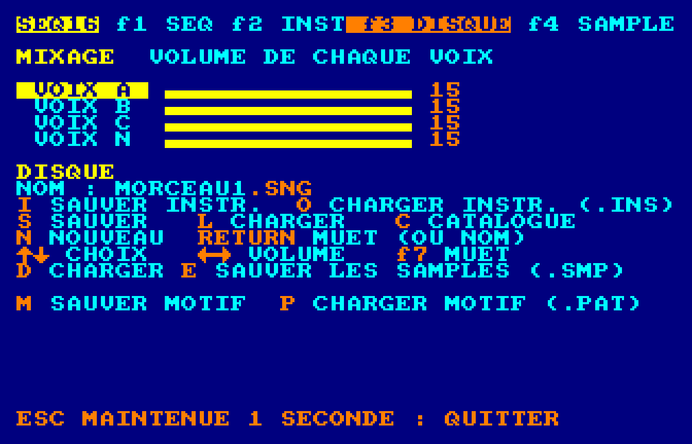

<div align="center">

```
███████╗███████╗ ██████╗        ██╗ ██████╗
██╔════╝██╔════╝██╔═══██╗      ███║██╔════╝
███████╗█████╗  ██║   ██║█████╗╚██║███████╗
╚════██║██╔══╝  ██║▄▄ ██║╚════╝ ██║██╔═══██╗
███████║███████╗╚██████╔╝       ██║╚██████╔╝
╚══════╝╚══════╝ ╚══▀▀═╝        ╚═╝ ╚═════╝
   S E Q U E N C E U R   C H I P T U N E  ·  A M S T R A D   C P C   6 1 2 8

Ready
RUN"SEQ16
█
```

**Un séquenceur chiptune 4 voix (3 tons + bruit) pour Amstrad CPC 6128, écrit en assembleur Z80.**
16 pas par motif, 32 motifs, 32 instruments, sauvegarde des morceaux sur disquette.


[](https://github.com/ChristopheCruz/seq-16/releases/latest)
[](https://www.buymeacoffee.com/ChristopheCruz)


</div>

---

## Sommaire

- [Essayer tout de suite](#-essayer-tout-de-suite)
- [Sur un vrai CPC avec un Gotek](#-sur-un-vrai-cpc-avec-un-gotek)
- [Les écrans](#️-les-écrans)
- [Les touches](#️-les-touches)
- [Le format des morceaux](#-le-format-des-morceaux)
- [Samples et digidrums (en cours)](#-samples-et-digidrums-en-cours)
- [Réassembler](#️-réassembler)
- [Organisation du code](#-organisation-du-code)
- [Feuille de route](#️-feuille-de-route)

## 💾 Essayer tout de suite

1. Télécharge **[`seq16.dsk`](https://github.com/ChristopheCruz/seq-16/releases/latest)** depuis la dernière release (une copie se trouve aussi dans [`build/`](build/)).
2. Insère la disquette dans un émulateur (WinAPE, Caprice32, ACE-DL, RetroVirtualMachine…) réglé en **CPC 6128**.
3. Tape :

```basic
RUN"SEQ16
```

Pour quitter, maintiens **ESC** une seconde. Un simple appui ne suffit pas, pour ne pas perdre son travail par erreur.

## 🔌 Sur un vrai CPC avec un Gotek

Pour jouer sur la machine réelle, il faut copier `seq16.dsk` sur la clé USB d'un lecteur Gotek (firmware FlashFloppy ou HxC).
L'outil compagnon **[CPC DISK](https://github.com/ChristopheCruz/AmstradCPC)** s'en charge : c'est un éditeur d'images `.dsk` à l'allure d'écran CPC, en Python pur, sans dépendance. Il sert à :

- ouvrir `seq16.dsk` et parcourir son catalogue AMSDOS ;
- récupérer les morceaux `.SNG` sauvés sur la disquette, ou en ajouter ;
- préparer la clé USB du Gotek.

## 🖥️ Les écrans

Trois écrans, à choisir avec les touches de fonction du pavé numérique : **f1** séquenceur, **f2** instrument, **f3** disque.

<table>
<tr>
<td width="50%" align="center">
<br>
<b>f1 · Séquenceur, voix séparées</b><br>
<sub>Les voix A, B, C et le bruit N sur 16 pas : note, octave, instrument.</sub>
</td>
<td width="50%" align="center">
<br>
<b>f1 · Séquenceur, son composé</b><br>
<sub>Une seule ligne qui joue un son composé sur les 4 voix à la fois.</sub>
</td>
</tr>
<tr>
<td width="50%" align="center">
<br>
<b>f2 · Instrument</b><br>
<sub>Enveloppe dessinée en direct, bruit, enveloppe matérielle, arpège, vibrato, glissando, portamento.</sub>
</td>
<td width="50%" align="center">
<br>
<b>f3 · Mixage et disque</b><br>
<sub>Volume et sourdine de chaque voix, sauvegarde et chargement des morceaux.</sub>
</td>
</tr>
<tr>
<td width="50%" align="center">
<br>
<b>f1 · En lecture</b><br>
<sub>Le pas joué est suivi à l'écran pendant la lecture.</sub>
</td>
<td width="50%" align="center">
<br>
<b>f3 · Catalogue</b><br>
<sub>Le contenu de la disquette, sans quitter le programme.</sub>
</td>
</tr>
</table>

## ⌨️ Les touches

### f1 — Séquenceur

| Touches | Effet |
|---|---|
| Flèches | déplacer le curseur ; on entend la note sur laquelle on arrive |
| Touches du piano | poser une note, l'entendre, passer au pas suivant |
| DEL | effacer la case |
| TAB (ou CLR) | arrêt de note (`--`) |
| CAPS LOCK | verrouiller l'instrument de saisie |
| ESPACE | lecture / arrêt |
| f5 | voix séparées / son composé |
| f7 | rendre muette (ou audible) la voix du curseur |
| SHIFT + ↑/↓ | octave de saisie |
| SHIFT + ←/→ | instrument de saisie (et de la note sous le curseur) |
| CTRL + ↑/↓ | tempo en BPM |
| CTRL + ←/→ | motif précédent / suivant (32 motifs) |

Une voix muette affiche `MUET` à gauche de la grille.

### f2 — Instrument

| Touches | Effet |
|---|---|
| ↑/↓ | choisir un réglage |
| ←/→ | changer sa valeur (avec SHIFT : par 10) |
| CTRL + ←/→ | instrument précédent / suivant (32 instruments) |
| SHIFT + ↑/↓ | octave d'essai |
| Touches du piano | essayer l'instrument |
| ESPACE | écouter le motif avec le son modifié |

Le dessin de l'enveloppe se met à jour à chaque changement d'attaque, de déclin, de tenue ou de relâche.
Les instruments 25 à 32 (`USER1` à `USER8`) sont libres pour créer ses propres sons.

### f3 — Mixage et disque

| Touches | Effet |
|---|---|
| ↑/↓ | choisir une voix (A, B, C, N) ou le nom de fichier |
| ←/→ | volume de la voix (0 à 15) |
| RETURN ou f7 | muet / audible (sur la ligne du nom : saisir le nom) |
| S | sauver le morceau |
| L | charger le morceau |
| C | afficher le catalogue de la disquette |
| N | nouveau morceau (appuyer deux fois) |
| ESPACE | écouter le motif pendant le réglage |

**Le nom de fichier** : descends sur la ligne `NOM`, appuie sur RETURN, tape le nom (8 lettres ou chiffres au plus), puis RETURN.
La première lettre tapée remplace l'ancien nom ; DEL corrige. L'extension `.SNG` est ajoutée toute seule.

**Le volume des voix** : le circuit sonore du CPC envoie la voie A à gauche, la voie C à droite et la voie B des deux côtés.
Selon l'écoute (haut-parleur interne, une seule oreillette, ampli branché sur une seule sortie), une voie peut paraître plus forte que les autres : on l'équilibre ici, et le réglage est sauvé avec le morceau.

## 🎵 Le format des morceaux

Un fichier `.SNG` (environ 9 Ko) contient **tout le morceau** :

- les 32 motifs ;
- les 32 instruments et leurs noms ;
- les 8 sons composés ;
- les volumes et les voix muettes.

Si un fichier du même nom existe, AMSDOS garde l'ancien sous l'extension `.BAK`.

## 🥁 Samples et digidrums (en cours)

SEQ-16 va apprendre à jouer des **samples** : un écran **f4 Sample Composer** pour écouter, découper et salir un son, et des **digidrums**, des samples déclenchés au pas comme une note.
Le parti pris est assumé : **la dégradation est recherchée**. Grain, repliement de spectre, souffle et hachures sont des effets voulus et réglables.

Le CPC n'a pas de convertisseur numérique-analogique. Il joue un sample en changeant très vite le **volume** d'une voie de l'AY : 16 niveaux sur une courbe presque logarithmique. C'est ce qui donne le grain.

### Où on en est : phase 1, la préparation sur PC

| Phase | Contenu | État |
|---|---|---|
| 1 | convertisseur `wav2smp.py`, WAV d'écoute, banque d'usine de synthèse | ✅ fait |
| 2 | lecture sur CPC (accès direct à l'AY), écran f4 minimal | à venir |
| 3 | mémoire supplémentaire du 6128, jauge, repli 464 | à venir |
| 4 | digidrums dans le séquenceur (mode BLOQUANT), `.SNG` version 2 | à venir |
| 5 | lecture directe du clavier, mode HACHÉ | à venir |
| 6 | finitions de f4 : forme d'onde, découpe, boucle, gravure, sauvegarde | à venir |

**Rien ne change encore sur le CPC** : le programme est le même qu'à l'étape 6. La disquette contient en plus la banque **`DRUMS.SMP`**, qui servira à partir de la phase 2.

### La banque d'usine `DRUMS.SMP`

Quatre sons fabriqués **par synthèse** dans [`tools/gen_drums.py`](tools/gen_drums.py) (sinus à hauteur descendante, bruit filtré). Aucun échantillon trouvé sur Internet, donc aucune question de droits.
La banque fait 2 037 octets : elle tient dans les 4 Ko disponibles sur un CPC 464.

| N° | Nom | Durée | Fréquence | À écouter dans [`samples/ecoute/`](samples/ecoute/) |
|---|---|---|---|---|
| 0 | KICK | 148 ms | 6 250 Hz | une grosse caisse sourde, avec un léger « toc » d'attaque granuleux |
| 1 | SNARE | 140 ms | 8 000 Hz | une caisse claire sèche et sale, comme une radio mal réglée |
| 2 | HAT | 60 ms | 12 500 Hz | un charley court et métallique, qui « crépite » plus qu'il ne siffle |
| 3 | CLAP | 140 ms | 8 000 Hz | trois claquements rapprochés, puis une courte queue qui s'éteint par paliers |

Les fichiers `*_ecoute.wav` simulent le rendu du CPC (mêmes niveaux de l'AY, même fréquence). **C'est ce qu'il faut écouter pour valider la phase 1.**
Les sons de synthèse d'origine, propres, sont dans [`samples/synth/`](samples/synth/), pour comparer ou les reconvertir autrement.

**Ce qui doit s'entendre** :

- Les fins de son s'arrêtent **par marches**, pas en douceur : sous un certain seuil, le signal tombe d'un coup sur le niveau de repos. C'est la courbe de l'AY.
- Le charley a une **brillance râpeuse**, due au repliement de spectre (aucun filtre).
- Rien ne doit **claquer** au début ni à la fin du fichier.

### Convertir ses propres sons : `tools/wav2smp.py`

Python 3, bibliothèque standard uniquement. Entrée : des WAV mono ou stéréo, 8 ou 16 bits, à n'importe quelle fréquence.

```bat
rem un son par fichier, à 8 kHz (par défaut)
python tools\wav2smp.py kick.wav snare.wav -o samples\MABANK.SMP -v

rem une boucle de batterie découpée en 8 tranches, à 6 kHz
python tools\wav2smp.py boucle.wav --slice 8 --rate 6000 -o samples\BOUCLE.SMP

rem très sale : saturé, 2 bits, un échantillon sur 3
python tools\wav2smp.py voix.wav --drive 4 --bits 2 --decim 3 -o samples\SALE.SMP

rem ajouter la banque à la disquette build\seq16.dsk
python tools\wav2smp.py son.wav -o samples\SON.SMP --dsk

rem voir le contenu d'une banque
python tools\wav2smp.py --info samples\DRUMS.SMP
```

| Option | Effet |
|---|---|
| `--rate` | fréquence de 4 000 à 16 000 Hz. Plus bas, c'est plus sale et plus long en mémoire |
| `--drive` | gain avant écrêtage (1 = rien, 4 = très saturé). Remonte aussi les fins de son |
| `--clean` | ajoute un filtre avant le rééchantillonnage, pour moins de repliement |
| `--bits 4/3/2/1` | moins de niveaux. En 1 bit, il ne reste que 2 niveaux, et le son devient un « bip » dur et faible |
| `--dither noise` | tramage : un souffle remplace les marches |
| `--decim` | 1, 2, 3, 4, 6 ou 8 : un échantillon sur N est maintenu N fois. Ce réglage est stocké, il ne détruit rien |
| `--slice N` | découpe chaque WAV en N tranches égales |
| `--names` | noms des samples (6 caractères), séparés par des virgules |
| `--dsk` | ajoute la banque à `build/seq16.dsk` (ou à la disquette indiquée) |
| `-v` | affiche la taille et la durée, et prévient au-delà de 4 Ko (464) ou de 64 Ko (6128) |

Chaque conversion écrit aussi les WAV d'écoute à côté de la banque.
Pour la place : une seconde à 8 kHz occupe 4 Ko. Une banque contient 16 samples au plus, 16 Ko au plus chacun.

### Le format `.SMP`

Le format est décrit en détail en tête de [`tools/wav2smp.py`](tools/wav2smp.py) :

- un en-tête `SQSM` de 16 octets (version 1) ;
- une fiche de 16 octets par sample : nom, position, longueur, fréquence, boucle, drapeaux, réglages ;
- les données, 2 échantillons de 4 bits par octet.

Trois choix faits pendant la phase 1 :

- **La fréquence** est stockée comme la durée d'un échantillon en NOP (µs), de 62 à 250. C'est directement le réglage de la boucle de lecture du Z80.
- **Un sample ne chevauche jamais une frontière de 16 Ko**, pour que la lecture n'ait pas à changer de bloc mémoire en cours de route.
- **Chaque échantillon est un code de niveau de l'AY**, de 0 à 15. Écrit tel quel dans le registre de volume, il redonne le son au plus près. Le silence correspond au niveau 12.

La table des 16 niveaux de l'AY vient de l'émulateur open source [Ayumi](https://github.com/true-grue/ayumi) (licence MIT).

### Points à vérifier sur la vraie machine (phase 2)

- Les niveaux mesurés par Ayumi correspondent-ils à l'oreille sur un vrai AY-3-8912 de CPC ? La sortie du CPC passe par un filtre et par l'ampli interne, ce qui peut changer le rendu.
- Le niveau de repos 12 provoque-t-il un « toc » au début et à la fin de la lecture sur le vrai CPC ?

### Tester

```bat
python -m unittest discover -s tools -p "test_*.py"
```

Les 20 tests vérifient :

- un sinus converti puis relu, et sa taille ;
- le respect des 16 niveaux de l'AY, des bits et de la décimation ;
- l'en-tête et les fiches de la banque ;
- le découpage en tranches ;
- l'écriture sur la disquette, relue ensuite ;
- que `DRUMS.SMP` correspond bien au script et fait moins de 4 Ko.

## 🛠️ Réassembler

Sous Windows :

1. Place `rasm.exe` dans `tools\` (dépôt [EdouardBERGE/rasm](https://github.com/EdouardBERGE/rasm), page *Releases*).
2. Si tu modifies les instruments et motifs d'usine dans `tools/gen_factory.py`, lance d'abord :
   ```bat
   python tools\gen_factory.py
   ```
3. Si tu modifies les sons de batterie dans `tools/gen_drums.py`, lance `python tools\gen_drums.py`.
4. Lance `build.bat` : il assemble `src/main.asm`, fabrique `build\seq16.dsk` et y ajoute `samples\DRUMS.SMP` (il faut Python 3).

## 📁 Organisation du code

| Fichier | Rôle |
|---|---|
| [`src/main.asm`](src/main.asm) | les trois écrans, le curseur, la saisie, la disquette |
| [`src/song.asm`](src/song.asm) | le morceau : organisation en mémoire, remise à zéro |
| [`src/seq.asm`](src/seq.asm) | le séquenceur : format du motif, lecture au tempo |
| [`src/sound.asm`](src/sound.asm) | le moteur de son (4 voix, volumes, voix muettes) |
| [`src/factory.asm`](src/factory.asm) | instruments, sons et motifs d'usine (fichier généré) |
| [`src/tables.asm`](src/tables.asm) | tables des notes et des volumes (fichier généré) |
| [`src/firmware.asm`](src/firmware.asm) | les adresses des routines système du CPC utilisées |
| [`tools/gen_factory.py`](tools/gen_factory.py), [`tools/gen_tables.py`](tools/gen_tables.py) | les scripts qui génèrent ces fichiers |
| [`tools/wav2smp.py`](tools/wav2smp.py) | convertit des WAV en banque de samples `.SMP` (et WAV d'écoute) |
| [`tools/gen_drums.py`](tools/gen_drums.py) | fabrique la banque d'usine `DRUMS.SMP` par synthèse |
| [`tools/amsdsk.py`](tools/amsdsk.py) | ajoute un fichier sur une disquette `.dsk` (ou en affiche le catalogue) |
| [`tools/test_wav2smp.py`](tools/test_wav2smp.py) | les tests des trois scripts précédents |
| [`samples/`](samples/) | la banque d'usine, ses sons de synthèse et ses WAV d'écoute |
| [`build.bat`](build.bat) | assemble et fabrique la disquette |
| [`build/seq16.dsk`](build/seq16.dsk) | la disquette prête à l'emploi |
| [`snapshots/`](snapshots/) | les captures d'écran de ce README |

## 🗺️ Feuille de route

- [x] **Étape 6 : instruments, mixage et disquette** ← version actuelle
- [ ] Étape 7 : édition des sons composés à l'écran
- [ ] Étape 8 : enchaînement des motifs en morceau
- [ ] Renommer les instruments
- [ ] Étape 10 : copier-coller de blocs
- [x] Samples, phase 1 : convertisseur et banque d'usine (sur PC)
- [ ] Samples, phases 2 à 6 : lecture sur CPC, écran f4, digidrums

---

<div align="center">

<sub>Fait avec ♥ pour le CPC · voir aussi <a href="https://github.com/ChristopheCruz/AmstradCPC">CPC DISK</a>, l'éditeur de disquettes <code>.dsk</code></sub>

</div>
